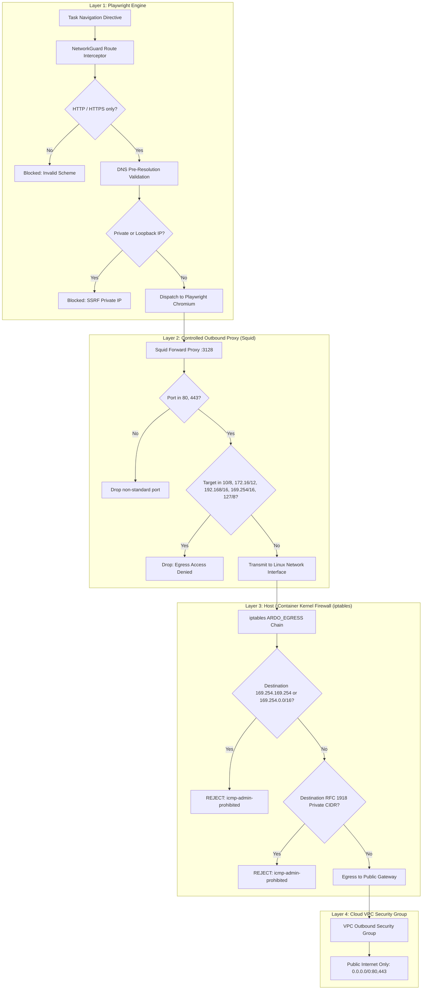

# ARDO — Browser Network Security & Egress Isolation Architecture

## 1. Threat Model & Design Requirements

Playwright browser automation operates by rendering and interacting with external third-party web pages based on autonomous planning directives.
While application-level URL checks and DNS validation ([`NetworkGuard`](file:///c:/Users/vahin/OneDrive/Documents/AI Goal-To-Task Planning Engine/backend/execution/browser/network_guard.py)) provide a first line of defense, **network-level egress controls are mandatory** in production to prevent:
1. **Server-Side Request Forgery (SSRF):** Attacking internal microservices, private VPC endpoints, or loopback services.
2. **Cloud Metadata Exfiltration:** Accessing `http://169.254.169.254/latest/meta-data/` on AWS, GCP, Azure, or Kubernetes service account tokens.
3. **DNS Rebinding & Host Confusion Attacks:** Circumventing application-level hostname checks via dynamic DNS TTL expiration.
4. **Internal Port Scanning & Lateral Movement:** Probing non-HTTP internal infrastructure (e.g. Postgres on 5432, Mongo on 27017, Redis on 6379).

---

## 2. Multi-Layered Defense-in-Depth Model

ARDO enforces four concentric layers of egress boundaries:



---

## 3. Concrete Deployment Implementation

### 3.1 Layer 1: Application-Level Interception (`NetworkGuard`)
- Implemented in [`backend/execution/browser/network_guard.py`](file:///c:/Users/vahin/OneDrive/Documents/AI Goal-To-Task Planning Engine/backend/execution/browser/network_guard.py).
- Intercepts all page navigations, subresources (fetch/XHR/images/scripts), popups, and HTTP 3xx redirect chains.
- Validates pre-resolved IPs against `BLOCKED_IPV4_NETWORKS` and `BLOCKED_IPV6_NETWORKS`.

### 3.2 Layer 2: Controlled Outbound Proxy (`Squid`)
- Configured in [`deploy/squid/squid.conf`](file:///c:/Users/vahin/OneDrive/Documents/AI Goal-To-Task Planning Engine/deploy/squid/squid.conf).
- Playwright Chromium connects directly to the proxy via `BROWSER_EGRESS_PROXY=http://squid-egress:3128`.
- Squid ACLs deny any connection targeting internal subnets or cloud metadata services.
- Removes client IP headers (`forwarded_for off`, `Via`, `X-Forwarded-For`).

### 3.3 Layer 3: Host & Container Firewall (`iptables`)
- Configured in [`deploy/firewall/egress_rules.sh`](file:///c:/Users/vahin/OneDrive/Documents/AI Goal-To-Task Planning Engine/deploy/firewall/egress_rules.sh).
- Applies directly to the worker container's network interface:
  ```bash
  # Block metadata services
  iptables -A OUTPUT -d 169.254.169.254/32 -j REJECT --reject-with icmp-admin-prohibited
  iptables -A OUTPUT -d 169.254.0.0/16 -j REJECT --reject-with icmp-admin-prohibited

  # Block RFC 1918 private subnets
  iptables -A OUTPUT -d 10.0.0.0/8 -j REJECT --reject-with icmp-admin-prohibited
  iptables -A OUTPUT -d 172.16.0.0/12 -j REJECT --reject-with icmp-admin-prohibited
  iptables -A OUTPUT -d 192.168.0.0/16 -j REJECT --reject-with icmp-admin-prohibited
  iptables -A OUTPUT -d 127.0.0.0/8 -j REJECT --reject-with icmp-admin-prohibited
  ```

### 3.4 Layer 4: Cloud VPC Security Groups
- In AWS / GCP / Azure:
  - Place worker instances in a dedicated **Isolated Egress Subnet**.
  - Route outbound Internet traffic through an **Egress-Only Internet Gateway** or NAT Gateway.
  - Deny peering or routing tables leading to production database subnets or internal VPC CIDRs.
  - In AWS, enforce IMDSv2 and disable metadata endpoint hop limit (`http_put_response_hop_limit = 1`).

---

## 4. Verification and Validation

Operators can verify the egress boundary using the diagnostic verification test:
```bash
pytest backend/tests/test_production_readiness.py -k test_browser_network_isolation_configuration
```
And manually on live workers:
```bash
# 1. Verify cloud metadata is unreachable
curl -m 2 http://169.254.169.254/latest/meta-data/  # Expect: Connection timed out / icmp-admin-prohibited

# 2. Verify private internal subnets are unreachable
curl -m 2 http://10.0.0.1:8000/api/v1/health         # Expect: Connection refused / prohibited

# 3. Verify public internet works through proxy
curl -m 5 -x http://localhost:3128 https://example.com/ # Expect: HTTP 200 OK
```

