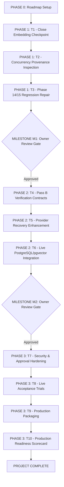

# ARDO — Master Project Completion Roadmap
## Controlled, Evidence-Based Execution

**Branch:** `stabilization-2-closure`  
**Base Commit:** `914d61a05b90c12679632b8c70c73667f5ae4539`  
**Authoritative Plan Version:** 1.0  
**Status:** ACTIVE  

---

## 1. Global Execution Rules

1. **Incremental Execution:** Work strictly one task at a time.
2. **Inspection First:** Inspect existing implementation and repository state before making any changes.
3. **No Unnecessary Repetition:** Do not repeat completed work unless empirical evidence proves a defect.
4. **Targeted Verification:** Use fast, targeted test suites during individual tasks.
5. **Milestone Full-Suite Runs:** Run full test suites at designated milestones (M1, M2), not after every documentation-only or isolated edit.
6. **Execution Time Boundedness:** No command may run longer than 30 minutes. Investigate hangs immediately rather than waiting indefinitely.
7. **Empirical Evidence Logging:** Record exact command lines, output results, execution durations, failures, and skips.
8. **Test Assertion Preservation:** Preserve all existing tests and assertions. Never delete a test or relax an assertion without explicit owner approval.
9. **Strict Scope Containment:** No unrelated refactoring, feature expansion, or aesthetic redesigns.
10. **Environment & Dependency Freeze:** Do not install packages, change environment configurations, or execute destructive database migrations without owner approval.
11. **No Unauthorized Live Services:** Never call live external APIs (Gemini, OpenAI) or remote databases (Atlas) without explicit owner authorization.
12. **Git Branch & Push Protection:** Do not commit, push, merge, rebase, or alter the `main` branch without explicit owner approval.
13. **Uncommitted Work Preservation:** Preserve all existing uncommitted modifications from Pass A, Pass B, Pass B.1, and the embedding correction pass.
14. **Accurate Task Statuses:** Every task must maintain one of five statuses: `todo`, `in_progress`, `done`, `blocked_owner`, `blocked_environment`.
15. **Truthful Live Claims:** Never claim a feature is live-tested when only mocked or in-memory tests were executed.

---

## 2. Task Status Taxonomy

- `todo`: Task defined with clear scope and exit gates, not yet started.
- `in_progress`: Task actively being executed under strict scope constraints.
- `done`: Task completed, empirically verified, and exit gate passed.
- `blocked_owner`: Task halted waiting for owner review, approval, or credentials.
- `blocked_environment`: Task halted because an external environmental dependency (e.g. Docker PostgreSQL container) is unavailable.

---

## 3. Phased Execution Plan

---

### PHASE 0 — ROADMAP SETUP
- **Objective:** Establish authoritative roadmap, state tracking, owner dependency register, and evidence directory. Reconcile working-tree state and discrepancies.
- **Tasks:**
  - Create `docs/roadmap/ROADMAP.md`
  - Create `docs/roadmap/STATE.md`
  - Create `docs/roadmap/NEEDS_OWNER.md`
  - Create `docs/roadmap/evidence/`
- **Exit Gate:** All four tracking assets exist, working-tree inventory is verified against git, and historical discrepancies are documented.
- **Status:** `done`

---

### PHASE 1 — STABILIZATION

#### Task T1: Close Embedding Architecture Checkpoint
- **Objective:** Consolidate documentation and empirical evidence for the embedding-dimension and model-space compatibility architecture.
- **Scope:**
  - Record 44/44 targeted test results.
  - Document strict model-space identity (`embedding_space = provider:model:dimension`) and dimension safeguards.
  - Explicitly document that live PostgreSQL/pgvector testing has NOT been performed.
  - Record provider recovery limitations (rate limit vs. billing stop, missing `Retry-After`, auth reload).
  - Strictly documentation only: no application code changes.
- **Deliverable:** `docs/roadmap/evidence/T1_EMBEDDING_ARCHITECTURE_CHECKPOINT.md`
- **Exit Gate:** Evidence recorded, zero code modified, targeted tests 100% passing.
- **Status:** `done`

#### Task T2: Concurrency Provenance Inspection
- **Objective:** Conduct a strictly read-only audit of concurrency safety and provenance attribution across all shared and singleton components.
- **Scope:**
  - Shared mutable provider state in `HybridEmbeddingService` and AI providers.
  - Singleton services and dependency injection lifecycles.
  - Rate limiter state sharing across sessions.
  - Windows Proactor worker thread lifecycle and session locks.
  - `EvidenceVault` write concurrency and tenant segregation.
  - Checkpoint persistence and race conditions.
  - Semantic memory and playbook persistence cross-talk.
  - Potential cross-session and cross-tenant attribution risks.
  - Identify exact file and line references.
  - Strictly read-only: no code modifications.
- **Deliverable:** `docs/roadmap/evidence/T2_CONCURRENCY_PROVENANCE_AUDIT.md` and `docs/roadmap/evidence/T2_1_SECURITY_FINDINGS_VERIFICATION.md`
- **Exit Gate:** Complete audit document detailing all shared mutable state, potential cross-session leaks, exact file/line references, and prioritized risk rankings.
- **Status:** `done`

#### Task T3: Phase 14/15 Regression Investigation and Repair
- **Objective:** Systematically inspect every remaining test failure across Phase 14 and Phase 15 test suites and repair confirmed regressions.
- **Scope:**
  - Execute Phase 14 and Phase 15 test suites with faulthandler timeouts.
  - Classify each failure: real defect, stale fixture, obsolete test, or environment issue.
  - Repair real defects and stale fixtures without weakening `NetworkGuard` or live test isolation.
  - Verify five-task acceptance workflow passes cleanly without network calls.
  - Never delete tests or relax assertions without explicit owner approval.
- **Deliverable:** `docs/roadmap/evidence/T3_PHASE14_15_REPAIR_REPORT.md`
- **Exit Gate:** Zero unexpected failures in Phase 14/15 suites; all remaining skips or environmental blocks documented and justified.
- **Status:** `done`

#### Milestone M1: Owner Review Gate
- **Objective:** Present consolidated Phase 1 stabilization report for owner inspection and decision.
- **Scope:**
  - Consolidate evidence from T1, T2, and T3.
  - Deliver detailed report containing actual test results, outstanding failures, and list of all changed files.
  - **STOP AND AWAIT OWNER APPROVAL BEFORE ADVANCING TO PHASE 2.**
- **Status:** `done`

---

### PHASE 2 — FUNCTIONAL RELIABILITY

#### Task T4: Remaining Pass B Verification Contracts
- **Scope:** Verify structured planner fields, `PlanCritic` enforcement, atomic task definitions, real input-value verification before submitting forms, playback verification accuracy, honest weakest-link goal confidence, correct success-rate metrics, and fast-path observability. Only implement missing or demonstrably defective functionality.
- **Deliverable:** `docs/roadmap/evidence/T4_FUNCTIONAL_RELIABILITY_REPORT.md`
- **Exit Gate:** All 7 contracts audited and empirically verified (45/45 tests passing); T3 endpoint security review completed.
- **Status:** `done`

#### Task T5: Provider Recovery Enhancement
- **Scope:** Implement granular rate-limit classification, billing exhaustion handling, `Retry-After` header parsing, paused execution and bounded resume, checkpoint preservation, non-idempotent action idempotency, and protection against bad semantic-memory learning during outages. Use mocked providers.
- **Deliverable:** `docs/roadmap/evidence/T5_PROVIDER_RECOVERY_REPORT.md`
- **Exit Gate:** All 12 recovery contracts audited and empirically verified (81 regression tests + 5-task acceptance passing); report delivered.
- **Status:** `done`

#### Task T6: Live PostgreSQL/pgvector Integration
- **Scope:** Attempt only when live Docker environment is available. Verify real inserts, dimensions, JSONB filtering, vector similarity, and full-text fallback using uniquely identified test records. Clean up test records. If database is offline, mark `blocked_environment`.
- **Deliverable:** `docs/roadmap/evidence/T6_LIVE_POSTGRESQL_PGVECTOR_REPORT.md`
- **Exit Gate:** Live PostgreSQL 16 + pgvector 0.8.6 connected and validated; 13/13 live tests passing in 6.91s; zero external API calls.
- **Status:** `done`

#### Milestone M2: Owner Review Gate
- **Scope:** Mandatory stopping point. Present Phase 2 completion (Tasks T4, T5, T6) for owner review and decision before proceeding to Phase 3.
- **Status:** `done`

---

### PHASE 3 — PRODUCTION PREPARATION

#### Task T7: Security and Approval Hardening
- **Scope:** Approval binding, WebSocket ticket security, tenant isolation, secret handling, and safety controls.
- **Deliverable:** `docs/roadmap/evidence/T7_SECURITY_APPROVAL_HARDENING_REPORT.md`
- **Exit Gate:** Remediate T2-01, T2-02, T2-03, T2-04, T2-06, T4-SEC-01; preserve disproven classification of T2-05; pass focused security regression tests without weakening existing contracts.
- **Status:** `done`

#### Task T7.1: Targeted Security Remediation
- **Scope:** Remediate four owner review defects: DEF-T7-01 (checkpoint scheduler bypass), DEF-T7-02 (unscoped semantic memory retrieval in planning), DEF-T7-03 (sensitive browser input credential exposure), and DEF-T7-04 (approval API dynamic recomputed hash and fail-open validation).
- **Deliverable:** `docs/roadmap/evidence/T7_1_TARGETED_SECURITY_REMEDIATION_REPORT.md`
- **Exit Gate:** All 4 defects resolved fail-closed; 13/13 dedicated tests passing; 100/100 regression suite passing; 14/14 live DB tests passing; offline acceptance passing.
- **Status:** `done`

#### Task T7.1.1: Final Security Gap Verification and Remediation
- **Scope:** Verify and remediate residual edge cases across DEF-T7-01 (unowned paused-session resume), DEF-T7-02 (SQL tenant isolation parameterization in semantic memory), DEF-T7-03 (sensitive browser input credential & autocomplete redaction in serialized inspect API), and DEF-T7-04 (cryptographic plan hash binding to session & user identity to eliminate cross-session approval replay).
- **Deliverable:** `docs/roadmap/evidence/T7_1_1_FINAL_SECURITY_GAP_REPORT.md`
- **Exit Gate:** All 4 findings resolved fail-closed; 12/12 dedicated tests passing; 80/80 combined targeted regression suite passing; 5-task offline acceptance passing without network.
- **Status:** `done`

#### Task T7.1.2: Final Approval Integrity and Session Access Verification
- **Scope:** Remediate DEF-T7-04 by removing stale cached-hash fallback in `runtime_engine.py` and enforcing live authoritative recomputed plan hash bound to session and user identity; enforce fail-closed caller and session owner validation in `ARDOScheduler.get_session()` while preserving `get_session_internal()` for background sweeps; mandate session and user identity during approval issuance and execution dispatch; verify live PostgreSQL 16 + pgvector tenant isolation.
- **Deliverable:** `docs/roadmap/evidence/T7_1_2_FINAL_APPROVAL_INTEGRITY_REPORT.md`
- **Exit Gate:** Stale approval fallback eliminated; fail-closed session identity enforced; 10/10 dedicated tests passing; 90/90 combined targeted regression suite passing; 14 live PostgreSQL integration tests passing; 5-task acceptance passing.
- **Status:** `done`

#### Task T7.1.3: Public API Session Enumeration Remediation
- **Scope:** Remove caller-controlled invocation of `ARDOScheduler.get_session_internal(session_id)` from `POST /orchestrate/{session_id}/approve/{task_id}`; return uniform HTTP 404 response for missing, foreign, and unowned sessions to eliminate session enumeration oracle; preserve internal background cleanup use of `get_session_internal()`; verify zero API references via static AST audit; validate 99-test targeted regression sweep.
- **Deliverable:** `docs/roadmap/evidence/T7_1_3_SESSION_ENUMERATION_REMEDIATION_REPORT.md`
- **Exit Gate:** `get_session_internal()` removed from API routes; AST audit passing; 9/9 dedicated tests passing; 90/90 rerun targeted regression passing; 99/99 combined targeted security sweep passing.
- **Status:** `done`

#### Milestone M3: Security Sign-Off Gate
- **Scope:** Formal owner approval gate for Phase 3 security hardening and remediation (Tasks T7, T7.1, T7.1.1, T7.1.2, T7.1.3).
- **Status:** `done` (APPROVED by Project Owner)

---

### CRITICAL REMEDIATION TRACK — FALSE-SUCCESS ELIMINATION (P0)

#### Stage 0: Project Preservation & Working-Tree Inventory
- **Scope:** Exhaustive inventory of 34 modified tracked files, 10 untracked Python test files, and roadmap documentation. Zero file changes.
- **Deliverable:** `docs/roadmap/evidence/ARDO_STAGE0_PROJECT_PRESERVATION_REPORT.md`
- **Status:** `done`

#### Stage 0B: Verified Project Checkpoint
- **Scope:** Clean, granular Git commit consolidating all verified M1, M2, M3 work prior to remediation.
- **Commit:** `bdaa78ef7c00a104d3a30089a6614e117fda291f`
- **Status:** `done`

#### Stage 1A: False-Success Remediation Specification & Architecture Alignment
- **Scope:** Complete engineering design for eliminating generic task simulation, decoupling task completion from verification, enforcing weakest-link goal confidence, preventing unverified playbook/memory pollution, transaction-safe quarantine of 4 contaminated database records, and designing offline Chromium acceptance tests on a local fixture. Read-only design.
- **Deliverable:** `docs/roadmap/evidence/ARDO_STAGE1A_FALSE_SUCCESS_REMEDIATION_SPEC.md`
- **Status:** `done`

#### Stage 1B: False-Success Remediation Implementation
- **Scope:** Implement Stage 1A specification:
  1. Remove all simulated execution and enforce fail-closed behavior on unbound tasks.
  2. Implement `CalculationTool` AST-safe mathematical evaluator in `backend/execution/registry/`.
  3. Decouple completion from verification in `SemanticVerifier.verify_goal_outcome`.
  4. Quarantined 4 contaminated PostgreSQL records (`pb_f8b7ab912370`, `pb_3ed0edabd366`, `mem_859b0e4920a5`, `mem_651c95e43ab8`) with backup in `quarantine_backup_records.json`.
  5. Updated fallback rules to decompose media goals into 5 discrete browser tasks and set `is_fallback: True`.
  6. Added truthful frontend telemetry and fallback status banner in `ExecutionControl.tsx`.
  7. Created `mock_youtube.html` local fixture and verified genuine offline Chromium execution with real Playwright.
  8. Verified 14/14 regression scenarios in `test_false_success_remediation.py` and 2/2 offline acceptance tests in `test_offline_chromium_acceptance.py`.
- **Deliverable:** `docs/roadmap/evidence/ARDO_STAGE1B_FALSE_SUCCESS_REMEDIATION_REPORT.md`
- **Status:** `done`

#### Stage 1C: Independent False-Success Remediation Verification
- **Scope:** Strict read-only forensic verification of Stage 1B implementation, identifying 8 targeted follow-up items (`DEF-1C-01` through `DEF-1C-08`) with verdict `PASS WITH CONDITIONS — READY AFTER SPECIFIED CORRECTIONS`.
- **Deliverable:** `docs/roadmap/evidence/ARDO_STAGE1C_INDEPENDENT_VERIFICATION_REPORT.md`
- **Status:** `done`

#### Stage 1D: Targeted False-Success Remediation Corrections & Bounded Verification
- **Scope:** Resolve `DEF-1C-01` through `DEF-1C-08` (fallback plan memory/playbook guard, strict evidence session/task/tenant/plan-hash binding, frontend truthfulness, quarantine filter enforcement on explicit status/ID queries, word-boundary browser classification, legacy test contract alignment, `ToolResult.output_data` persistence & empty-output rejection, and full-pipeline offline Chromium orchestration acceptance) plus resolve `_BrowserSession._op_lock` non-reentrant self-deadlock on `INSPECT_PAGE` via `_inspect_page_unlocked()`.
- **Deliverable:** `docs/roadmap/evidence/ARDO_STAGE1D_TARGETED_CORRECTIONS_REPORT.md`
- **Exit Gate:** All 8 defects and `_op_lock` deadlock resolved; `test_15_8_registry_dispatch` (1/1 passed in 15.84s), selected Phase 15 perception subset (7/7 passed, 5 deselected in 35.43s), `test_false_success_remediation.py` (19/19 passed in 7.13s), `test_offline_chromium_acceptance.py` (4/4 passed), and focused regression suites passing with zero hangs.
- **Status:** `done`

#### Stage 1E: Independent Verification of Stage 1D Corrections
- **Scope:** Strict read-only independent code and bounded test verification of all Stage 1D corrections (`DEF-1C-01`..`DEF-1C-08`), the `_BrowserSession._op_lock` deadlock fix, and individual forensic assessment of the 5 deselected Phase 15 perception tests.
- **Deliverable:** `docs/roadmap/evidence/ARDO_STAGE1E_INDEPENDENT_VERIFICATION_REPORT.md`
- **Exit Gate:** Verdict **`PASS`** issued; 162/162 backend tests passed in combined Stage 1E run (1 skipped live DB test), 7/7 selected Phase 15 perception tests passed (5 deselected legacy `ActionSynthesizer` tests accounted for), frontend `npx tsc --noEmit` passed (0 errors).
- **Status:** `done`

#### Stage 2: Fix Goal Decomposition and Fallback Transparency
- **Scope:** Ensure reliable goal decomposition, structured primary planner failure classification (`provider_timeout`, `provider_quota_exhausted`, `provider_rate_limited`, `provider_auth_error`, `provider_unavailable`, `empty_response`, `malformed_output`, `validation_rejected`), ambiguity/clarification HTTP 422 propagation, deduplicated & parallel/calculation-aware fallback planning, strict DAG structural validation (rejecting duplicate node IDs, dangling edges, and cycles), end-to-end provenance propagation (`DAGBuilder`, `/plan`, `/orchestrate`, `/orchestrate/{id}/state`, checkpoints, and frontend `ChatPanel`/`ExecutionControl`), and preservation of all Stage 1 false-success guarantees.
- **Deliverable:** `docs/roadmap/evidence/ARDO_STAGE2_GOAL_DECOMPOSITION_FALLBACK_REPORT.md`
- **Exit Gate:** All 31 Stage 2 scenarios verified (`58/58 passed` in Stage 2 planning/fallback suite, `161/161 passed` + `1 skipped` in Stage 1/security/recovery regression suite, `npx tsc --noEmit` 0 errors).
- **Status:** `done`

#### Stage 3: Protect Memory, Playbooks and RAG
- **Scope:** End-to-end protection and verification of semantic memory, playbook promotion, and RAG grounding against unverified or contaminated inputs (`DEF-S3-01` through `DEF-S3-05`): fail-closed tenant isolation on playbook lookup/status updates, evidence-backed semantic memory eligibility/lifecycle/deduplication/supersession/expiration/CRUD, playbook candidate step-status & evidence provenance validation, tenant-scoped RAG document ingestion & retrieval with prompt-injection delimiter neutralization, and per-key `HybridEmbeddingService` 401 failure scoping.
- **Deliverable:** `docs/roadmap/evidence/ARDO_STAGE3_MEMORY_PLAYBOOKS_RAG_REPORT.md`
- **Exit Gate:** All 52 Stage 3 behavioral scenarios verified (`52/52 passed` in `test_stage3_memory_playbooks_rag.py`, `119/119 passed` + `1 skipped` across all 8 Stage 3 + RAG/memory/playbook suites, and `130/130 passed` + `1 skipped` across Stage 1, Stage 2, and M3 security regression suites).
- **Status:** `done`

#### Stage 4: Correct Dashboard Execution Reporting
- **Scope:** End-to-end verification and refinement of dashboard execution reporting across all states.
- **Status:** `todo` (Awaiting Project Owner Authorization)

#### Stage 5: Run Comprehensive Regression Tests
- **Scope:** Full-system regression verification across all stages.
- **Status:** `todo` (Awaiting Project Owner Authorization)

---

### PHASE 3 — PRODUCTION PREPARATION (CONTINUED)

#### Task T8: Live Acceptance Trials
- **Scope:** Requires explicit owner approval and valid Gemini credentials/quota. Run real live browser and API acceptance trials.
- **Status:** `todo`

#### Task T9: Production Packaging
- **Scope:** Docker Compose, startup config validation, health/readiness endpoints, CI workflows, dependency auditing, structured logging, operational runbooks.
- **Status:** `todo`

#### Task T10: Production-Readiness Scorecard
- **Scope:** Measure performance, task success, goal success, LLM token efficiency, security posture, and failure recovery. Final sign-off.
- **Status:** `todo`

