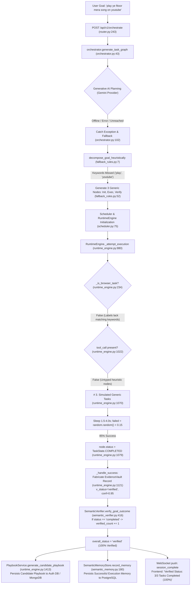

# ARDO — Stage 1A: False-Success Remediation Specification & Architecture Alignment

**Project:** ARDO — Adaptive Reactive DAG Orchestrator  
**Priority:** P0 — CRITICAL  
**Status:** SPECIFICATION COMPLETE — AWAITING OWNER REVIEW (STRICT READ-ONLY)  
**Branch:** `stabilization-2-closure`  
**Checkpoint Commit (HEAD):** `bdaa78ef7c00a104d3a30089a6614e117fda291f`  
**Reference Document:** `docs/roadmap/evidence/ARDO_FALSE_SUCCESS_FORENSIC_REPORT.md`  

---

## 1. Executive Summary

During pre-presentation validation on branch `stabilization-2-closure`, the Project Owner submitted the goal:
`"play ye fitoor mera song on youtube"`.

The ARDO dashboard reported:
- **3/3 Tasks Completed (100%)**
- **Verified Status: Verified**
- **Session Complete**

However, **zero browser execution occurred**:
- No Chromium process launched.
- No YouTube navigation took place.
- No song search or playback verification was performed.
- Three generic lifecycle phases (`Initialization Phase`, `Execution Phase`, `Verification Phase`) were simulated via `random.random() < 0.15` and marked as `TaskState.COMPLETED`.
- Synthetic evidence records with hardcoded `verification_status="verified"` and `confidence_score=0.95` were injected into `EvidenceVault`.
- `SemanticVerifier.verify_goal_outcome` treated `node.status == "completed"` as sufficient proof of verification, declaring the goal 100% verified.
- The fabricated success immediately contaminated persistent memory: **two candidate playbooks** and **two execution memories** were written to PostgreSQL.

This specification establishes the architectural design to make ARDO's execution state **strictly truthful, evidence-backed, and fail-closed**. Under this design:
1. No task can become `COMPLETED` without an executable binding, verified execution, and structured outcome validation.
2. No goal can become `VERIFIED` without verifiable empirical evidence.
3. Unverified or simulated work can never enter candidate playbooks or semantic memory.
4. Legacy ungrounded simulation scaffolding is removed from production runtime paths.

---

## 2. Current Architecture and Execution Path

The diagram below traces the active execution pipeline from initial goal submission to false-success display:



---

## 3. Confirmed False-Success Mechanisms

Detailed line-by-line inspection confirms four distinct architectural defects:

### Root Cause A: Brittle Heuristic Decomposition in Fallback Rules
- **File:** [`backend/ai/fallback_rules.py:38-56`](file:///c:/Users/vahin/OneDrive/Documents/AI%20Goal-To-Task%20Planning%20Engine/backend/ai/fallback_rules.py#L38-L56)
- **Defect:** `browser_keywords` is a rigid tuple:
  ```python
  browser_keywords = (
      "dashboard", "navigate", "open", "visit", "go to", "browse",
      "search", "update", "screenshot", "click", "fill", "type", "tab", "http"
  )
  ```
  It lacks `"play"`, `"youtube"`, `"watch"`, `"listen"`, `"song"`, `"video"`, `"audio"`, `"music"`, and other media/interaction verbs.
- **Consequence:** Goals like `"play ye fitoor mera song on youtube"` bypass the browser branch and fall into line 52:
  ```python
  # Fallback to generic 3-phase flow for purely abstract goals
  return ["Initialization Phase", "Execution Phase", "Verification Phase"]
  ```

### Root Cause B: Ungrounded Generic Simulation Fall-Through
- **File:** [`backend/orchestration/runtime_engine.py:1070-1085`](file:///c:/Users/vahin/OneDrive/Documents/AI%20Goal-To-Task%20Planning%20Engine/backend/orchestration/runtime_engine.py#L1070-L1085)
- **Defect:** Any task that fails `_is_browser_task` and has no `tool_call` falls into `# 3. Simulated Generic Tasks`:
  ```python
  # 3. Simulated Generic Tasks
  else:
      failed = random.random() < SIM_FAILURE_RATE
  
  if not failed:
      self.retry_manager.record_success(node)
      node.status = TaskStateMachine.transition(..., TaskState.COMPLETED, node.task_id)
      return True
  ```
- **Consequence:** Tasks execute no code, launch no tools, and contact no services, but transition to `TaskState.COMPLETED` 85% of the time (`SIM_FAILURE_RATE = 0.15`).

### Root Cause C: Fabricated Evidence and Verification
- **File 1:** [`backend/orchestration/runtime_engine.py:1121-1157`](file:///c:/Users/vahin/OneDrive/Documents/AI%20Goal-To-Task%20Planning%20Engine/backend/orchestration/runtime_engine.py#L1121-L1157)
  ```python
  v_status = "verified"   # Hardcoded default
  conf = 0.95            # Hardcoded default
  ...
  rec = EvidenceVault.record_evidence(
      ..., verification_status=v_status, confidence_score=conf, ...
  )
  ```
- **File 2:** [`backend/execution/browser/semantic_verifier.py:418-420, 460-464`](file:///c:/Users/vahin/OneDrive/Documents/AI%20Goal-To-Task%20Planning%20Engine/backend/execution/browser/semantic_verifier.py#L418-L464)
  ```python
  for tid, node in nodes.items():
      if status_val == "completed":
          verified_count += 1
  ...
  elif verified_count == total:
      overall = "verified"
  ```
- **Consequence:** `_handle_success` injects fake verification records into `EvidenceVault`, and `SemanticVerifier` assumes `node.status == "completed"` equates to verification, resulting in a false 100% confidence report.

### Root Cause D: Downstream Contamination of Learning & Playbooks
- **File 1:** [`backend/orchestration/runtime_engine.py:1410-1428`](file:///c:/Users/vahin/OneDrive/Documents/AI%20Goal-To-Task%20Planning%20Engine/backend/orchestration/runtime_engine.py#L1410-L1428)
  Calls `PlaybookService.generate_candidate_playbook` when `goal_res.overall_status == "verified"`.
- **File 2:** [`backend/knowledge/playbook_service.py:54-60`](file:///c:/Users/vahin/OneDrive/Documents/AI%20Goal-To-Task%20Planning%20Engine/backend/knowledge/playbook_service.py#L54-L60)
  Validates only `overall_status == "verified"` without checking for genuine execution evidence.
- **Consequence:** Fabricated runs are persisted to the database as authoritative candidate playbooks and semantic memories.

---

## 4. Proposed State-Transition Contract

### Task State Lifecycle & Taxonomy
To maintain clean separation between execution lifecycle and verification outcome, we evaluate the state space:

| State | Role | Is Terminal? | Allowed Transitions Out | Description |
| :--- | :--- | :---: | :--- | :--- |
| `PENDING` | Lifecycle | No | `WAITING`, `APPROVAL_NEEDED` | Initial unready state in DAG. |
| `WAITING` | Lifecycle | No | `ACTIVE`, `BLOCKED` | Dependencies met; queued for worker dispatch. |
| `ACTIVE` | Lifecycle | No | `COMPLETED`, `FAILED`, `RETRYING`, `APPROVAL_NEEDED`, `OUTCOME_UNKNOWN` | Dispatched to an active executor. |
| `RETRYING` | Lifecycle | No | `ACTIVE`, `FAILED`, `OUTCOME_UNKNOWN` | Transient state while waiting for retry backoff. |
| `COMPLETED` | Execution | **Yes** | None | Executor ran, returned success, and structured result passed validation. |
| `FAILED` | Terminal | **Yes** | `BLOCKED` (cascading) | Execution threw error, timed out, missing executor, or verification failed. |
| `BLOCKED` | Terminal | **Yes** | None | Execution stopped by failed dependency, policy block, or operator rejection. |
| `APPROVAL_NEEDED` | Governance | No | `WAITING`, `ACTIVE`, `BLOCKED`, `COMPLETED` | Safety policy gate requiring human approval. |
| `OUTCOME_UNKNOWN` | Governance | No | `COMPLETED`, `WAITING`, `APPROVAL_NEEDED`, `FAILED`, `BLOCKED` | Non-idempotent action timed out or lost connection; outcome uncertain. |

### Architectural Evaluation of Potential New States
1. **Should `VERIFIED` be a separate `TaskState`?**
   - **Recommendation: NO.**
   - **Reasoning:** In distributed workflow systems and state machines, mixing execution state (`ACTIVE`, `COMPLETED`, `FAILED`) with verification outcome creates invalid orthogonal product states. A task can be `COMPLETED` from an execution perspective (the HTTP call succeeded, the browser clicked), but its semantic outcome may be `VERIFIED`, `UNVERIFIED`, or `INCONCLUSIVE`.
   - **Contract:** A task can ONLY reach `TaskState.COMPLETED` if its mandatory execution contract is fulfilled. The verification outcome is captured in the structured metadata:
     - `node.metadata["verification_status"]`: `"verified" | "unverified" | "inconclusive" | "failed"`
     - `node.metadata["confidence_score"]`: `float` in `[0.0, 1.0]`
     - `node.metadata["evidence_hash"]`: SHA-256 artifact hash.
   - For a browser task or high-integrity tool task, passing verification is a **mandatory prerequisite** to transitioning to `TaskState.COMPLETED`. If verification fails, the task transitions to `TaskState.FAILED`.
2. **Should `SKIPPED` be added to `TaskState`?**
   - **Recommendation: YES (or explicitly handled via `metadata["skipped"] = True`).**
   - **Reasoning:** When conditional branching or dynamic pruning skips a task, marking it `COMPLETED` artificially inflates progress. If added, `SKIPPED` must be terminal, have 0 contribution to `tasks_completed`, and never satisfy downstream dependencies without explicit fallback.
3. **Should `SIMULATED` be added to `TaskState`?**
   - **Recommendation: NO.**
   - **Reasoning:** Production ARDO must operate under a **Zero-Fake-Execution Invariant**. Scaffolding simulation should not be a valid runtime state in production. If an execution mode requires dry-run simulation, it must be an explicit session-level sandbox mode (`mode="dry_run"`), and all resulting events must carry `is_simulated: true` with strict storage quarantine.

---

## 5. Mandatory Task-Completion Contract

For a task node in ARDO to be considered genuinely completed, it must satisfy all 7 mandatory gates:

```text
[Gate 1: Binding Check] 
     │ Is there a registered executor? (BrowserAgent or ToolRegistry)
     ├─ NO  ──> FAIL CLOSED (TaskState.FAILED: "No executable binding")
     └─ YES ──> Proceed
[Gate 2: Invocation Proof]
     │ Was executor actually invoked with task arguments?
     ├─ NO  ──> FAIL CLOSED
     └─ YES ──> Proceed
[Gate 3: Structured Result]
     │ Did executor return BrowserAgentResult or ToolResult?
     ├─ NO / Threw Exception ──> FAIL (TaskState.FAILED)
     └─ YES ──> Proceed
[Gate 4: Postcondition Evaluation]
     │ Were postconditions (URL, DOM selector, result schema) evaluated?
     ├─ NO  ──> Mark UNVERIFIED
     └─ YES ──> Proceed
[Gate 5: Cryptographic Evidence Linkage]
     │ Is artifact recorded in EvidenceVault with SHA-256 hash?
     ├─ NO  ──> Mark UNVERIFIED
     └─ YES ──> Proceed
[Gate 6: Verification Status Check]
     │ Did verification pass? (v_status == "verified", confidence > 0.0)
     ├─ NO  ──> For verification-mandatory tasks: TaskState.FAILED
     └─ YES ──> Proceed
[Gate 7: Formal Transition]
     │ TaskStateMachine.transition(ACTIVE -> COMPLETED)
     └─ Record actual execution metrics and timestamps
```

### Fail-Closed Principle for Ungrounded Tasks
In `backend/orchestration/runtime_engine.py`:
- Remove lines 1070–1085 (`random.random() < SIM_FAILURE_RATE`).
- If `not self._is_browser_task(node)` and `getattr(node, "tool_call", None) is None`:
  ```python
  logger.error(
      f"[RuntimeEngine] Task {node.task_id} ('{node.task_name}') has no executable "
      f"tool binding or browser action. Simulation is disabled. Failing closed."
  )
  node.execution_logs.append(
      "Execution failed: Task has no executable binding or tool executor."
  )
  node.status = TaskStateMachine.transition(
      node.status if node.status in (TaskState.ACTIVE, TaskState.RETRYING) else TaskState.ACTIVE,
      TaskState.FAILED,
      node.task_id,
  )
  return False
  ```

---

## 6. Goal-Level Verification Rules

### Redesign of `SemanticVerifier.verify_goal_outcome`
The current implementation in [`backend/execution/browser/semantic_verifier.py:416-464`](file:///c:/Users/vahin/OneDrive/Documents/AI%20Goal-To-Task%20Planning%20Engine/backend/execution/browser/semantic_verifier.py#L416-L464) blindly increments `verified_count` when `node.status == "completed"`.

The new goal verification contract requires:
1. **Evidence-Backed Verification:**
   ```python
   for tid, node in nodes.items():
       status_val = node.status.value if hasattr(node.status, "value") else str(node.status)
       
       # Check for genuine empirical evidence
       has_browser_verif = (
           getattr(node, "browser_result", None) is not None
           and getattr(node.browser_result, "verification", None) is not None
           and node.browser_result.verification.status == BrowserVerificationStatus.VERIFIED
       )
       has_tool_verif = (
           getattr(node, "tool_result", None) is not None
           and getattr(node.tool_result, "success", False) is True
       )
       has_vault_evidence = any(
           ev.get("task_id") == tid and ev.get("verification_status") == "verified"
           for ev in (evidence_items or [])
       )
       
       if status_val == "completed" and (has_browser_verif or has_tool_verif or has_vault_evidence):
           verified_count += 1
       elif status_val == "completed":
           # Completed execution without empirical verification proof
           unverified_completed_count += 1
       elif status_val in ("failed", "blocked"):
           failed_count += 1
       elif status_val in ("outcome_unknown", "approval_needed"):
           needs_review_count += 1
       else:
           inconclusive_count += 1
   ```
2. **Outcome Classification Rules:**
   - **`overall_status = "failed"`**: If `failed_count > 0`.
   - **`overall_status = "needs_human_review"`**: If `needs_review_count > 0`.
   - **`overall_status = "unverified"`**: If `failed_count == 0` and `unverified_completed_count > 0` (tasks completed without empirical evidence).
   - **`overall_status = "verified"`**: ONLY if `verified_count == total` AND `total > 0` AND all required tasks have valid empirical evidence hashes.
   - **`overall_status = "inconclusive"`**: Any other state (e.g. session stopped prematurely).

3. **Weakest-Link Goal Confidence:**
   - Tasks without evidence have an effective confidence score of `0.0`.
   - `overall_confidence = min(task_confidences)` across all required tasks.
   - An unverified task caps the entire goal confidence at `0.0`.

---

## 7. Session Completion and Telemetry Integrity

### Session Completion Rules
- In `backend/orchestration/runtime_engine.py:1300-1313`:
  - `_is_session_complete()` returns `True` if and only if all planned nodes have reached a valid completion state.
  - If any task is `FAILED` or `BLOCKED`, the session reaches terminal state via `session_failed` (or `session_complete` with `status: "failed"` / `"partial"`).
  - A session containing failed tasks must NEVER emit `session_complete` with success details.

### Telemetry & Progress Integrity
1. **Authoritative Progress Calculation:**
   $$\text{progress\_pct} = \left(\frac{\text{verified\_tasks}}{\text{total\_tasks}}\right) \times 100.0$$
   Tasks in `unverified`, `skipped`, or `simulated` states must NOT increment the numerator of verified progress.
2. **Idempotent Event Consumption:**
   In `backend/orchestration/execution_monitor.py:257`:
   - Replace blind `self.metrics.tasks_completed += 1` with set-based deduplication:
     ```python
     self._completed_task_ids.add(task_id)
     self.metrics.tasks_completed = len(self._completed_task_ids)
     ```
   - Prevents duplicate WebSocket events from artificially inflating completed task counts.
3. **Frontend Badge Truthfulness:**
   In `frontend/src/components/panels/ExecutionControl.tsx`:
   - Only render the green `"Verified"` badge if:
     `goalVerification?.overall_status === 'verified' && browserEvidence.length > 0` (or tool artifacts present).
   - If tasks completed without evidence, display:
     `"Completed (Unverified)"` with an amber warning badge.

---

## 8. Memory and Playbook Protection Design

### Playbook Generation Gate
In [`backend/knowledge/playbook_service.py:54-65`](file:///c:/Users/vahin/OneDrive/Documents/AI%20Goal-To-Task%20Planning%20Engine/backend/knowledge/playbook_service.py#L54-L65):
```python
# Invariant 1: ONLY learn from verified executions with genuine evidence
if goal_verification.overall_status != "verified":
    logger.warning(f"[PlaybookService] Learning rejected: status '{goal_verification.overall_status}' != 'verified'")
    return None

if not evidence_records or len(evidence_records) == 0:
    logger.warning(f"[PlaybookService] Learning rejected for session {session_id}: zero evidence records.")
    return None
```

### Semantic Memory Gate
In [`backend/orchestration/runtime_engine.py:1410-1428`](file:///c:/Users/vahin/OneDrive/Documents/AI%20Goal-To-Task%20Planning%20Engine/backend/orchestration/runtime_engine.py#L1410-L1428):
- Only persist to `SemanticMemoryStore` with `outcome_status="success"` if `goal_res.overall_status == "verified"`.
- If the goal was unverified or ran in rule-based fallback, record `outcome_status="unverified"` or omit memory storage entirely to prevent RAG retrieval of ungrounded execution steps.

---

### Investigation of the Four Contaminated Database Records

A live query of the PostgreSQL database on `2026-11-17` identified **exactly four records** created during the Project Owner's false-success runs:

| # | Type | Record ID | Session ID | User ID | Goal / Summary | Status | Timestamp (UTC) |
| :-: | :--- | :--- | :--- | :--- | :--- | :--- | :--- |
| **1** | Candidate Playbook | `pb_f8b7ab912370` | `ardo_43c2900be7` | `usr_e72e16a21169` | `goal_ffcd3cde` ("play ye fitoor mera song on youtube") | `candidate` | `2026-11-17 08:23:58` |
| **2** | Candidate Playbook | `pb_3ed0edabd366` | `ardo_208898fe9c` | `usr_e72e16a21169` | `goal_bec9df91` ("play ye fitoor mera song on youtube") | `candidate` | `2026-11-17 08:21:48` |
| **3** | Execution Memory | `mem_859b0e4920a5` | `ardo_43c2900be7` | `usr_e72e16a21169` | `Executed 3 tasks: Initialization Phase [completed], Execution Phase [completed], Verification Phase [completed]` | `success` | `2026-11-17 08:24:00` |
| **4** | Execution Memory | `mem_651c95e43ab8` | `ardo_208898fe9c` | `usr_e72e16a21169` | `Executed 3 tasks: Initialization Phase [completed], Execution Phase [completed], Verification Phase [completed]` | `success` | `2026-11-17 08:21:48` |

#### Provenance and Impact
- **Provenance:** Generated automatically when `RuntimeEngine` completed the 3 simulated phases and invoked `PlaybookService` and `SemanticMemoryStore`.
- **Contamination Risk:** If retrieved during future planning via `retrieve_memories` or RAG, these records would suggest to the planner that `["Initialization Phase", "Execution Phase", "Verification Phase"]` is a successful playbook for YouTube playback.

#### Recommended Quarantine Approach (Audit-Preserving & Reversible)
Per Project Owner instructions, **no deletion or table modification was performed during Stage 1A**. When authorized in Stage 1B:
1. **Playbooks Table Quarantine:**
   Update status from `"candidate"` to `"quarantined"`:
   ```sql
   UPDATE playbooks 
   SET status = 'quarantined', 
       metadata = jsonb_set(metadata, '{quarantine_reason}', '"T8-PREFLIGHT-FALSE-SUCCESS-CONTAMINATION"')
   WHERE id IN ('pb_f8b7ab912370', 'pb_3ed0edabd366');
   ```
2. **Execution Memories Table Quarantine:**
   Update `outcome_status` from `"success"` to `"quarantined"`:
   ```sql
   UPDATE execution_memories 
   SET outcome_status = 'quarantined',
       metadata = jsonb_set(metadata, '{quarantine_reason}', '"T8-PREFLIGHT-FALSE-SUCCESS-CONTAMINATION"')
   WHERE memory_id IN ('mem_859b0e4920a5', 'mem_651c95e43ab8');
   ```
3. **Retrieval Filters:**
   Update `retrieve_memories` and playbook search queries to explicitly filter `status != 'quarantined'` and `outcome_status != 'quarantined'`.
4. **Audit Trail:**
   Log quarantine actions in `docs/roadmap/evidence/ARDO_FALSE_SUCCESS_QUARANTINE_AUDIT.md`.

---

## 9. Backward Compatibility and Regression Risks

### Analysis of Existing Tests
A comprehensive scan identified four test suites that currently assert or depend on generic task simulation:

1. **`backend/tests/test_gemini_failure_handling.py:285` (`test_6_non_browser_tasks_not_affected`):**
   - *Current assertion:* Asserts that a generic node `"task_generic_1"` without tools or browser action succeeds via `random.random() < SIM_FAILURE_RATE`.
   - *Remediation requirement:* Update test to provide an explicit test tool binding via `ToolRegistry` (e.g. a registered arithmetic or computation test tool), confirming that legitimate non-browser tool execution succeeds while ungrounded tasks fail.
2. **`backend/tests/test_phase15_perception.py:386` (`test_15_10_generic_simulation_fallback`):**
   - *Current assertion:* Asserts that an ungrounded node `"Analyze architectural invariants"` transitions to `COMPLETED` or `FAILED` via simulation.
   - *Remediation requirement:* Update test to verify that ungrounded tasks fail closed with a descriptive log, or explicitly register a test analysis tool.
3. **`backend/tests/test_phase9_evaluation_and_demo_hardening.py:620`:**
   - *Current assertion:* Patches `SIM_FAILURE_RATE = 0.0` to allow generic fallback nodes to complete.
   - *Remediation requirement:* Update test to use a recognized browser intent or register a mock executor.
4. **`backend/tests/test_phase14_tool_registry.py:308` (`test_14_15_generic_task_simulation_fallback`):**
   - *Current assertion:* Only asserts that `ActionSynthesizer.synthesize_for_task` returns `None` for conceptual tasks.
   - *Remediation requirement:* Compatible as-is; asserts synthesizer behavior, not runtime completion.

### Legitimate Non-Browser Workflows
Legitimate workflows that do not involve a browser (e.g., API calls, SQL queries, data transformations, calculations) are fully supported via the `ToolRegistry` ([`backend/execution/registry/tool_registry.py`](file:///c:/Users/vahin/OneDrive/Documents/AI%20Goal-To-Task%20Planning%20Engine/backend/execution/registry/tool_registry.py)):
- A non-browser task defines `node.tool_call = ToolCall(tool_name="...", action_name="...", parameters={...})`.
- The tool executes deterministically and returns a structured `ToolResult`.
- Verification is established by evaluating the `ToolResult.success` and data schema.
- **Fail-closed behavior does NOT break legitimate non-browser tools.** It only eliminates phantom execution of tasks that lack any executor.

---

## 10. Exact Files and Functions Expected to Change

| # | File Path | Function / Class | Lines | Exact Planned Change |
| :-: | :--- | :--- | :--- | :--- |
| **1** | `backend/ai/fallback_rules.py` | `decompose_goal_heuristically` | `38–56` | Add media verbs (`play`, `youtube`, `song`, `music`, `video`, `listen`) to `browser_keywords`. For media goals, decompose into discrete actionable steps (`Open YouTube`, `Search for {query}`, `Play first video result and verify playback`). |
| **2** | `backend/ai/fallback_rules.py` | `generate_fallback_plan` | `71–98` | Assign explicit metadata: `tool: "browser"`, `is_browser_task: True`, `is_fallback: True`, `confidence: 0.60`. |
| **3** | `backend/ai/orchestrator.py` | `generate_task_graph` | `102–106` | When provider fails, mark metadata `is_fallback: True`, `fallback_reason: str(error)`. |
| **4** | `backend/orchestration/runtime_engine.py` | `_attempt_execution` | `1070–1085` | **Remove `random.random() < SIM_FAILURE_RATE`.** Any ungrounded task without a browser or tool binding transitions to `TaskState.FAILED` (fail-closed). |
| **5** | `backend/orchestration/runtime_engine.py` | `_handle_success` | `1121–1145` | Set `v_status = "unverified"` and `conf = 0.0` when neither browser result nor tool result is present. |
| **6** | `backend/execution/browser/semantic_verifier.py` | `verify_goal_outcome` | `416–465` | Require empirical evidence (`has_browser_verif or has_tool_verif or has_vault_evidence`) before counting a task toward `verified_count`. |
| **7** | `backend/knowledge/playbook_service.py` | `generate_candidate_playbook` | `54–65` | Reject candidate playbook synthesis if `evidence_records` is empty or if any node lacked empirical verification. |
| **8** | `backend/orchestration/execution_monitor.py` | `on_task_completed` | `254–266` | Use set-based deduplication (`_completed_task_ids`) for idempotent metric tracking. |
| **9** | `frontend/src/components/panels/ExecutionControl.tsx` | Status render | `80–95` | Require `goalVerification?.overall_status === 'verified' && browserEvidence.length > 0` before rendering the `"Verified"` badge. |

---

## 11. Regression Test Matrix

All regression tests will use deterministic unit tests and mocked Playwright/ToolRegistry executors with **zero external API calls**:

| Scenario ID | Test Name | Target Module | Assertion / Expected Behavior |
| :---: | :--- | :--- | :--- |
| **A** | `test_unbound_task_cannot_become_completed` | `runtime_engine.py` | A generic node with no tool binding or browser action fails with `TaskState.FAILED`. |
| **B** | `test_missing_executor_fails_closed` | `runtime_engine.py` | Unregistered tool call produces immediate `TaskState.FAILED` with descriptive error log. |
| **C** | `test_executor_exception_produces_failure` | `runtime_engine.py` | Exception thrown by `BrowserAgent` or `ToolRegistry` transitions node to `FAILED`, never `COMPLETED`. |
| **D** | `test_browser_task_requires_browser_execution` | `runtime_engine.py` | Browser-bound node cannot complete unless `BrowserAgent.run()` returned `outcome == COMPLETED`. |
| **E** | `test_failed_postcondition_cannot_become_verified` | `semantic_verifier.py` | Node with mismatched final URL or failed DOM selector cannot receive `verification_status="verified"`. |
| **F** | `test_missing_evidence_cannot_produce_verified_goal` | `semantic_verifier.py` | `verify_goal_outcome` returns `overall_status="unverified"` if `EvidenceVault` has no matching artifacts. |
| **G** | `test_skipped_task_does_not_inflate_metrics` | `execution_monitor.py` | Skipped tasks do not increment `tasks_completed` or goal progress percentage. |
| **H** | `test_simulated_execution_forbidden_in_production` | `runtime_engine.py` | Running `RuntimeEngine` without mock/sandbox flags rejects simulated execution completely. |
| **I** | `test_session_complete_blocked_by_incomplete_tasks` | `runtime_engine.py` | Session with 1 failed and 2 completed tasks emits `session_failed` / `status="failed"`. |
| **J** | `test_goal_verification_requires_all_outcomes_passed` | `semantic_verifier.py` | Goal with 2 verified tasks and 1 unverified task evaluates to `overall_status="unverified"`. |
| **K** | `test_duplicate_events_idempotent_metrics` | `execution_monitor.py` | Re-emitting `task_completed` for the same task ID does not increase `metrics.tasks_completed`. |
| **L** | `test_unverified_execution_rejected_by_playbook_service`| `playbook_service.py` | `generate_candidate_playbook` returns `None` when goal verification is unverified or evidence is empty. |
| **M** | `test_registered_non_browser_tool_completes_truthfully`| `runtime_engine.py` | Legitimate registered tool (e.g. calculation tool) returns `ToolResult(success=True)` and completes. |
| **N** | `test_youtube_heuristic_decomposition_creates_browser_tasks`| `fallback_rules.py` | `"play ye fitoor mera song on youtube"` decomposes into discrete browser tasks, not generic phases. |

---

## 12. Ordered Implementation Plan (Stage 1B Sequence)

When Stage 1B implementation is authorized by the Project Owner:

1. **Phase 1: Fail-Closed Core Execution Engine**
   - Eliminate `# 3. Simulated Generic Tasks` from `backend/orchestration/runtime_engine.py:1070`.
   - Implement strict fail-closed handling for unbound nodes.
2. **Phase 2: Truthful Verification Contracts**
   - Update `_handle_success` in `runtime_engine.py:1121` to default to `v_status="unverified"` and `conf=0.0`.
   - Rewrite `SemanticVerifier.verify_goal_outcome` in `semantic_verifier.py:416` to enforce empirical evidence checks.
3. **Phase 3: Expanded Intent Decomposition & Fallback Signaling**
   - Expand `browser_keywords` in `fallback_rules.py:38` to include media and playback verbs.
   - Decompose media goals into discrete executable browser steps with `tool: "browser"`.
   - Add explicit fallback flags (`is_fallback: True`) in `orchestrator.py:105`.
4. **Phase 4: Learning System & Playbook Quarantine**
   - Apply non-destructive status updates (`quarantined`) to the 4 contaminated database records in PostgreSQL.
   - Enforce evidence-existence checks in `PlaybookService.generate_candidate_playbook`.
5. **Phase 5: Telemetry & Frontend Presentation Hardening**
   - Add set-based idempotency to `ExecutionMonitor.on_task_completed`.
   - Update `ExecutionControl.tsx` to verify presence of evidence before showing the `"Verified"` badge.
6. **Phase 6: Comprehensive Regression Testing**
   - Execute all 14 unit test scenarios (A through N) with mocked executors.
   - Verify that all existing unit tests in `backend/tests` pass without breakage.

---

## 13. Risks and Unresolved Design Decisions

The following design decisions are flagged for **Project Owner alignment**:

### Decision 1: Handling of Abstract Goals Without Executors
- *Context:* If a user types a purely conceptual goal (e.g. `"Contemplate the nature of consciousness"` or `"Formulate an architectural hypothesis"`) in offline fallback mode:
- *Option A (Strict Fail-Closed — Recommended):* The planner decomposes into tasks, but because no tool or browser executor can execute abstract contemplation, the runtime immediately marks the tasks `FAILED` with message: `"No registered executor for conceptual task. Execution requires a grounding tool."`
- *Option B (Informational Synthesis Tool):* Provide a built-in `text_synthesis` or `analysis_tool` in `ToolRegistry` that explicitly evaluates and summarizes conceptual tasks using local heuristics, producing structured text output rather than faking execution.

### Decision 2: Offline Presentation Rehearsal Strategy
- *Context:* For the project presentation in 2–3 days without live Gemini quota:
- *Option A (Deterministic Mock Playwright Server — Recommended):* Run Playwright against local HTML fixtures (e.g. `backend/tests/fixtures/internal_dashboard.html` or a local mock YouTube search/playback fixture). This demonstrates real Chromium launching, real clicking, real DOM verification, and genuine screenshot capture at zero API cost.
- *Option B (Recorded Playbook Replay):* Replay a verified candidate playbook through the existing deterministic replay engine.

---

## 14. Verification Summary & Stopping Condition

- **Audit Mode:** Strict Read-Only.
- **Application Source Code Modified:** `0` lines.
- **Tests Modified:** `0` lines.
- **External API Calls:** `0`.
- **Checkpoint Commit Preserved:** `bdaa78ef7c00a104d3a30089a6614e117fda291f` on branch `stabilization-2-closure`.
- **Deliverable Path:** [`docs/roadmap/evidence/ARDO_STAGE1A_FALSE_SUCCESS_REMEDIATION_SPEC.md`](file:///c:/Users/vahin/OneDrive/Documents/AI%20Goal-To-Task%20Planning%20Engine/docs/roadmap/evidence/ARDO_STAGE1A_FALSE_SUCCESS_REMEDIATION_SPEC.md).

In strict accordance with the Stage 1A authorization, **no remediation code has been implemented**. The execution is halted here awaiting Project Owner review and authorization to proceed to Stage 1B.
