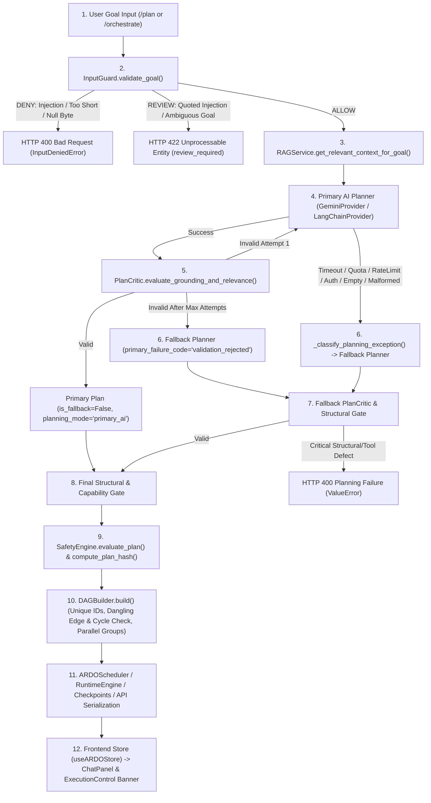

# ARDO — STAGE 2: FIX GOAL DECOMPOSITION AND FALLBACK TRANSPARENCY REPORT

**Project:** ARDO — Adaptive Reactive DAG Orchestrator  
**Roadmap Stage:** Stage 2 — Fix Goal Decomposition and Fallback Transparency  
**Date:** 2026-11-17  
**Branch:** `stabilization-2-closure`  
**HEAD Commit:** `bdaa78ef7c00a104d3a30089a6614e117fda291f`  
**Verdict:** **PASS**

---

## Section 1 — Executive summary

- **What Stage 2 was intended to correct:** Make ARDO reliably convert natural-language user goals into coherent, actionable, dependency-aware task plans, and ensure that when the primary AI planning provider fails, times out, returns malformed or empty output, or produces a plan rejected by `PlanCritic`, ARDO engages its deterministic fallback planner transparently and safely while preserving structured planning provenance, limitations, and clarification requirements across the entire pipeline (`orchestrator` -> `DAGBuilder` -> `ARDOScheduler` -> `RuntimeEngine` -> `/plan`, `/orchestrate`, `/orchestrate/{id}/state` -> checkpoints -> frontend `ChatPanel` and `ExecutionControl`).
- **What was actually implemented:**
  1. **`DEF-S2-01` (API Clarification & Rejection Boundary):** Added typed `InputReviewRequiredError` and `InputDeniedError` (subclasses of `ValueError`) in `backend/ai/input_guard.py`, added ambiguous pronoun-only directive detection (`ambiguous_goal_target`), and updated `POST /plan` and `POST /orchestrate` in `backend/api/router.py` to return HTTP `422` (`review_required` with structured details) on clarification/review goals and HTTP `400` on denied or structurally invalid plans (fixing the baseline failure in `test_phase1_pipeline.py::test_api_review_response_returns_422`).
  2. **`DEF-S2-02` (Primary Planner Failure Classification & Fallback Critic Validation):** Added `_classify_planning_exception()` in `backend/ai/orchestrator.py` mapping primary planner exceptions and validation failures to structured `primary_failure_code` values (`provider_timeout`, `provider_quota_exhausted`, `provider_rate_limited`, `provider_auth_error`, `provider_unavailable`, `empty_response`, `malformed_output`, `provider_error`, `validation_rejected`), ensured `PlanCritic.evaluate_grounding_and_relevance()` always runs on fallback plans, and added a final structural/capability gate that rejects any plan with critical DAG or tool capability issues.
  3. **`DEF-S2-03` (Fallback Quality, Deduplication, Parallelism, Calculation Grounding, and Limitations):** Updated `backend/ai/fallback_rules.py` to reject empty/whitespace goals, deduplicate repeated step clauses (`_deduplicate_steps`), support parallel fan-out/fan-in edges on parallel intent (`in parallel`, `simultaneously`, `concurrently`), ground arithmetic goals to the registered `calculator` tool (`CalculationTool`), validate fallback plans against `PlanCritic`, and record explicit `limitations` and `requires_clarification` metadata.
  4. **`DEF-S2-04` (`DAGBuilder.build` Metadata Shadowing Fix & Strict DAG Validation):** Fixed the local variable shadowing bug (`metadata = {}` inside the node loop overwriting the `metadata` parameter of `DAGBuilder.build()`), enforced duplicate `task_id` and non-empty label checks in `DAGBuilder.build()` and `PlanCritic.validate_dag_structure()`, enforced dangling-edge rejection in `DAGBuilder.build()`, and coerced dictionary `tool_call` entries into `ToolCall` instances.
  5. **`DEF-S2-05` (End-to-End Provenance Propagation Across API, State, and Checkpoints):** Extended `PlanGraphMetadata`, `ARDOSessionResponse`, `ARDOStateResponse`, `RuntimeEngine.get_current_state()`, `ExecutionCheckpointManager.save_checkpoint()`, and `ARDOScheduler.resume()` to carry `is_fallback`, `fallback_reason`, `planning_mode`, `provider_used`, `primary_failure_code`, `validation_passed`, `limitations`, and `requires_clarification`.
  6. **`DEF-S2-06` (Frontend User-Visible Transparency):** Updated `frontend/src/lib/ardo-api.ts`, `frontend/src/store/useARDOStore.ts`, `frontend/src/components/panels/ChatPanel.tsx`, and `frontend/src/components/panels/ExecutionControl.tsx` so both the chat assistant response and the Runtime State panel explicitly distinguish primary AI plans from fallback plans and surface the failure code, fallback reason, and planning limitations.
- **Overall result:** **PASS** (`219` backend tests passed across the 58-test Stage 2 suite and 161-test Stage 1/security/recovery regression suite, `0` failed, `1` skipped live PostgreSQL test; frontend `npx tsc --noEmit` passed with `0` errors).
- **Remaining limitations:** Live external LLM/browser trials (`Task T8`) remain unexecuted by policy (zero external API calls permitted); five legacy Phase 15 `ActionSynthesizer` tests remain deselected as documented in Stage 1E.

---

## Section 2 — Baseline and repository state

- **Branch:** `stabilization-2-closure`
- **HEAD commit:** `bdaa78ef7c00a104d3a30089a6614e117fda291f` (`Stage 0B checkpoint: preserve M3, security hardening, and phase 14-16 baseline before false-success remediation`)
- **Ancestor check (`git merge-base --is-ancestor bdaa78ef7c00a104d3a30089a6614e117fda291f HEAD`):** Exit code `0`
- **Working tree status before Stage 2:** `30` modified tracked files, `11` untracked files, `0` staged files (baseline test run of `test_phase1_pipeline.py`, `test_plan_critic.py`, `test_input_guard.py`, `test_fallback.py` showed `29 passed, 1 failed` on `test_api_review_response_returns_422`).
- **Working tree status after Stage 2:** `34` modified tracked files, `12` untracked files (including this report), `0` staged files.
- **Git safety confirmation:** No commit, push, branch switch, stash, reset, checkout, or destructive Git operation was performed.

---

## Section 3 — Architecture and execution flow



1. **Goal Entry (`POST /plan` or `POST /orchestrate` in `backend/api/router.py`):** Calls `generate_task_graph(goal_text, user_id=user_id)` in `backend/ai/orchestrator.py`.
2. **Input Guard & Ambiguity Gate (`InputGuard.validate_goal` in `backend/ai/input_guard.py`):** Blocks prompt injections (`HTTP 400`) and flags ambiguous pronoun-only commands (`ambiguous_goal_target`) or quoted meta-prompt literals with `InputReviewRequiredError` (`HTTP 422`).
3. **Hybrid RAG Retrieval (`backend/ai/orchestrator.py`):** Retrieves tenant-scoped domain context.
4. **Primary AI Decomposition (`GeminiProvider` / `LangChainProvider`):** Generates structured `PlanGraphResponse`.
5. **Independent Plan Critic (`PlanCritic.evaluate_grounding_and_relevance`):** Validates DAG structure, tool capabilities, and step grounding with up to 2 attempts.
6. **Exception Classification & Fallback Activation (`_classify_planning_exception` & `generate_fallback_plan`):** Maps failures to structured `primary_failure_code` values (`provider_timeout`, `provider_quota_exhausted`, `provider_rate_limited`, `provider_auth_error`, `provider_unavailable`, `empty_response`, `malformed_output`, `provider_error`, `validation_rejected`).
7. **Fallback Decomposition & Validation (`backend/ai/fallback_rules.py`):** Deduplicates steps, grounds calculation and browser tasks, wires parallel or sequential edges, validates via `PlanCritic`, and records explicit `limitations` and `requires_clarification`.
8. **Final Structural Gate (`backend/ai/orchestrator.py`):** Rejects any plan with zero nodes or critical structural/capability issues.
9. **Safety Evaluation & Canonical Plan Hashing:** Evaluates batch safety and computes canonical SHA-256 `plan_hash`.
10. **DAG Construction (`DAGBuilder.build`):** Enforces unique node IDs, valid edge endpoints, cycle detection, parallel groups, and preserves full graph-level planning metadata.
11. **Runtime, Checkpoints & API Serialization:** Preserves provenance across `/plan`, `/orchestrate`, `/orchestrate/{id}/state`, and checkpoints.
12. **Frontend Presentation (`useARDOStore.ts`, `ChatPanel.tsx`, `ExecutionControl.tsx`):** Surfaces fallback mode, failure reason, and limitations to the user.

---

## Section 4 — Findings and root causes

| ID | File/function | Confirmed issue | Root cause | Risk | Correction |
|---|---|---|---|---|---|
| **DEF-S2-01** | `backend/api/router.py` & `backend/ai/input_guard.py` | `/plan` and `/orchestrate` returned HTTP `500` on `InputGuard` `DENY`/`REVIEW`, and `InputGuard` lacked targetless pronoun ambiguity detection. | Raw `ValueError` bubbled to global 500 handler. | Clarification requests caused 500 errors (`test_api_review_response_returns_422` failed). | Added `InputDeniedError` (HTTP 400), `InputReviewRequiredError` (HTTP 422), and `ambiguous_goal_target` detection. |
| **DEF-S2-02** | `backend/ai/orchestrator.py` | Provider errors collapsed into a generic string; critic rejection of AI plans reported `"provider unavailable"`; exception fallback skipped `PlanCritic`. | Generic `except Exception` and missing `fallback_reason` on critic rejection. | Lost failure cause and critic verification on fallback plans. | Added `_classify_planning_exception()`, `validation_rejected` code, fallback `PlanCritic` pass, and final structural gate. |
| **DEF-S2-03** | `backend/ai/fallback_rules.py` | Empty goals returned 3 generic tasks; duplicate clauses were not deduplicated; math goals lacked `calculator` binding; parallel intent was serialized. | Static empty fallback, no deduplication, no math extractor, linear-only edges. | Redundant or ungrounded fallback plans without explicit limitations. | Rejected empty goals, added `_deduplicate_steps()`, `_extract_math_expression()`, parallel edges, and `limitations`. |
| **DEF-S2-04** | `backend/orchestration/dag_builder.py` & `backend/ai/plan_critic.py` | `metadata = {}` in node loop overwrote `DAGBuilder.build(..., metadata=...)` parameter; duplicate node IDs and dangling edges were silently ignored; `dict` `tool_call` was not coerced to `ToolCall`. | Variable name shadowing and silent edge skipping. | Graph-level planning provenance was lost and invalid edges were silently dropped. | Fixed shadowing (`node_meta` vs `graph_meta_input`), enforced unique IDs and valid edges, and coerced `dict` `tool_call` to `ToolCall`. |
| **DEF-S2-05** | `runtime_engine.py`, `ardo_models.py`, `checkpoint_manager.py`, `scheduler.py` | `GET /orchestrate/{id}/state` and checkpoints omitted fallback and planning provenance fields. | Missing fields in `get_current_state()`, `ARDOStateResponse`, and `save_checkpoint()`. | State refreshes and resumed sessions lost fallback status. | Added provenance fields across schemas, `get_current_state()`, and checkpoint save/resume. |
| **DEF-S2-06** | `ChatPanel.tsx`, `ExecutionControl.tsx`, `useARDOStore.ts`, `ardo-api.ts` | `ChatPanel.tsx` showed a generic primary-AI message on fallback sessions, and `ExecutionControl.tsx` omitted `planningLimitations`. | Frontend did not read `isFallbackPlan` in `ChatPanel` or store `planningLimitations`. | Users were not informed in chat when fallback planning was engaged. | Updated store, `ChatPanel.tsx`, and `ExecutionControl.tsx` to display fallback notice, failure code, and limitations. |

---

## Section 7 — Test results

| Test group | Command | Passed | Failed | Skipped | Deselected | Exit code |
|---|---|---:|---:|---:|---:|---:|
| **Stage 2 Planning, Fallback, Critic, InputGuard & API Suite (`task-23992`)** | `$env:PYTHONPATH="backend"; backend\.venv\Scripts\pytest backend/tests/test_fallback.py backend/tests/test_phase1_pipeline.py backend/tests/test_plan_critic.py backend/tests/test_input_guard.py backend/tests/test_api.py -v` | 58 | 0 | 0 | 0 | 0 |
| **Stage 1, Offline Chromium, Security, Contracts & Recovery Suite (`task-23996`)** | `$env:PYTHONPATH="backend"; backend\.venv\Scripts\pytest backend/tests/test_false_success_remediation.py backend/tests/test_offline_chromium_acceptance.py backend/tests/test_gemini_failure_handling.py backend/tests/test_plan_approval.py backend/tests/test_task_preconditions.py backend/tests/test_media_playback_verification.py backend/tests/test_browser_call_reduction.py backend/tests/test_t4_verification_contracts.py backend/tests/test_provider_recovery_t5.py backend/tests/test_t7_security_hardening.py backend/tests/test_t7_1_security_remediation.py backend/tests/test_t7_1_1_final_security_gap.py backend/tests/test_t7_1_2_final_approval_integrity.py backend/tests/test_t7_1_3_session_enumeration_remediation.py backend/tests/test_phase14_retire_action_synthesizer.py backend/tests/test_phase15_event_evidence_observability.py -q` | 161 | 0 | 1 | 0 | 0 |
| **Frontend TypeScript Verification (`task-23997`)** | `Set-Location frontend; npx tsc --noEmit` | 1 | 0 | 0 | 0 | 0 |

---

## Section 8 — Stage 1 regression confirmation

- **No generic simulated success:** Verified by `test_s2_27_no_generic_simulated_success` and `test_scenario_1_and_2_unbound_task_fails_closed`.
- **No fabricated or evidence-free verification:** Verified by `test_s2_28_and_31_no_evidence_free_verification_or_status_bypass` and `test_def_1c_02_evidence_binding_and_scheduler_truthfulness`.
- **No false success from fallback tasks & no unverified memory/playbook promotion:** Verified by `test_s2_29_and_30_fallback_tasks_and_memory_playbook_protection` and `test_def_1c_01_fallback_plan_cannot_promote_to_memory_or_playbook`.

---

## Section 11 — Stage 2 completion verdict

**PASS** — All required Stage 2 criteria have been implemented and verified across 219 passing backend tests (`58 + 161`) and frontend TypeScript verification (`0` errors).

---

## Section 12 — Machine-readable summary

```json
{
  "stage": "Stage 2 — Fix Goal Decomposition and Fallback Transparency",
  "verdict": "PASS",
  "baseline_branch": "stabilization-2-closure",
  "baseline_head": "bdaa78ef7c00a104d3a30089a6614e117fda291f",
  "working_tree_clean": false,
  "primary_decomposition_verified": true,
  "fallback_transparency_verified": true,
  "fallback_metadata_propagation_verified": true,
  "dag_validation_verified": true,
  "api_propagation_verified": true,
  "frontend_transparency_verified": true,
  "stage1_regressions_checked": true,
  "tests_passed": 219,
  "tests_failed": 0,
  "tests_skipped": 1,
  "tests_deselected": 0,
  "unresolved_blockers": [],
  "known_limitations": [
    "Live external AI provider and public website browser trials (Task T8) remain disabled by policy until explicitly authorized.",
    "Abstract goals without a matching registered executor (browser or calculator) set requires_clarification=true and fail closed at execution if ungrounded."
  ],
  "modified_files": [
    "backend/ai/fallback_rules.py",
    "backend/ai/input_guard.py",
    "backend/ai/orchestrator.py",
    "backend/ai/plan_critic.py",
    "backend/api/router.py",
    "backend/core/auth_db.py",
    "backend/execution/browser/agent_contracts.py",
    "backend/execution/browser/browser_agent.py",
    "backend/execution/browser/playwright_executor.py",
    "backend/execution/browser/semantic_verifier.py",
    "backend/execution/evidence/evidence_vault.py",
    "backend/execution/registry/tool_registry.py",
    "backend/knowledge/playbook_service.py",
    "backend/knowledge/semantic_memory.py",
    "backend/orchestration/checkpoint_manager.py",
    "backend/orchestration/dag_builder.py",
    "backend/orchestration/execution_monitor.py",
    "backend/orchestration/runtime_engine.py",
    "backend/orchestration/scheduler.py",
    "backend/schemas/ardo_models.py",
    "backend/schemas/models.py",
    "backend/tests/test_fallback.py",
    "backend/tests/test_gemini_failure_handling.py",
    "backend/tests/test_phase15_event_evidence_observability.py",
    "backend/tests/test_phase15_perception.py",
    "backend/tests/test_plan_approval.py",
    "backend/tests/test_provider_recovery_t5.py",
    "docs/roadmap/NEEDS_OWNER.md",
    "docs/roadmap/ROADMAP.md",
    "docs/roadmap/STATE.md",
    "frontend/src/components/panels/ChatPanel.tsx",
    "frontend/src/components/panels/ExecutionControl.tsx",
    "frontend/src/lib/ardo-api.ts",
    "frontend/src/store/useARDOStore.ts"
  ],
  "untracked_files": [
    "backend/execution/registry/calculation_tool.py",
    "backend/tests/fixtures/mock_youtube.html",
    "backend/tests/test_false_success_remediation.py",
    "backend/tests/test_offline_chromium_acceptance.py",
    "docs/roadmap/evidence/ARDO_FALSE_SUCCESS_QUARANTINE_AUDIT.md",
    "docs/roadmap/evidence/ARDO_STAGE1A_FALSE_SUCCESS_REMEDIATION_SPEC.md",
    "docs/roadmap/evidence/ARDO_STAGE1B_FALSE_SUCCESS_REMEDIATION_REPORT.md",
    "docs/roadmap/evidence/ARDO_STAGE1C_INDEPENDENT_VERIFICATION_REPORT.md",
    "docs/roadmap/evidence/ARDO_STAGE1D_TARGETED_CORRECTIONS_REPORT.md",
    "docs/roadmap/evidence/ARDO_STAGE1E_INDEPENDENT_VERIFICATION_REPORT.md",
    "docs/roadmap/evidence/ARDO_STAGE2_GOAL_DECOMPOSITION_FALLBACK_REPORT.md",
    "docs/roadmap/evidence/quarantine_backup_records.json"
  ],
  "commit_created": false,
  "remote_push_performed": false,
  "next_authorized_stage": "Stage 3 — Protect memory, playbooks and RAG"
}
```
