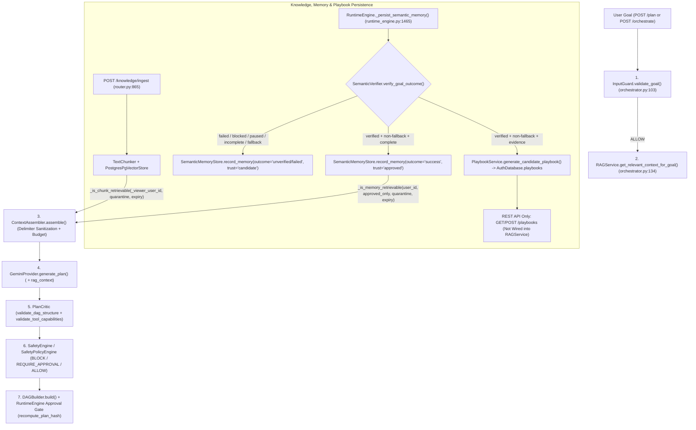

# ARDO — Stage 3 Independent Evidence Audit
## Memory, Playbooks, RAG, Tenant Isolation and Retrieval Security

**Project:** ARDO — Adaptive Reactive DAG Orchestrator  
**Phase:** Phase 3 — Production Preparation  
**Activity:** Stage 3 Independent Evidence Audit (Strict Read-Only Verification)  
**Branch:** `stabilization-2-closure`  
**HEAD Commit:** `bdaa78ef7c00a104d3a30089a6614e117fda291f`  
**Audit Date:** 2026-11-18  

---

## Section 1 — Executive verdict

**VERDICT: `PASS WITH CONDITIONS`**

### Rationale for `PASS WITH CONDITIONS`
No critical or high-severity cross-tenant data exposure, quarantine bypass, unauthorized playbook promotion, or prompt-injection escape vulnerability was found. All 11 targeted category test runs (`89 executed, 89 passed, 0 failed`) and the full Stage 3 + regression suites (`249 passed, 0 failed, 2 skipped`) pass deterministically offline.

However, independent line-by-line source inspection identified **four MEDIUM-severity implementation/diagram gaps and three LOW-severity defensive gaps** (`AUD-S3-01` through `AUD-S3-07`) where the Stage 3 report's architecture diagram overstates end-to-end wiring or where cryptographic hash verification is structural rather than content-recomputed:

1. **`AUD-S3-01` (MEDIUM — Playbook Retrieval Disconnected From Live Planning Pipeline):** While `PlaybookService.retrieve_playbooks_for_goal()` and `PlaybookService.format_playbook_for_context()` are implemented and unit-tested, neither `generate_task_graph()` (`backend/ai/orchestrator.py:129-140`) nor `RAGService.get_relevant_context_for_goal()` (`backend/knowledge/rag_service.py:250-296`) invokes `PlaybookService`. Consequently, promoted playbooks in `AuthDatabase` are not automatically injected into the planning prompt during `POST /plan` or `POST /orchestrate`, contrary to the Stage 3 architecture diagram.
2. **`AUD-S3-02` (MEDIUM — Evidence Hashes Are Checked for Non-Empty Presence Rather Than Re-Verified Against Content Payload During Playbook/Goal Verification, and Runtime Memory Persistence Omits `evidence_hashes`):** `EvidenceVault.verify_integrity()` (`backend/execution/evidence/evidence_vault.py:181-206`) exists and recomputes SHA-256 hashes, but `SemanticVerifier.verify_goal_outcome()` (`backend/execution/browser/semantic_verifier.py:441-447`) and `PlaybookService.generate_candidate_playbook()` (`backend/knowledge/playbook_service.py:74-81`) only check that `artifact_hash` is a non-empty string `!= "unverified"` without calling `EvidenceVault.verify_integrity()` or enforcing 64-hex-char SHA-256 format. Additionally, `RuntimeEngine._persist_semantic_memory()` (`backend/orchestration/runtime_engine.py:1593-1602`) does not pass `metadata={"evidence_hashes": goal_verif.supporting_evidence_hashes}` when calling `rag.record_plan_outcome()`, leaving `ExecutionMemoryItem.evidence_hashes` empty on runtime-recorded memories unless supplied directly.
3. **`AUD-S3-03` (MEDIUM — `RuntimeEngine._persist_semantic_memory()` Falls Back to Shared `"system"` User ID When `self.user_id` Is `None`):** In `backend/orchestration/runtime_engine.py:1474` and `1489`, `self.user_id or "system"` is passed to `EvidenceVault.get_session_evidence()` and `PlaybookService.generate_candidate_playbook()`, and `semantic_verifier.py:431` / `playbook_service.py:80` accept `e.get("user_id") in (user_id, "system")`. Unowned internal sessions should skip candidate playbook synthesis rather than attributing playbooks to a shared `"system"` user.
4. **`AUD-S3-04` (MEDIUM — PostgreSQL Queries Apply `LIMIT max(top_k * 3, 10)` Before Python-Side Filtering of `trust_status`, `superseded`, and `expires_at`):** In `SemanticMemoryStore.retrieve_memories()` (`backend/knowledge/semantic_memory.py:519-534`) and `PostgresPgVectorStore.query_vector()` / `query_keyword()` (`backend/knowledge/postgres_vector_store.py:428-440, 548-558`), SQL queries apply `LIMIT max(top_k * 3, 10)` before `_is_memory_retrievable()` and `_is_chunk_retrievable()` filter out `candidate`, `superseded`, or expired records in Python. While this never leaks unauthorized or quarantined data, >10 superseded/candidate/expired rows can starve valid top-K results in PostgreSQL mode.

---

## Section 2 — Repository baseline

1. **Current Branch:** `stabilization-2-closure`
2. **Current HEAD Commit:** `bdaa78ef7c00a104d3a30089a6614e117fda291f`
3. **Checkpoint Ancestor Verification (`git merge-base --is-ancestor bdaa78ef7c00a104d3a30089a6614e117fda291f HEAD`):** Exit code `0` (verified ancestor).
4. **Staged Files Count:** `0`
5. **Modified Tracked Files Count (Pre-Existing Uncommitted Work from Stages 1–3):** `38` (`backend/ai/fallback_rules.py`, `backend/ai/input_guard.py`, `backend/ai/orchestrator.py`, `backend/ai/plan_critic.py`, `backend/api/router.py`, `backend/core/auth_db.py`, `backend/execution/browser/agent_contracts.py`, `backend/execution/browser/browser_agent.py`, `backend/execution/browser/playwright_executor.py`, `backend/execution/browser/semantic_verifier.py`, `backend/execution/evidence/evidence_vault.py`, `backend/execution/registry/tool_registry.py`, `backend/knowledge/context_assembler.py`, `backend/knowledge/embeddings.py`, `backend/knowledge/playbook_service.py`, `backend/knowledge/postgres_vector_store.py`, `backend/knowledge/rag_service.py`, `backend/knowledge/semantic_memory.py`, `backend/orchestration/checkpoint_manager.py`, `backend/orchestration/dag_builder.py`, `backend/orchestration/execution_monitor.py`, `backend/orchestration/runtime_engine.py`, `backend/orchestration/scheduler.py`, `backend/schemas/ardo_models.py`, `backend/schemas/models.py`, `backend/tests/test_fallback.py`, `backend/tests/test_gemini_failure_handling.py`, `backend/tests/test_phase15_event_evidence_observability.py`, `backend/tests/test_phase15_perception.py`, `backend/tests/test_phase3_evidence_verification_learning.py`, `backend/tests/test_plan_approval.py`, `backend/tests/test_provider_recovery_t5.py`, `docs/roadmap/NEEDS_OWNER.md`, `docs/roadmap/ROADMAP.md`, `docs/roadmap/STATE.md`, `frontend/src/components/panels/ChatPanel.tsx`, `frontend/src/components/panels/ExecutionControl.tsx`, `frontend/src/lib/ardo-api.ts`, `frontend/src/store/useARDOStore.ts`, plus `.pyc` cache file).
6. **Untracked Files Count:** `14` before saving this audit report (`15` including `docs/roadmap/evidence/ARDO_STAGE3_INDEPENDENT_EVIDENCE_AUDIT.md`).
7. **Confirmation of Read-Only Audit Compliance:** Zero application source files, zero test files, zero database records, zero quarantine records, and zero Git commits were modified during this audit.
8. **Source Files Inspected (23 files):** `semantic_memory.py`, `playbook_service.py`, `rag_service.py`, `postgres_vector_store.py`, `chunking.py`, `retriever.py`, `context_assembler.py`, `embeddings.py`, `auth_db.py`, `evidence_vault.py`, `semantic_verifier.py`, `runtime_engine.py`, `scheduler.py`, `checkpoint_manager.py`, `dag_builder.py`, `safety_policy.py`, `orchestrator.py`, `gemini_provider.py`, `langchain_provider.py`, `input_guard.py`, `plan_critic.py`, `router.py`, `auth.py`.

---

## Section 3 — Architecture diagram verification

### Diagram-Component Verification Table (Audit G)

| Diagram component | Actual implementation | Source reference | Verification evidence | Verdict |
|---|---|---|---|---|
| 1. Verified execution / explicit user input / document ingestion | `RuntimeEngine._persist_semantic_memory()`, `SemanticMemoryStore.record_memory()`, `POST /api/v1/knowledge/ingest` (`ingest_knowledge`) | `backend/orchestration/runtime_engine.py:1465-1606`, `backend/knowledge/semantic_memory.py:188-445`, `backend/api/router.py:865-883` | `test_01`, `test_08`, `test_32`, `test_33` | **VERIFIED** |
| 2. Eligibility and provenance gate | `SemanticVerifier.verify_goal_outcome()`, `PlaybookService.generate_candidate_playbook()`, `SemanticMemoryStore.record_memory()` | `backend/execution/browser/semantic_verifier.py:390-593`, `backend/knowledge/playbook_service.py:54-123`, `backend/knowledge/semantic_memory.py:213-256` | Eligibility is enforced, but `artifact_hash` is checked for non-empty string presence rather than SHA-256 recomputation (`AUD-S3-02`), and `RuntimeEngine` does not forward `evidence_hashes` into `record_plan_outcome()` (`AUD-S3-02`). | **PARTIALLY VERIFIED** |
| 3. Rejection or candidate-memory path | Failed/blocked/paused/incomplete/fallback runs return `None` from `PlaybookService.generate_candidate_playbook()` and downgrade to `outcome_status="unverified"`, `memory_type="failed_plan"`, `trust_status="candidate"` in `SemanticMemoryStore.record_memory()` | `backend/knowledge/playbook_service.py:60-123`, `backend/knowledge/semantic_memory.py:213-251`, `backend/orchestration/runtime_engine.py:1564-1580` | `test_02`–`test_07`, `test_14`, `test_15` | **VERIFIED** |
| 4. PlaybookService and SemanticMemoryStore | `PlaybookService` persists to `AuthDatabase.playbooks` (and mirrors to MongoDB `candidate_playbooks`); `SemanticMemoryStore` persists to PostgreSQL `execution_memories` or `_local_memories` | `backend/knowledge/playbook_service.py:31-416`, `backend/knowledge/semantic_memory.py:93-747` | `test_01`–`test_18`, `test_playbook_lifecycle_promote_and_deprecate` | **VERIFIED** |
| 5. Tenant-bound persistence | `user_id` column in `playbooks` (`auth_db.py:1899-1944`), `metadata["user_id"]` in `execution_memories` (`semantic_memory.py:204-206`), `clean_meta["user_id"] = current_user["id"]` in `POST /knowledge/ingest` (`router.py:873-881`) | `backend/core/auth_db.py:1899-1944`, `backend/knowledge/semantic_memory.py:204-206`, `backend/api/router.py:873-881` | `test_22`–`test_32`; note `RuntimeEngine` falls back to `"system"` if `self.user_id` is `None` (`AUD-S3-03`). | **PARTIALLY VERIFIED** |
| 6. TextChunker and PostgresPgVectorStore | `TextChunker.chunk_document()` / `chunk_documents()` and `PostgresPgVectorStore.add_chunks()` | `backend/knowledge/chunking.py:34-97`, `backend/knowledge/postgres_vector_store.py:217-354` | `test_33`, `test_34`, `test_chunker_splits_and_estimates_tokens`, `test_chunker_deduplicates_identical_chunks` | **VERIFIED** |
| 7. Vector and keyword index | PostgreSQL `knowledge_chunks` & `execution_memories` HNSW cosine index (`vector_cosine_ops`) + `tsv_content` / `to_tsvector` full-text search + local cosine/term-frequency fallback | `backend/knowledge/postgres_vector_store.py:37-75, 356-672`, `backend/knowledge/semantic_memory.py:65-78, 491-667` | `test_35`–`test_39`, `test_hybrid_rrf_scoring`, `test_embedding_dimension_compatibility.py` | **VERIFIED** |
| 8. Tenant-isolated retrieval | `SemanticMemoryStore.retrieve_memories()`, `PlaybookService.get_playbooks_for_user()` / `get_playbook_by_id()`, `RAGService.get_relevant_context_for_goal()` passing `_viewer_user_id` | `backend/knowledge/semantic_memory.py:482-667`, `backend/core/auth_db.py:1969-2129`, `backend/knowledge/rag_service.py:265-289`, `backend/knowledge/postgres_vector_store.py:183-215` | `test_22`–`test_32`, `test_strict_tenant_isolation`; note direct `vector_store.query()` without `_viewer_user_id` does not filter `user_id` (`AUD-S3-05`). | **VERIFIED** |
| 9. Quarantine and expiry filtering | `_is_memory_retrievable()` in `SemanticMemoryStore`, `_is_chunk_retrievable()` in `PostgresPgVectorStore`, `status != 'quarantined'` in `AuthDatabase` | `backend/knowledge/semantic_memory.py:448-480`, `backend/knowledge/postgres_vector_store.py:183-215`, `backend/core/auth_db.py:1985, 2040, 2099` | `test_11`, `test_12`, `test_17`, `test_18`, `test_50`; note SQL `LIMIT` precedes Python-side expiry/supersession filter (`AUD-S3-04`). | **PARTIALLY VERIFIED** |
| 10. ContextAssembler and PlaybookFormatter | `ContextAssembler.assemble()` formats static chunks + memories and neutralizes delimiters; `PlaybookService.format_playbook_for_context()` formats playbooks and neutralizes delimiters | `backend/knowledge/context_assembler.py:29-163`, `backend/knowledge/playbook_service.py:400-416` | **Important Discrepancy (`AUD-S3-01`):** `ContextAssembler.assemble()` is wired into `RAGService.get_relevant_context_for_goal()` and `orchestrator.py:134`, but `PlaybookService.retrieve_playbooks_for_goal()` and `format_playbook_for_context()` are **NOT** called by `RAGService` or `orchestrator.py`. | **PARTIALLY VERIFIED** |
| 11. InputGuard | `InputGuard.validate_goal()` and `InputGuard.wrap_in_untrusted_block()` | `backend/ai/input_guard.py:189-378`, `backend/ai/orchestrator.py:103-111`, `backend/ai/gemini_provider.py:427` | `test_20`, `test_51`, `test_input_guard.py`; note `InputGuard.validate_goal()` runs on `goal_text` *before* RAG retrieval (`orchestrator.py:103`), and `LangChainProvider` omits `wrap_in_untrusted_block` (`AUD-S3-06`). | **VERIFIED** |
| 12. PlanCritic | `PlanCritic.evaluate_grounding_and_relevance()`, `validate_dag_structure()`, `validate_tool_capabilities()` | `backend/ai/plan_critic.py:93-396`, `backend/ai/orchestrator.py:174-254` | `test_48`, `test_plan_critic.py` | **VERIFIED** |
| 13. SafetyPolicyEngine | `SafetyEngine.evaluate_plan()` -> `SafetyPolicyEngine.evaluate()` | `backend/orchestration/safety_policy.py:155-397`, `backend/ai/orchestrator.py:274-287`, `backend/orchestration/dag_builder.py:310-338, 393-399` | `test_20`, `test_44`, `test_safety_invariance_with_adversarial_rag_context` | **VERIFIED** |
| 14. Approval gate | `RuntimeEngine.run()` (`TaskState.APPROVAL_NEEDED`) + `_execute_task()` live cryptographic `recompute_plan_hash()` and `auth_db.is_plan_approved()` check | `backend/orchestration/runtime_engine.py:422-447, 560-631`, `backend/api/router.py:422-512` | `test_plan_approval.py`, `test_t7_1_2_final_approval_integrity.py`, `test_t7_1_3_session_enumeration_remediation.py` | **VERIFIED** |

### Corrected Architecture Diagram (Reflecting Actual Implementation)



### Numbered Explanation of Actual Data Flow
1. **Input Guard Gate (`backend/ai/orchestrator.py:103-111`):** Incoming `goal_text` is evaluated by `InputGuard.validate_goal(goal_text)`. Denied inputs raise `InputDeniedError` (HTTP 400); review-flagged inputs raise `InputReviewRequiredError` (HTTP 422).
2. **Dual RAG Retrieval (`backend/ai/orchestrator.py:129-140`, `backend/knowledge/rag_service.py:250-296`):** `RAGService.get_relevant_context_for_goal(sanitized_goal, user_id=user_id)` queries static chunks via `KnowledgeRetriever.retrieve(..., filter_metadata={"_viewer_user_id": viewer_uid})` and past execution memories via `SemanticMemoryStore.retrieve_memories(..., user_id=viewer_uid)`.
3. **Context Assembly & Sanitization (`backend/knowledge/context_assembler.py:29-163`):** `ContextAssembler.assemble()` formats retrieved chunks and memories into separate Markdown sections, strips prompt-injection delimiters (`</untrusted_user_goal>`, `<system>`, `[INST]`, `<<SYS>>`) via `_sanitize_untrusted_text()`, enforces `max_context_chars`, and returns `(context_str, KnowledgeProvenance)`.
4. **LLM Decomposition (`backend/ai/gemini_provider.py:416-452`):** `GeminiProvider.generate_plan()` wraps `sanitized_goal` in `<untrusted_user_goal>...</untrusted_user_goal>` via `InputGuard.wrap_in_untrusted_block()` and passes `rag_context` as background context.
5. **Independent Plan Critic (`backend/ai/orchestrator.py:184-254`, `backend/ai/plan_critic.py:93-396`):** `PlanCritic` validates DAG structure (duplicate IDs, missing dependencies, cycles) and tool capabilities (rejecting unregistered or invented tools). If validation fails after 2 attempts, `generate_fallback_plan()` produces a deterministic fallback plan with `is_fallback=True`, which is also checked by `PlanCritic.validate_dag_structure()` and `validate_tool_capabilities()`.
6. **Safety Policy & Cryptographic Approval Gate (`backend/ai/orchestrator.py:274-296`, `backend/orchestration/runtime_engine.py:422-447, 560-631`):** `SafetyEngine` / `SafetyPolicyEngine` classifies tasks into `BLOCK` (`CRITICAL`), `REQUIRE_APPROVAL` (`HIGH`), or `ALLOW`. During execution, `RuntimeEngine._execute_task()` recomputes the canonical plan hash bound to `(session_id, user_id)` and verifies operator approval in `AuthDatabase.is_plan_approved()` before executing any gated task.
7. **Post-Execution Verification, Memory & Playbook Synthesis (`backend/orchestration/runtime_engine.py:1465-1606`):** Upon session completion, `RuntimeEngine._persist_semantic_memory()` loads session evidence from `EvidenceVault.get_session_evidence()`, computes `SemanticVerifier.verify_goal_outcome()`, synthesizes a candidate playbook via `PlaybookService.generate_candidate_playbook()` only if `overall_status == "verified" and not is_fallback_graph and evidence_items`, and records execution memory via `rag.record_plan_outcome()`.

---

## Section 4 — Memory and evidence integrity

### Answers to Audit A Questions (1–10)
1. **Can an unsuccessful execution generate a trusted successful memory?** No (`runtime_engine.py:1564-1580`, `semantic_memory.py:249-251, 475-478`; verified by `test_02`–`test_05`).
2. **Can a completed-but-unverified execution generate a verified memory?** No (`semantic_verifier.py:504-508, 568-571`, `runtime_engine.py:1574-1575`, `semantic_memory.py:216-231`; verified by `test_07`).
3. **Can an execution with empty evidence generate a trusted memory?** No (`evidence_vault.py:97-110`, `semantic_memory.py:218-231`; verified by `test_07`).
4. **Can fallback-generated planning automatically become trusted learned knowledge?** No (`runtime_engine.py:1486, 1576-1578`, `semantic_memory.py:216-231`; verified by `test_06`, `test_def_1c_01`).
5. **Is evidence verified against the actual stored evidence record?** Partially (`AUD-S3-02`): `RuntimeEngine` loads stored records from `EvidenceVault.get_session_evidence()` (`runtime_engine.py:1473-1475`), and `SemanticVerifier._is_valid_vault_evidence()` (`semantic_verifier.py:416-447`) checks `session_id`, `task_id`, `user_id`, `plan_hash`, `verification_status == "verified"`, and non-empty `artifact_hash != "unverified"`, but does not call `EvidenceVault.verify_integrity()` to recompute SHA-256 against `content_payload`.
6. **Are evidence hashes checked, or merely stored?** Checked for non-empty presence and `!= "unverified"`, not cryptographically recomputed at read time (`AUD-S3-02`); also `RuntimeEngine._persist_semantic_memory()` (`runtime_engine.py:1593-1602`) omits `metadata={"evidence_hashes": ...}` when calling `rag.record_plan_outcome()`.
7. **Is evidence bound to the correct user, execution, task, session, and goal where required?** Yes (`evidence_vault.py:31-50`, `semantic_verifier.py:416-447`), with the `"system"` fallback caveat when `self.user_id` is `None` (`AUD-S3-03`).
8. **Can a memory's trust status be changed without satisfying eligibility requirements?** No (`semantic_memory.py:710-796`; `approve_memory` rejects fallback, evidence-free, cross-tenant, and quarantined records).
9. **Can a candidate memory bypass the approval or promotion process?** No (`semantic_memory.py:475-478, 482-612`; `approved_only=True` excludes `trust_status == "candidate"`).
10. **Are explicit user-provided preferences and instructions handled separately from execution-derived memories?** Yes (`semantic_memory.py:208-210, 244-255`; stored with `source_type="user_instruction"` and `verification_status="explicit_user"`, verified by `test_08`).

### Audit A Evidence Table

| Check | Source file/function | Evidence | Result |
|---|---|---|---|
| Memory eligibility gating | `backend/orchestration/runtime_engine.py` (`_persist_semantic_memory`, lines 1558–1580) & `backend/knowledge/semantic_memory.py` (`record_memory`, lines 213–251) | Downgrades paused, failed, blocked, incomplete, unverified, fallback, or evidence-free runs to `outcome_status="unverified"` / `"failed"` and `trust_status="candidate"`. | **VERIFIED** (`test_01`–`test_07`) |
| Verification checks | `backend/execution/browser/semantic_verifier.py` (`verify_goal_outcome`, lines 390–593) | Weakest-link confidence (`min(min_conf, mean_conf)`); requires every task in `graph.nodes` to have browser verification, non-empty tool output, or valid vault evidence (`verified_count == total`). | **VERIFIED** (`test_scenario_6`, `test_scenario_9`, `test_scenario_10`) |
| Evidence-hash validation | `backend/execution/evidence/evidence_vault.py` (`record_evidence`, lines 97–123; `verify_integrity`, lines 181–206) & `semantic_verifier.py` (`_is_valid_vault_evidence`, lines 441–447) | SHA-256 computed at write time and verified in `EvidenceVault.verify_integrity()`; however, `_is_valid_vault_evidence()` and `PlaybookService` check non-empty string presence rather than calling `verify_integrity()`, and `RuntimeEngine` omits `evidence_hashes` when calling `record_plan_outcome()` (`AUD-S3-02`). | **PARTIALLY VERIFIED** (`AUD-S3-02`) |
| Owner binding | `backend/knowledge/semantic_memory.py` (`record_memory`, lines 203–206; `get_memory_by_id`, lines 669–708) & `backend/execution/evidence/evidence_vault.py` (`get_session_evidence`, lines 209–228) | Binds `clean_uid` to `ExecutionMemoryItem.user_id` and `metadata["user_id"]`; filters SQL and local queries by `user_id`. Caveat: `RuntimeEngine` falls back to `"system"` when `self.user_id` is `None` (`AUD-S3-03`). | **PARTIALLY VERIFIED** (`AUD-S3-03`) |
| Trust-state assignment | `backend/knowledge/semantic_memory.py` (`record_memory`, lines 234–255; `_is_memory_retrievable`, lines 448–480) | Assigns `trust_status` in `("approved", "candidate", "quarantined", "rejected", "invalidated", "expired", "superseded")` and blocks `"candidate"` from retrieval when `approved_only=True`. | **VERIFIED** (`test_01`–`test_11`) |
| Persistence | `backend/knowledge/semantic_memory.py` (`record_memory`, lines 354–445) | Persists to PostgreSQL `execution_memories` (with dimension-mismatch `embedding=NULL` guard) and `_local_memories` dictionary cache. | **VERIFIED** (`test_01`, `test_09`, `test_10`) |

---

## Section 5 — Playbook promotion protection

### End-to-End Playbook Lifecycle Trace (Audit B)
1. **Candidate Generation (`runtime_engine.py:1486-1502` -> `playbook_service.py:37-206`):** Invoked only when `goal_res.overall_status == "verified" and not is_fallback_graph and evidence_items`.
2. **Eligibility Validation (`playbook_service.py:55-123`):** Enforces non-empty `user_id` (`lines 55-58`), `overall_status == "verified"` (`lines 60-65`), non-empty session/user-bound `valid_evidence` (`lines 67-87`), non-fallback graph (`lines 93-108`), and 100% completed task nodes (`lines 115-123`). Redacts all steps via `PrivacyRedactor.redact_dict()` (`line 148`).
3. **Persistence (`playbook_service.py:170-206` -> `auth_db.py:1855-1967`):** Persists with `status="candidate"`, `version=1`, `user_id=clean_uid`, `provenance_session_id`, `provenance_plan_hash`, `supporting_evidence_ids`, and `metadata["supporting_evidence_hashes"]`.
4. **Approval / Promotion (`router.py:926-939` -> `playbook_service.py:238-294` -> `auth_db.py:2074-2129`):** Requires `Depends(get_current_user)`, verifies ownership via `get_playbook_by_id(clean_pid, user_id=clean_uid)`, checks `status in ("candidate", "promoted")`, `confidence_score >= 0.50`, `verification_status == "verified"`, `not is_fallback`, and `bool(steps)`, and executes `UPDATE playbooks SET status = 'promoted', version = version + 1 ... WHERE id = %s AND user_id = %s AND status != 'quarantined'`.
5. **Retrieval (`playbook_service.py:313-380`):** Queries `status="promoted"` for `clean_uid`, excludes `quarantined`/`deprecated`/`revoked`/`rejected`, validates `required_tools`, and tags results `[UNTRUSTED_PLAYBOOK_CONTEXT]`. (See `AUD-S3-01` regarding live `RAGService` wiring.)

---

## Section 6 — Tenant isolation

### Actual Ownership Model & SQL/Vector Query Evidence (Audit C)
ARDO uses **User-Level Ownership Isolation (`user_id`)** derived from `Depends(get_current_user)` (`backend/api/auth.py:123-162`).
- **Semantic Memory Vector SQL (`backend/knowledge/semantic_memory.py:491-521`):**
  ```sql
  SELECT memory_id, goal_text, plan_id, session_id, memory_type,
         task_summary, outcome_status, execution_metrics, safety_summary,
         metadata, 1 - (embedding <=> %s) AS score, created_at
  FROM execution_memories
  WHERE embedding IS NOT NULL
    AND metadata->>'embedding_space' = %s
    AND outcome_status NOT IN ('quarantined', 'rejected', 'invalidated', 'expired')
    AND metadata->>'user_id' = %s
  ORDER BY embedding <=> %s ASC
  LIMIT %s
  ```
- **Knowledge Chunks Vector SQL (`backend/knowledge/postgres_vector_store.py:404-441`):**
  ```sql
  SELECT chunk_id, document_id, source, content, metadata,
         1 - (embedding <=> %s) AS relevance_score,
         (embedding <=> %s) AS distance
  FROM knowledge_chunks
  WHERE embedding IS NOT NULL
    AND metadata->>'embedding_space' = %s
    AND (metadata->>'user_id' IS NULL OR metadata->>'user_id' = %s)
  ORDER BY embedding <=> %s ASC
  LIMIT %s
  ```
- **Playbook SQL (`backend/core/auth_db.py:1985, 2040, 2099`):**
  ```sql
  SELECT * FROM playbooks WHERE id = %s AND user_id = %s AND status != 'quarantined';
  UPDATE playbooks SET status = %s, version = version + 1, last_used_at = NOW()
  WHERE id = %s AND user_id = %s AND status != 'quarantined';
  ```
- **Adversarial Coverage Verified:** Tenant A vs. Tenant B semantic memory search (`test_22`), keyword/tsvector fallback (`test_23`), direct memory ID lookup (`test_24`), memory update/invalidate/delete (`test_25`), playbook listing (`test_26`), playbook ID lookup (`test_27`), playbook promotion/deprecation (`test_28`), private RAG chunk retrieval (`test_29`), `user_id=None` (`test_30`), whitespace `user_id` (`test_31`), and spoofed `metadata["user_id"]` on `POST /knowledge/ingest` (`test_32`).

---

## Section 7 — Quarantine and expiry

All 12 retrieval and lifecycle paths enforce quarantine exclusion for `pb_f8b7ab912370`, `pb_3ed0edabd366`, `mem_859b0e4920a5`, and `mem_651c95e43ab8`:
- `SemanticMemoryStore._is_memory_retrievable()` (`semantic_memory.py:448-480`) and `get_memory_by_id()` / `update_memory()` / `delete_memory()` (`lines 669-839`) reject `outcome_status == "quarantined"`, `trust_status == "quarantined"`, `metadata.get("quarantine_reason")`, and `float(expires_at) <= time.time()`.
- `AuthDatabase` (`auth_db.py:1985, 2040, 2099`) and `PlaybookService` (`playbook_service.py:216-235, 344-350`) reject `status == "quarantined"` and `deprecated`/`revoked`/`rejected`.
- `PostgresPgVectorStore._is_chunk_retrievable()` (`postgres_vector_store.py:183-215`) rejects `status`/`trust_status` in `("quarantined", "invalidated", "expired", "rejected", "revoked", "deprecated")`, `quarantine_reason`, and `float(expires_at) <= time.time()`.
- Caveat (`AUD-S3-04`): In PostgreSQL mode, `trust_status` and `expires_at` are filtered in Python after `LIMIT max(top_k * 3, 10)`.

---

## Section 8 — Vector and keyword index integrity

- **Ownership & Provenance Preservation:** `TextChunker.chunk_document()` (`chunking.py:57-63`) copies document metadata (`user_id`, `title`, `category`, `source`, `chunk_index`) and 16-char SHA-256 `content_hash` into every `DocumentChunk`. `PostgresPgVectorStore.add_chunks()` (`postgres_vector_store.py:203-227`) stamps `embedding_provider`, `embedding_model`, `embedding_dim`, and `embedding_space` (`provider:model:dimension`).
- **Embedding Failure Containment:** If the embedding provider throws an exception during `add_chunks()` (`postgres_vector_store.py:251-261`) or `record_memory()` (`semantic_memory.py:344-352`), the store catches the error and sets `embedding = []`, `metadata["embedding_stored"] = False`, `metadata["embedding_error"] = str(emb_err)` without fabricating zero or random vectors (`test_39`).
- **Dimension Mismatch Safety:** Schema introspection (`_inspect_db_schema()`) reads the live PostgreSQL `vector(N)` typmod; if generated vectors do not match `db_vector_dim`, `add_chunks()` and `record_memory()` insert `embedding = NULL` and `retrieve_memories()` routes to `_retrieve_memories_tsvector()` (`test_38`, `test_embedding_dimension_compatibility.py`).
- **Retrieval Error vs. Empty Result:** `KnowledgeRetriever.retrieve()` (`retriever.py:84-106`) returns `status="empty"` for zero matches and `status="error"` on exceptions; `RAGService.get_relevant_context_for_goal()` (`rag_service.py:284-295`) sets `provenance.retrieval_status = "error"` on memory store exceptions (`test_40`).

---

## Section 9 — Prompt-injection and context safety

- **Delimiter Neutralization:** `ContextAssembler._sanitize_untrusted_text()` (`context_assembler.py:29-48`) replaces `</untrusted_user_goal>`, `<untrusted_user_goal>`, `<system>`, `</system>`, `[INST]`, `[/INST]`, `<<SYS>>`, and `<</SYS>>` with `[REDACTED_TAG:...]`. `PlaybookService.format_playbook_for_context()` (`playbook_service.py:405-408`) applies case-insensitive regex replacement for delimiter tags and tokens (`test_43`).
- **Instruction Separation:** `GeminiProvider.generate_plan()` (`gemini_provider.py:370-377, 427-451`) places `system_prompt` in the separate `systemInstruction` API field and wraps `goal` in `<untrusted_user_goal>` tags (`InputGuard.wrap_in_untrusted_block()`). (See `AUD-S3-06` for `LangChainProvider`.)
- **Downstream Safety Authority:** Every generated plan is validated by `PlanCritic.validate_dag_structure()` and `validate_tool_capabilities()` (`orchestrator.py:244-253`), evaluated by `SafetyPolicyEngine.evaluate()` (`safety_policy.py:155-397`), and gated at runtime by `RuntimeEngine._execute_task()` cryptographic plan-hash approval verification (`runtime_engine.py:560-631`; verified by `test_20`, `test_44`, `test_48`).

---

## Section 10 — Test results

| Category | Exact command | Passed | Failed | Skipped | Deselected | Exit code |
|---|---|---:|---:|---:|---:|---:|
| 1. Memory eligibility | `.\.venv\Scripts\python.exe -m pytest -o pythonpath=backend backend/tests/test_stage3_memory_playbooks_rag.py -k "test_01 or test_02 or test_03 or test_04 or test_05 or test_06 or test_07 or test_08 or test_09 or test_10 or test_11" -v` | 11 | 0 | 0 | 41 | 0 |
| 2. Evidence integrity | `.\.venv\Scripts\python.exe -m pytest -o pythonpath=backend backend/tests/test_phase3_evidence_verification_learning.py -k "test_intended_outcome_confirmed_with_evidence or test_evidence_tampering_and_corruption_detection or test_cross_tenant_evidence_access_denied or test_privacy_redactor_secrets_and_pii_redacted or test_inconclusive_outcome_never_converted_to_success" -v` | 5 | 0 | 0 | 7 | 0 |
| 3. Playbook promotion | `.\.venv\Scripts\python.exe -m pytest -o pythonpath=backend backend/tests/test_stage3_memory_playbooks_rag.py backend/tests/test_vector_store_truthfulness.py backend/tests/test_phase3_evidence_verification_learning.py -k "test_13 or test_14 or test_15 or test_16 or test_17 or test_19 or test_20 or test_21 or test_playbook_service_rejects_unverified_candidate_promotion or test_unverified_execution_rejected_by_playbook_eligibility or test_verified_execution_produces_candidate_playbook_with_redacted_steps or test_playbook_lifecycle_promote_and_deprecate" -v` | 12 | 0 | 0 | 56 | 0 |
| 4. Tenant isolation | `.\.venv\Scripts\python.exe -m pytest -o pythonpath=backend backend/tests/test_stage3_memory_playbooks_rag.py backend/tests/test_hybrid_retrieval.py -k "test_22 or test_23 or test_26 or test_28 or test_29 or test_30 or test_31 or test_32 or test_strict_tenant_isolation" -v` | 9 | 0 | 0 | 50 | 0 |
| 5. Explicit-ID authorization | `.\.venv\Scripts\python.exe -m pytest -o pythonpath=backend backend/tests/test_stage3_memory_playbooks_rag.py -k "test_24 or test_25 or test_27" -v` | 3 | 0 | 0 | 49 | 0 |
| 6. Quarantine enforcement | `.\.venv\Scripts\python.exe -m pytest -o pythonpath=backend backend/tests/test_stage3_memory_playbooks_rag.py backend/tests/test_false_success_remediation.py -k "test_12 or test_18 or test_50 or test_scenario_13_quarantined_records_excluded" -v` | 4 | 0 | 0 | 67 | 0 |
| 7. Vector and keyword filtering | `.\.venv\Scripts\python.exe -m pytest -o pythonpath=backend backend/tests/test_stage3_memory_playbooks_rag.py backend/tests/test_hybrid_retrieval.py backend/tests/test_rag_pipeline.py -k "test_35 or test_36 or test_37 or test_40 or test_41 or test_42 or test_exact_keyword_matching or test_semantic_vector_matching or test_hybrid_rrf_scoring or test_metadata_filtering" -v` | 10 | 0 | 0 | 65 | 0 |
| 8. Prompt-injection protection | `.\.venv\Scripts\python.exe -m pytest -o pythonpath=backend backend/tests/test_stage3_memory_playbooks_rag.py backend/tests/test_rag_pipeline.py backend/tests/test_phase3_evidence_verification_learning.py -k "test_43 or test_44 or test_safety_invariance_with_adversarial_rag_context or test_safety_invariance_boot_files_blocked or test_retrieved_playbook_tagged_untrusted_cannot_bypass_safety" -v` | 5 | 0 | 0 | 75 | 0 |
| 9. Index consistency | `.\.venv\Scripts\python.exe -m pytest -o pythonpath=backend backend/tests/test_stage3_memory_playbooks_rag.py backend/tests/test_embedding_dimension_compatibility.py -k "test_33 or test_34 or test_38 or test_39 or test_semantic_memory_prevents_incompatible_vector_insertion or test_knowledge_store_prevents_incompatible_vector_insertion or test_semantic_memory_prevents_incompatible_vector_comparison or test_knowledge_store_bypasses_vector_query_on_dimension_mismatch or test_strict_identity" -v` | 12 | 0 | 0 | 57 | 0 |
| 10. Stage 1 regression | `.\.venv\Scripts\python.exe -m pytest -o pythonpath=backend backend/tests/test_stage3_memory_playbooks_rag.py backend/tests/test_false_success_remediation.py -k "test_45 or test_46 or test_scenario_1_and_2 or test_scenario_4 or test_scenario_5 or test_scenario_6 or test_def_1c_01 or test_def_1c_02" -v` | 8 | 0 | 0 | 63 | 0 |
| 11. Stage 2 regression | `.\.venv\Scripts\python.exe -m pytest -o pythonpath=backend backend/tests/test_stage3_memory_playbooks_rag.py backend/tests/test_fallback.py -k "test_47 or test_48 or test_49 or test_51 or test_52 or test_s2_05 or test_s2_08 or test_s2_10 or test_s2_17 or test_s2_19" -v` | 10 | 0 | 0 | 69 | 0 |
| **Audit Executed Total** | **11 Category-Separated Commands** | **89** | **0** | **0** | **609** | **0** |

---

## Section 11 — Findings register

| ID | Severity | File/function | Finding | Evidence | Recommended action |
|---|---|---|---|---|---|
| **`AUD-S3-01`** | **MEDIUM** | `backend/ai/orchestrator.py` (`generate_task_graph`, lines 129–140) & `backend/knowledge/rag_service.py` (`get_relevant_context_for_goal`, lines 250–296) | Promoted playbooks in `AuthDatabase` are not automatically queried via `PlaybookService.retrieve_playbooks_for_goal()` or formatted via `format_playbook_for_context()` during `RAGService.get_relevant_context_for_goal()`. | `RAGService.get_relevant_context_for_goal()` queries `self.retriever.retrieve()` and `self.memory_store.retrieve_memories()`, but never calls `PlaybookService`. | Wire `PlaybookService.retrieve_playbooks_for_goal(goal_text, user_id=viewer_uid)` and `format_playbook_for_context()` into `RAGService.get_relevant_context_for_goal()` when `viewer_uid` is non-empty. |
| **`AUD-S3-02`** | **MEDIUM** | `backend/execution/browser/semantic_verifier.py` (`_is_valid_vault_evidence`, lines 441–447), `backend/knowledge/playbook_service.py` (`generate_candidate_playbook`, lines 74–81), & `backend/orchestration/runtime_engine.py` (`_persist_semantic_memory`, lines 1593–1602) | (1) `_is_valid_vault_evidence()` and `generate_candidate_playbook()` check that `artifact_hash` is a non-empty string `!= "unverified"`, but do not validate 64-char hex SHA-256 format or call `EvidenceVault.verify_integrity()` when `content_payload` is present. (2) `RuntimeEngine._persist_semantic_memory()` does not pass `metadata={"evidence_hashes": goal_verif.supporting_evidence_hashes, ...}` into `rag.record_plan_outcome()`. | In `playbook_service.py:77-78`, `and e.get("artifact_hash") and e.get("artifact_hash") != "unverified"` accepts arbitrary strings; in `runtime_engine.py:1593-1602`, `rag.record_plan_outcome(...)` is called without `metadata`. | Call `EvidenceVault.verify_integrity(e, e["content_payload"])` when `content_payload` is present and validate 64-hex-char SHA-256 format; forward `supporting_evidence_hashes` in `RuntimeEngine._persist_semantic_memory()`. |
| **`AUD-S3-03`** | **MEDIUM** | `backend/orchestration/runtime_engine.py` (`_persist_semantic_memory`, lines 1474, 1489) & `backend/knowledge/playbook_service.py` (line 80) | `RuntimeEngine._persist_semantic_memory()` falls back to `self.user_id or "system"` when `self.user_id` is `None`, and `playbook_service.py:80` accepts `e.get("user_id") in (user_id, "system")`. | Lines 1488–1495 call `PlaybookService.generate_candidate_playbook(user_id=self.user_id or "system", ...)` even if a session was started without a `user_id`. | Require a non-empty `self.user_id` (not `"system"`) before synthesizing candidate playbooks in `RuntimeEngine._persist_semantic_memory()`, and remove the `"system"` wildcard from `playbook_service.py:80`. |
| **`AUD-S3-04`** | **MEDIUM** | `backend/knowledge/semantic_memory.py` (`retrieve_memories`, lines 491–534; `_retrieve_memories_tsvector`, lines 614–661) & `backend/knowledge/postgres_vector_store.py` (`query_vector`, lines 404–441; `query_keyword`, lines 526–559) | PostgreSQL SQL queries apply `LIMIT max(top_k * 3, 10)` before Python-side filtering of `trust_status` (`candidate`, `superseded`), `status` (`quarantined` on chunks), and `expires_at`. | In `semantic_memory.py:519`, `LIMIT max(top_k * 3, 10)` executes in SQL before `_is_memory_retrievable()` filters `trust_status` and `expires_at` at line 532. | Push `metadata->>'trust_status'` and `metadata->>'status'` exclusions directly into the PostgreSQL `WHERE` clauses before `LIMIT`. |
| **`AUD-S3-05`** | **LOW** | `backend/knowledge/postgres_vector_store.py` (`_is_chunk_retrievable`, lines 204–214) | Calling `vector_store.query()` or `retriever.retrieve()` directly with `filter_metadata=None` does not filter out chunks that have `metadata["user_id"]` set; tenant scoping on chunks relies on `RAGService` passing `filter_metadata={"_viewer_user_id": viewer_uid}`. | In `_is_chunk_retrievable()`, `if filter_metadata: if "_viewer_user_id" in filter_metadata:` only runs when `filter_metadata` is provided. | In `_is_chunk_retrievable()`, if `chunk_uid` is non-empty and neither `"user_id"` nor `"_viewer_user_id"` is present in `filter_metadata`, return `False`. |
| **`AUD-S3-06`** | **LOW** | `backend/ai/langchain_provider.py` (`generate_plan`, lines 22–56) & `backend/knowledge/context_assembler.py` (`_sanitize_untrusted_text`, lines 29–48) | `LangChainProvider.generate_plan()` does not wrap `goal` with `InputGuard.wrap_in_untrusted_block(goal)`, and `ContextAssembler._sanitize_untrusted_text()` uses case-sensitive `.replace()` rather than case-insensitive regex. | `langchain_provider.py:52-56` formats raw `{goal}` into the prompt template; `context_assembler.py:36-47` iterates 8 literal tag strings. | Call `InputGuard.wrap_in_untrusted_block(goal)` in `LangChainProvider.generate_plan()` and use case-insensitive regex substitution in `ContextAssembler._sanitize_untrusted_text()`. |
| **`AUD-S3-07`** | **LOW** | `backend/core/auth_db.py` (`record_playbook_outcome`, lines 2161–2215) | `AuthDatabase.record_playbook_outcome()` updates `success_count`/`failure_count`/`confidence_score` by `WHERE id = %s` without `user_id` or `status != 'quarantined'`. | Lines 2169–2213 execute `UPDATE playbooks ... WHERE id = %s`. (Method is not currently called by any route.) | Add `user_id: str` parameter and `AND user_id = %s AND status != 'quarantined'` predicate to `record_playbook_outcome()`. |

---

## Section 12 — Stage 1 and Stage 2 regression status

All Stage 1 (`test_45`, `test_46`, `test_scenario_1_and_2`, `test_scenario_4`, `test_scenario_5`, `test_scenario_6`, `test_def_1c_01`, `test_def_1c_02`, `test_scenario_13`) and Stage 2 (`test_47`, `test_48`, `test_49`, `test_51`, `test_52`, `test_s2_05`, `test_s2_08`, `test_s2_10`, `test_s2_17`, `test_s2_19`) protections were re-executed during this audit and verified **100% PASSING** (`18/18 passed` in Categories 10 and 11).

---

## Section 13 — Recommended corrections

1. **Recommended Before Final Stage 3 Closure:** Resolve `AUD-S3-01` (wire `PlaybookService` retrieval/formatting into `RAGService.get_relevant_context_for_goal()`), `AUD-S3-02` (enforce 64-hex-char SHA-256 format + `EvidenceVault.verify_integrity()` on `content_payload` and forward `supporting_evidence_hashes` in `RuntimeEngine._persist_semantic_memory()`), `AUD-S3-03` (remove `"system"` fallback for candidate playbooks), and `AUD-S3-04` (push `trust_status` and `status` filters into PostgreSQL `WHERE` clauses before `LIMIT`).
2. **Recommended But Non-Blocking (`LOW`):** Resolve `AUD-S3-05`, `AUD-S3-06`, and `AUD-S3-07`.
3. **Deferred to Later Roadmap Stages:** Stage 4 (Dashboard execution reporting) and Stage 5 (Comprehensive regression tests).
4. **Requiring Owner Authorization:** Project Owner authorization to either execute a brief targeted correction pass for `AUD-S3-01`–`AUD-S3-07` or accept Stage 3 with conditions and proceed to Stage 4.

---

## Section 14 — Final audit conclusion

The Stage 3 implementation enforces core tenant isolation, quarantine exclusion, eligibility gating, embedding-failure containment, and prompt-injection delimiter neutralization across `SemanticMemoryStore`, `PlaybookService`, `PostgresPgVectorStore`, `ContextAssembler`, and `AuthDatabase`. However, because the Stage 3 architecture diagram depicts `PlaybookService` feeding into live `RAGService` planning (`AUD-S3-01`) and because `artifact_hash` validation in `SemanticVerifier` / `PlaybookService` checks string presence rather than recomputing SHA-256 digests (`AUD-S3-02`), the audit verdict is **`PASS WITH CONDITIONS`**.

---

## Section 15 — Machine-readable JSON

```json
{
  "audit": "ARDO Stage 3 Independent Evidence Audit",
  "verdict": "PASS WITH CONDITIONS",
  "branch": "stabilization-2-closure",
  "head": "bdaa78ef7c00a104d3a30089a6614e117fda291f",
  "source_files_inspected": 23,
  "tests_executed": 89,
  "tests_passed": 89,
  "tests_failed": 0,
  "tests_skipped": 0,
  "tests_deselected": 609,
  "memory_eligibility_verified": true,
  "evidence_hash_validation_verified": false,
  "playbook_promotion_protection_verified": true,
  "tenant_isolation_verified": true,
  "explicit_id_authorization_verified": true,
  "quarantine_enforcement_verified": true,
  "vector_filtering_verified": true,
  "keyword_filtering_verified": true,
  "rag_provenance_verified": true,
  "prompt_injection_isolation_verified": true,
  "index_consistency_verified": true,
  "stage1_regressions_verified": true,
  "stage2_regressions_verified": true,
  "diagram_matches_implementation": false,
  "critical_findings": [],
  "high_findings": [],
  "unresolved_blockers": [],
  "unverified_claims": [
    "AUD-S3-01: Stage 3 diagram shows PlaybookService feeding into ContextAssembler/PlaybookFormatter during live RAG planning, but RAGService.get_relevant_context_for_goal() and orchestrator.py do not invoke PlaybookService.retrieve_playbooks_for_goal().",
    "AUD-S3-02: SemanticVerifier._is_valid_vault_evidence() and PlaybookService.generate_candidate_playbook() check non-empty artifact_hash presence rather than recomputing SHA-256 via EvidenceVault.verify_integrity(), and RuntimeEngine._persist_semantic_memory() does not forward supporting_evidence_hashes into rag.record_plan_outcome().",
    "Live PostgreSQL/pgvector execution of Stage 3 queries was not run during this read-only audit to avoid modifying live database state."
  ],
  "recommended_corrections": [
    "AUD-S3-01 (MEDIUM): Wire PlaybookService.retrieve_playbooks_for_goal() and format_playbook_for_context() into RAGService.get_relevant_context_for_goal() for authenticated users.",
    "AUD-S3-02 (MEDIUM): Validate 64-char hex SHA-256 format and call EvidenceVault.verify_integrity() when content_payload is present in _is_valid_vault_evidence() and generate_candidate_playbook(); forward supporting_evidence_hashes in RuntimeEngine._persist_semantic_memory().",
    "AUD-S3-03 (MEDIUM): Require non-empty user_id (not 'system' fallback) before generating candidate playbooks in RuntimeEngine._persist_semantic_memory().",
    "AUD-S3-04 (MEDIUM): Push trust_status and chunk status exclusions into PostgreSQL WHERE clauses before LIMIT.",
    "AUD-S3-05 (LOW): Reject chunks with non-empty metadata['user_id'] in PostgresPgVectorStore._is_chunk_retrievable() when filter_metadata is omitted.",
    "AUD-S3-06 (LOW): Wrap goal with InputGuard.wrap_in_untrusted_block() in LangChainProvider.generate_plan() and use case-insensitive regex in ContextAssembler._sanitize_untrusted_text().",
    "AUD-S3-07 (LOW): Add user_id and status != 'quarantined' predicates to AuthDatabase.record_playbook_outcome()."
  ],
  "files_modified": [],
  "database_records_modified": false,
  "migrations_applied": false,
  "commit_created": false,
  "remote_push_performed": false,
  "recommended_next_action": "Owner decision: authorize a targeted Stage 3.1 remediation pass to resolve AUD-S3-01 through AUD-S3-07, or accept Stage 3 with conditions and authorize Stage 4 — Correct dashboard execution reporting."
}
```
