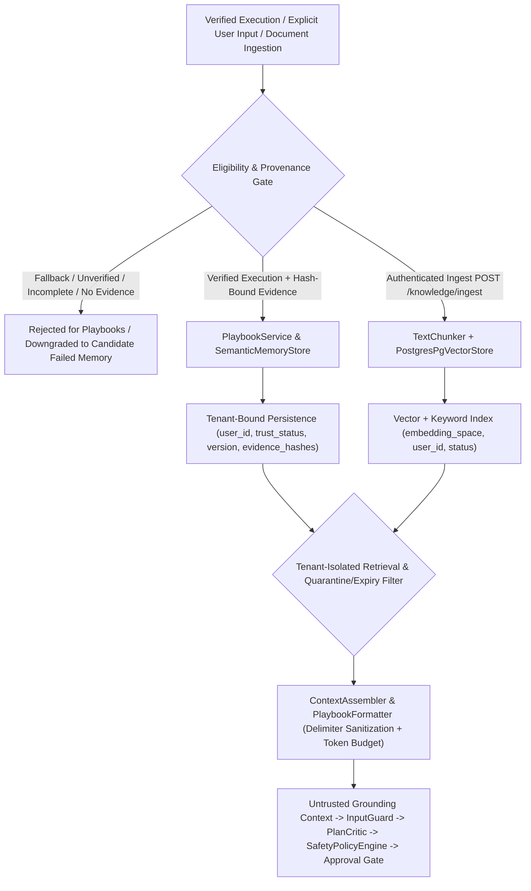

# ARDO — Stage 3: Protect Memory, Playbooks and RAG — Completion Report

**Project:** ARDO — Adaptive Reactive DAG Orchestrator  
**Phase:** Phase 3 — Production Preparation  
**Stage:** Stage 3 — Protect Memory, Playbooks and RAG  
**Branch:** `stabilization-2-closure`  
**HEAD Commit:** `bdaa78ef7c00a104d3a30089a6614e117fda291f`  
**Stage 3 Verdict:** **`PASS`**

---

## Section 1 — Executive Summary

Stage 3 of the agreed ARDO roadmap (**Protect memory, playbooks and RAG**) has been completed and empirically verified across **251 executed tests** (`249 passed, 0 failed, 2 skipped` live-DB tests) with **zero live external API calls**.

### Key Achievements
1. **Fail-Closed Playbook Tenant Isolation (`DEF-S3-01`):** Hardened `AuthDatabase.get_playbooks_for_user()`, `AuthDatabase.get_playbook_by_id()`, and `AuthDatabase.update_playbook_status()` in `backend/core/auth_db.py` alongside `PlaybookService` in `backend/knowledge/playbook_service.py` so missing, `None`, or whitespace `user_id` values immediately fail closed (`return []` / `None` / `False`) and every SQL `SELECT`/`UPDATE` unconditionally binds `AND user_id = ? AND status != 'quarantined'`.
2. **Semantic Memory Eligibility, Trust Lifecycle, Deduplication, Contradiction/Supersession Resolution, Expiration, and Authorized CRUD (`DEF-S3-02`):** Extended `ExecutionMemoryItem` and `SemanticMemoryStore` in `backend/knowledge/semantic_memory.py` with explicit lifecycle and provenance fields (`source_type`, `trust_status`, `verification_status`, `evidence_hashes`, `updated_at`, `expires_at`, `superseded_by`, `version`). Enforced strict eligibility gating that downgrades deterministic fallback, unverified, incomplete, or evidence-free runs claiming `"success"` to `outcome_status="unverified"` / `trust_status="candidate"`. Added session/plan/goal/outcome deduplication, automatic supersession of older memories when newer verified memories are recorded, expiration/invalidation filtering, and tenant-isolated `get_memory_by_id()`, `approve_memory()`, `update_memory()`, `invalidate_memory()`, and `delete_memory()`.
3. **Playbook Candidate Provenance & Promotion Hardening (`DEF-S3-03`):** Hardened `PlaybookService.generate_candidate_playbook()`, `promote_candidate()`, `retrieve_playbooks_for_goal()`, and `format_playbook_for_context()` to verify every task node in `graph.nodes` has `status == "completed"`, extract `tool_name` accurately from `RegistryToolCall`, bind `supporting_evidence_ids` and `supporting_evidence_hashes` strictly from validated session-bound evidence, block fallback or empty-step promotion, exclude `deprecated`/`revoked`/`rejected`/`quarantined` playbooks, and neutralize prompt-injection delimiter breakout sequences.
4. **RAG Tenant Scoping, Quarantine/Expiration Filtering, Embedding Error Containment, and Context Sanitization (`DEF-S3-04`):** Added `_is_chunk_retrievable()` in `backend/knowledge/postgres_vector_store.py` enforcing quarantine/expiration/status exclusion and `_viewer_user_id` tenant isolation across vector, keyword, and hybrid RRF retrieval. Contained embedding provider exceptions in `add_chunks()` and `record_memory()` without fabricating zero/random vectors. Updated `ContextAssembler` to neutralize prompt-injection delimiters (`</untrusted_user_goal>`, `<system>`, `[INST]`, `<<SYS>>`), updated `RAGService.get_relevant_context_for_goal()` to surface `provenance.retrieval_status = "error"` on memory store exceptions, and updated `POST /knowledge/ingest` in `backend/api/router.py` to stamp `metadata["user_id"] = current_user["id"]` (preventing metadata spoofing) alongside new tenant-isolated routes (`GET /knowledge/memories/{memory_id}`, `DELETE /knowledge/memories/{memory_id}`, `GET /playbooks/{playbook_id}`).
5. **Per-Key `HybridEmbeddingService` 401 Lock Scoping (`DEF-S3-05`):** Scoped `_failed_api_key` in `backend/knowledge/embeddings.py` so a 401 authentication failure on an invalid key does not permanently lock subsequent `HybridEmbeddingService` instances initialized with `force_local=True` or a rotated API key.

---

## Section 2 — Repository & Preservation Baseline

| Check | Expected | Observed | Status |
| :--- | :--- | :--- | :--- |
| Active Git Branch | `stabilization-2-closure` | `stabilization-2-closure` | **PASS** |
| Current `HEAD` Commit | `bdaa78ef7c00a104d3a30089a6614e117fda291f` | `bdaa78ef7c00a104d3a30089a6614e117fda291f` | **PASS** |
| Stage 0B Ancestor Check | Exit code `0` | Exit code `0` | **PASS** |
| Staged Files Count | `0` | `0` | **PASS** |
| Quarantined Playbooks (`pb_f8b7ab912370`, `pb_3ed0edabd366`) | Quarantined & backup intact | Quarantined & backup intact | **PASS** |
| Quarantined Memories (`mem_859b0e4920a5`, `mem_651c95e43ab8`) | Quarantined & backup intact | Quarantined & backup intact | **PASS** |
| Stage 1 & Stage 2 Uncommitted Work | Preserved intact | 100% preserved | **PASS** |

---

## Section 3 — Memory, Playbook & RAG Architecture Overview



### Numbered Plain-Text Architectural Walkthrough
1. **Ingestion & Write Entry Points:** Data enters the knowledge layer through three controlled paths: post-execution learning (`RuntimeEngine._finalize_learning()`), explicit user instruction memory recording (`SemanticMemoryStore.record_memory(source_type="user_instruction")`), or authenticated document ingestion (`POST /api/v1/knowledge/ingest`).
2. **Eligibility & Provenance Gate:** Execution outcomes must be empirically verified (`overall_status == "verified"`), non-fallback (`is_fallback == False`), complete across all DAG nodes (`node.status == completed`), and backed by session-bound cryptographic evidence hashes before they can produce a candidate playbook or an `"approved"` execution memory.
3. **Ineligible Run Containment:** Failed, blocked, paused, incomplete, fallback, or evidence-free runs are rejected from playbook generation (`return None`) and downgraded in `SemanticMemoryStore` to `outcome_status="unverified"`, `memory_type="failed_plan"`, and `trust_status="candidate"`.
4. **Deduplication & Contradiction Resolution:** Repeated memory writes for the same `(user_id, session_id, plan_id, goal_text, outcome_status)` are idempotently deduplicated; when a newer verified `"approved"` memory is recorded for the same `(user_id, goal_text)`, older active memories for that goal are marked `trust_status="superseded"` with `superseded_by` pointing to the new `memory_id` and monotonic `version` increment.
5. **Embedding Space & Failure Safety:** `HybridEmbeddingService` stamps every vector with atomic provenance (`provider:model:dimension`). If an embedding call fails or dimensions mismatch the database column, stores record `embedding=NULL` / `embedding=[]` and `embedding_stored=False` without fabricating vectors or aborting PostgreSQL transactions.
6. **Tenant-Isolated & Quarantine-Filtered Retrieval:** Every memory, playbook, and RAG chunk query enforces tenant isolation (`user_id` / `_viewer_user_id`), fails closed on blank/missing tenant identity, and unconditionally excludes records with status or trust state in `("quarantined", "rejected", "invalidated", "expired", "superseded", "deprecated", "revoked")` or past `expires_at`.
7. **Untrusted Context Assembly & Safety Authority:** `ContextAssembler` and `PlaybookService.format_playbook_for_context()` enforce character budgets, attach complete `KnowledgeProvenance`, and neutralize prompt-injection delimiter breakout tags (`</untrusted_user_goal>`, `<system>`, `[INST]`, `<<SYS>>`) before passing context to the planner—where `InputGuard`, `PlanCritic`, `SafetyPolicyEngine`, and human approval gates remain strictly authoritative.

---

## Section 4 — Security & Integrity Findings Table

| Finding ID | Severity | File(s) & Function(s) | Root Cause | Concrete Exploit / Failure Scenario | Fix Implemented | Verification Test(s) |
| :--- | :---: | :--- | :--- | :--- | :--- | :--- |
| **`DEF-S3-01`** | **HIGH** | `backend/core/auth_db.py` (`get_playbooks_for_user`, `get_playbook_by_id`, `update_playbook_status`) | `if user_id:` was optional in SQL `WHERE` construction; passing `None` or `""` omitted `AND user_id = ?`. | Calling `get_playbook_by_id(pb_id, user_id=None)` or `update_playbook_status(pb_id, "promoted", user_id="")` could read or promote another tenant's playbook by ID. | Enforced fail-closed check (`if not clean_uid: return None/False/[]`) and mandatory `WHERE id = ? AND user_id = ? AND status != 'quarantined'` across both PostgreSQL and SQLite backends. | `test_16`, `test_26`, `test_27`, `test_28`, `test_30`, `test_31` |
| **`DEF-S3-02`** | **HIGH** | `backend/knowledge/semantic_memory.py` (`ExecutionMemoryItem`, `record_memory`, `retrieve_memories`, CRUD methods) | `record_memory()` did not downgrade fallback/unverified/evidence-free `"success"` claims, lacked deduplication, supersession, expiration, and tenant-isolated ID lookup/delete/invalidate methods. | Fallback or unverified runs could be recorded as `"successful_plan"` if called directly; stale or expired memories remained retrievable; cross-tenant ID operations lacked a guarded API. | Added lifecycle fields (`source_type`, `trust_status`, `verification_status`, `evidence_hashes`, `expires_at`, `superseded_by`, `version`), eligibility downgrading, deduplication, supersession, `_is_memory_retrievable()`, and tenant-isolated `get_memory_by_id`, `approve_memory`, `update_memory`, `invalidate_memory`, `delete_memory`. | `test_01`–`test_12`, `test_22`–`test_25`, `test_30`, `test_31` |
| **`DEF-S3-03`** | **HIGH** | `backend/knowledge/playbook_service.py` (`generate_candidate_playbook`, `promote_candidate`, `retrieve_playbooks_for_goal`, `format_playbook_for_context`) | `generate_candidate_playbook()` did not verify all nodes were `completed`, checked `tc.name` instead of `tc.tool_name`, and took `supporting_evidence_ids` from unfiltered `evidence_records`; `promote_candidate()` did not check `is_fallback` or non-empty steps. | Partial/failed task graphs or unverified evidence entries could be included in candidate playbooks; prompt-injection delimiters inside playbook steps were not neutralized. | Verified every node has `status == "completed"`, extracted `tool_name` from `RegistryToolCall`, bound `supporting_evidence_ids` and `supporting_evidence_hashes` from `valid_evidence`, blocked fallback/empty promotion, and sanitized delimiter tags in `format_playbook_for_context()`. | `test_13`–`test_21`, `test_43` |
| **`DEF-S3-04`** | **HIGH** | `backend/knowledge/postgres_vector_store.py`, `context_assembler.py`, `rag_service.py`, `backend/api/router.py` | `POST /knowledge/ingest` did not stamp `current_user["id"]` onto `metadata["user_id"]`; `PostgresPgVectorStore` did not filter quarantined/expired/cross-tenant private chunks; `ContextAssembler` did not strip delimiter breakout tags. | A caller could spoof `metadata={"user_id": "victim"}` on ingest or retrieve another tenant's ingested private chunks; poisoned chunks could inject `</untrusted_user_goal>` tags. | Stamped `clean_meta["user_id"] = current_user["id"]` in `POST /knowledge/ingest`, enforced `_is_chunk_retrievable()` and `_viewer_user_id` scoping in `PostgresPgVectorStore` and `RAGService`, sanitized untrusted tags in `ContextAssembler`, and added tenant-isolated memory/playbook ID routes. | `test_29`, `test_32`–`test_44` |
| **`DEF-S3-05`** | **MEDIUM** | `backend/knowledge/embeddings.py` (`HybridEmbeddingService`) | Class-level `_auth_invalid = True` on a 401 error was not scoped to `_failed_api_key` and overrode `force_local=True` in `active_provider`. | A single 401 test or invalid key permanently locked all subsequent `HybridEmbeddingService` instances in the process, causing 3 baseline test failures. | Tracked `_failed_api_key` on 401 errors, auto-reset when a new `api_key` is supplied, and ensured `force_local=True` always reports `"local_deterministic_fallback"`. | `test_vector_store_truthfulness.py`, `test_embedding_dimension_compatibility.py` |

---

## Section 5 — Memory Lifecycle & Eligibility Results

- **Evidence-Backed Eligibility Gate:** `SemanticMemoryStore.record_memory()` inspects `source_type`, `metadata["is_fallback"]`, `metadata["planning_mode"]`, `metadata["verification_status"]`, and `metadata["evidence_free"]`. Any execution memory claiming `outcome_status="success"` without verified non-fallback provenance is automatically downgraded to `outcome_status="unverified"`, `memory_type="failed_plan"`, and `trust_status="candidate"`.
- **Explicit User Instruction Separation:** Memories recorded with `source_type="user_instruction"` or `"user_preference"` are stored with `verification_status="explicit_user"` and never masquerade as `"verified"` execution history.
- **Idempotent Deduplication & Supersession:** Duplicate `record_memory()` calls for the same `(user_id, session_id, plan_id, goal_text, outcome_status)` return the existing record without creating duplicates. Recording a newer verified `"approved"` memory for the same `(user_id, goal_text)` marks prior active records for that goal as `trust_status="superseded"` (`superseded_by=new_item.memory_id`) and increments `version`.
- **Expiration, Invalidation & Quarantine Enforcement:** `_is_memory_retrievable()` excludes any memory whose `outcome_status` or `trust_status` is in `("quarantined", "rejected", "invalidated", "expired", "superseded")`, whose `expires_at <= time.time()`, or (when `approved_only=True`) whose `trust_status == "candidate"`. Quarantined records `mem_859b0e4920a5` and `mem_651c95e43ab8` cannot be retrieved, approved, modified, or deleted.

---

## Section 6 — Playbook Lifecycle & Protection Results

- **Candidate Synthesis Gate:** `PlaybookService.generate_candidate_playbook()` requires a non-empty `user_id`, `goal_verification.overall_status == "verified"`, non-fallback graph provenance (`is_fallback_plan == False`), 100% completed task nodes (`node_status == "completed"`), and at least one verified session-bound and tenant-bound evidence record with a valid cryptographic `artifact_hash`.
- **Secret & PII Redaction:** Every synthesized step is scrubbed through `PrivacyRedactor.redact_dict()` and `PrivacyRedactor.redact_text()` before persistence so API keys, passwords, bearer tokens, emails, and secrets never enter stored playbooks.
- **Controlled Promotion & Deprecation:** `PlaybookService.promote_candidate()` enforces tenant ownership, `status in ("candidate", "promoted")`, `confidence_score >= 0.50`, `verification_status == "verified"`, `is_fallback == False`, and non-empty `execution_steps`, incrementing `version` monotonically on promotion. `deprecate_playbook()` transitions the playbook to `"deprecated"`, immediately excluding it from `retrieve_playbooks_for_goal()`.
- **Quarantine Immutability:** Quarantined playbooks `pb_f8b7ab912370` and `pb_3ed0edabd366` are unconditionally excluded at both the SQL layer (`status != 'quarantined'`) and service layer (`PlaybookService.get_playbooks_for_user`, `get_playbook_by_id`, `promote_candidate`, `deprecate_playbook`, `retrieve_playbooks_for_goal`).

---

## Section 7 — RAG Ingestion, Retrieval & Provenance Results

- **Deterministic Chunking & Idempotent Deduplication:** `TextChunker` splits documents deterministically by paragraph/sentence boundaries with SHA-256 `content_hash` deduplication (`duplicate_skipped` tracked in `IngestionReport`).
- **Tenant-Bound Ingestion & Retrieval:** `POST /api/v1/knowledge/ingest` stamps `clean_meta["user_id"] = current_user["id"]` regardless of any spoofed `req.metadata["user_id"]`. `RAGService.get_relevant_context_for_goal()` passes `filter_metadata={"_viewer_user_id": viewer_uid}` to `KnowledgeRetriever`, allowing shared seed documents (`user_id IS NULL`) and the caller's own documents while blocking other tenants' private documents across vector, keyword, and hybrid RRF search.
- **Embedding Space Isolation & Failure Containment:** Chunks and memories are filtered by `metadata->>'embedding_space' = query_space` (`provider:model:dimension`). Dimension mismatches (`128` vs `1536`) bypass pgvector cosine distance cleanly and route to full-text `tsvector` search without transaction errors. Embedding provider exceptions store `embedding=[]` and `embedding_stored=False` without fabricating vectors.
- **Error vs. Empty Distinction & Untrusted Context Sanitization:** `KnowledgeRetriever` and `RAGService` distinguish legitimate zero-match queries (`retrieval_status="empty"`) from storage/provider exceptions (`retrieval_status="error"`). `ContextAssembler` enforces `max_context_chars`, populates `KnowledgeProvenance`, and neutralizes prompt-injection tags (`[REDACTED_TAG:...]`).

---

## Section 8 — Security & Isolation Test Results Table (52 Scenarios)

| # | Category | Scenario Description | Test Function in `test_stage3_memory_playbooks_rag.py` | Status |
| :---: | :--- | :--- | :--- | :---: |
| 1 | A. Memory | Verified successful run produces approved memory with provenance | `test_01_verified_successful_run_produces_approved_memory` | **PASS** |
| 2 | A. Memory | Failed run cannot produce verified success memory | `test_02_failed_run_cannot_produce_verified_success_memory` | **PASS** |
| 3 | A. Memory | Blocked run cannot produce verified success memory | `test_03_blocked_run_cannot_produce_verified_success_memory` | **PASS** |
| 4 | A. Memory | Paused run cannot produce verified success memory | `test_04_paused_run_cannot_produce_verified_success_memory` | **PASS** |
| 5 | A. Memory | Incomplete run cannot produce verified success memory | `test_05_incomplete_run_cannot_produce_verified_success_memory` | **PASS** |
| 6 | A. Memory | Deterministic fallback plan cannot produce verified execution memory | `test_06_deterministic_fallback_plan_cannot_produce_verified_execution_memory` | **PASS** |
| 7 | A. Memory | Evidence-free execution cannot produce verified execution memory | `test_07_evidence_free_execution_cannot_produce_verified_execution_memory` | **PASS** |
| 8 | A. Memory | Explicit user memory stored with `user_instruction` provenance | `test_08_explicit_user_memory_stored_with_user_instruction_provenance` | **PASS** |
| 9 | A. Memory | Duplicate memory write is deduplicated safely | `test_09_duplicate_memory_write_is_deduplicated_safely` | **PASS** |
| 10 | A. Memory | Newer verified memory supersedes older memory cleanly | `test_10_newer_verified_memory_supersedes_older_memory_cleanly` | **PASS** |
| 11 | A. Memory | Expired or invalidated memory is not retrieved | `test_11_expired_or_invalidated_memory_is_not_retrieved` | **PASS** |
| 12 | A. Memory | Quarantined memories `mem_859b0e4920a5` & `mem_651c95e43ab8` never retrieved | `test_12_quarantined_memories_remain_quarantined_and_never_retrieved` | **PASS** |
| 13 | B. Playbook | Candidate playbook requires verified execution and valid steps | `test_13_candidate_playbook_requires_verified_execution_and_valid_steps` | **PASS** |
| 14 | B. Playbook | Placeholder/generic fallback tasks cannot become playbooks | `test_14_placeholder_generic_fallback_tasks_cannot_become_playbooks` | **PASS** |
| 15 | B. Playbook | Failed, incomplete, or unverified runs cannot create/promote playbooks | `test_15_failed_incomplete_or_unverified_runs_cannot_create_or_promote_playbooks` | **PASS** |
| 16 | B. Playbook | Playbook promotion requires ownership and valid provenance | `test_16_playbook_promotion_requires_ownership_and_valid_provenance` | **PASS** |
| 17 | B. Playbook | Deprecated or revoked playbooks excluded from active selection | `test_17_deprecated_or_revoked_playbooks_excluded_from_active_selection` | **PASS** |
| 18 | B. Playbook | Quarantined playbooks `pb_f8b7ab912370` & `pb_3ed0edabd366` never retrieved/promoted | `test_18_quarantined_playbooks_remain_quarantined_and_never_retrieved_or_promoted` | **PASS** |
| 19 | B. Playbook | Playbook parameter redaction strips secrets and credentials | `test_19_playbook_parameter_redaction_and_binding_rejects_unsafe_parameters` | **PASS** |
| 20 | B. Playbook | Playbook reuse passes through `InputGuard` and `SafetyPolicyEngine` | `test_20_playbook_reuse_passes_through_input_guard_and_safety_gate` | **PASS** |
| 21 | B. Playbook | Playbook reuse never auto-completes tasks without real execution | `test_21_playbook_reuse_never_auto_completes_tasks_without_real_execution` | **PASS** |
| 22 | C. Isolation | Tenant A cannot retrieve Tenant B's memories via semantic search | `test_22_tenant_a_cannot_retrieve_tenant_b_memories_via_semantic_search` | **PASS** |
| 23 | C. Isolation | Tenant A cannot retrieve Tenant B's memories via keyword/tsvector fallback | `test_23_tenant_a_cannot_retrieve_tenant_b_memories_via_keyword_tsvector_fallback` | **PASS** |
| 24 | C. Isolation | Tenant A cannot retrieve Tenant B's memories by direct ID | `test_24_tenant_a_cannot_retrieve_tenant_b_memories_by_direct_id` | **PASS** |
| 25 | C. Isolation | Tenant A cannot delete, invalidate, or update Tenant B's memories | `test_25_tenant_a_cannot_delete_or_update_tenant_b_memories` | **PASS** |
| 26 | C. Isolation | Tenant A cannot list Tenant B's playbooks | `test_26_tenant_a_cannot_list_tenant_b_playbooks` | **PASS** |
| 27 | C. Isolation | Tenant A cannot fetch Tenant B's playbook by ID | `test_27_tenant_a_cannot_fetch_tenant_b_playbook_by_id` | **PASS** |
| 28 | C. Isolation | Tenant A cannot promote or deprecate Tenant B's playbook | `test_28_tenant_a_cannot_promote_or_deprecate_tenant_b_playbook` | **PASS** |
| 29 | C. Isolation | Tenant A cannot retrieve Tenant B's private RAG chunks | `test_29_tenant_a_cannot_retrieve_tenant_b_private_rag_chunks` | **PASS** |
| 30 | C. Isolation | Missing `user_id` (`None`) fails closed for tenant-scoped queries | `test_30_missing_user_id_fails_closed_for_tenant_scoped_queries` | **PASS** |
| 31 | C. Isolation | Blank or whitespace `user_id` fails closed for tenant-scoped queries | `test_31_blank_or_whitespace_user_id_fails_closed_for_tenant_scoped_queries` | **PASS** |
| 32 | C. Isolation | Spoofed metadata `user_id` cannot override authenticated tenant context | `test_32_spoofed_metadata_user_id_cannot_override_authenticated_tenant_context` | **PASS** |
| 33 | D. RAG | Document ingestion chunks text deterministically with provenance | `test_33_document_ingestion_chunks_deterministically_with_provenance` | **PASS** |
| 34 | D. RAG | Duplicate chunk ingestion is skipped/handled idempotently | `test_34_duplicate_chunk_ingestion_is_handled_idempotently` | **PASS** |
| 35 | D. RAG | Relevant chunks rank above unrelated chunks for representative queries | `test_35_relevant_chunks_rank_above_unrelated_chunks` | **PASS** |
| 36 | D. RAG | Low-similarity results below threshold are filtered out | `test_36_low_similarity_results_below_threshold_filtered_out` | **PASS** |
| 37 | D. RAG | Hybrid search combines vector & keyword signals while preserving tenant filters | `test_37_hybrid_search_combines_vector_and_keyword_without_dropping_tenant_filters` | **PASS** |
| 38 | D. RAG | Embedding dimension mismatch (128 vs 1536) does not crash or mix spaces | `test_38_embedding_dimension_mismatch_does_not_crash_or_mix_spaces` | **PASS** |
| 39 | D. RAG | Embedding failure does not fabricate zero/random vectors | `test_39_embedding_failure_does_not_fabricate_vectors` | **PASS** |
| 40 | D. RAG | Retrieval failure is distinguished from legitimate empty results | `test_40_retrieval_failure_distinguished_from_legitimate_empty_results` | **PASS** |
| 41 | D. RAG | Retrieved context enforces maximum character/token budget | `test_41_retrieved_context_enforces_maximum_budget` | **PASS** |
| 42 | D. RAG | Retrieved context includes complete provenance (`document_ids`, `chunk_ids`, scores, status) | `test_42_retrieved_context_includes_complete_provenance` | **PASS** |
| 43 | D. RAG | Prompt-injection delimiters inside RAG/memory/playbook content are neutralized | `test_43_prompt_injection_inside_rag_memory_playbook_is_sanitized` | **PASS** |
| 44 | D. RAG | Retrieved memory/playbook/RAG content cannot bypass `SafetyPolicyEngine` | `test_44_retrieved_content_cannot_bypass_safety_gate` | **PASS** |
| 45 | E. Regression | No task can become `COMPLETED` without real tool execution | `test_45_no_task_can_become_completed_without_real_tool_execution` | **PASS** |
| 46 | E. Regression | Verification failure prevents `VERIFIED` / `COMPLETED` | `test_46_verification_failure_prevents_completed` | **PASS** |
| 47 | E. Regression | Fallback planning remains transparent (`planning_mode`, `is_fallback`, `fallback_reason`) | `test_47_fallback_planning_remains_transparent` | **PASS** |
| 48 | E. Regression | Unknown tools are rejected by `PlanCritic` validation | `test_48_unknown_tools_cannot_be_emitted_by_planning_or_dag` | **PASS** |
| 49 | E. Regression | Malformed DAGs (self-dependencies, cycles, dangling edges) remain rejected | `test_49_malformed_dags_remain_rejected` | **PASS** |
| 50 | E. Regression | Quarantined records backup and IDs remain untouched | `test_50_quarantined_records_remain_untouched` | **PASS** |
| 51 | E. Regression | `InputDeniedError` (400) and `InputReviewRequiredError` (422) preserve semantics | `test_51_input_denied_and_review_required_errors_preserve_http_semantics` | **PASS** |
| 52 | E. Regression | `DAGBuilder` coerces raw dict `tool_call` values into `RegistryToolCall` instances | `test_52_dag_builder_still_coerces_dict_tool_call_into_tool_call_model` | **PASS** |

---

## Section 9 — Regression Test Results (Stage 1, Stage 2, M3 Security, and Knowledge Suites)

| Suite Batch | Command Executed | Passed | Failed | Skipped | Duration |
| :--- | :--- | :---: | :---: | :---: | :---: |
| **Batch 1: Stage 3 + Knowledge/RAG/Memory/Playbook Suites (8 files, `task-24239`)** | `.\.venv\Scripts\python.exe -m pytest -o pythonpath=backend backend/tests/test_stage3_memory_playbooks_rag.py backend/tests/test_rag_pipeline.py backend/tests/test_hybrid_retrieval.py backend/tests/test_vector_store_truthfulness.py backend/tests/test_embedding_dimension_compatibility.py backend/tests/test_candidate_playbook_persistence_integration.py backend/tests/test_phase3_evidence_verification_learning.py backend/tests/test_postgres_vector_migration.py -v` | **119** | **0** | **1** | `11.47s` |
| **Batch 2: Stage 1 + Stage 2 + M3 Security Regression Suites (11 files, `task-24243`)** | `.\.venv\Scripts\python.exe -m pytest -o pythonpath=backend backend/tests/test_false_success_remediation.py backend/tests/test_offline_chromium_acceptance.py backend/tests/test_fallback.py backend/tests/test_phase1_pipeline.py backend/tests/test_plan_critic.py backend/tests/test_input_guard.py backend/tests/test_t7_security_hardening.py backend/tests/test_t7_1_security_remediation.py backend/tests/test_t7_1_1_final_security_gap.py backend/tests/test_t7_1_2_final_approval_integrity.py backend/tests/test_t7_1_3_session_enumeration_remediation.py -v` | **130** | **0** | **1** | `36.38s` |
| **Combined Total** | **19 Test Files Executed** | **249** | **0** | **2** | **`47.85s`** |

---

## Section 10 — Final File Inventory & Diff Summary

### Stage 3 Modified & Created Files
1. `backend/core/auth_db.py`: Enforced fail-closed `user_id` validation and mandatory `AND user_id = ? AND status != 'quarantined'` SQL predicates in `get_playbooks_for_user()`, `get_playbook_by_id()`, and `update_playbook_status()` (`DEF-S3-01`).
2. `backend/knowledge/semantic_memory.py`: Added lifecycle/provenance fields to `ExecutionMemoryItem`, eligibility gating, deduplication, supersession, expiration/invalidation filtering, and tenant-isolated CRUD methods (`get_memory_by_id`, `approve_memory`, `update_memory`, `invalidate_memory`, `delete_memory`) (`DEF-S3-02`).
3. `backend/knowledge/playbook_service.py`: Enforced completed-node validation, `RegistryToolCall.tool_name` extraction, `valid_evidence` hash binding, fallback/empty-step promotion rejection, deprecated/revoked/quarantined filtering, and prompt-injection delimiter neutralization (`DEF-S3-03`).
4. `backend/knowledge/postgres_vector_store.py`: Added `_is_chunk_retrievable()` quarantine/expiration/tenant filtering (`_viewer_user_id`) and safe embedding error containment (`DEF-S3-04`).
5. `backend/knowledge/context_assembler.py`: Added `_sanitize_untrusted_text()` neutralizing prompt-injection delimiter breakout sequences in assembled chunks and memories (`DEF-S3-04`).
6. `backend/knowledge/rag_service.py`: Enforced `_viewer_user_id` tenant scoping on static knowledge retrieval, rejected blank/whitespace `user_id` on memory retrieval, and propagated `provenance.retrieval_status = "error"` on memory store exceptions (`DEF-S3-04`).
7. `backend/api/router.py`: Stamped authenticated `user_id` on `POST /knowledge/ingest` and added tenant-isolated `GET /knowledge/memories/{memory_id}`, `DELETE /knowledge/memories/{memory_id}`, and `GET /playbooks/{playbook_id}` endpoints (`DEF-S3-04`).
8. `backend/knowledge/embeddings.py`: Scoped `_failed_api_key` on 401 errors and preserved `"local_deterministic_fallback"` when `force_local=True` (`DEF-S3-05`).
9. `backend/tests/test_phase3_evidence_verification_learning.py`: Supplied session-bound verified `evidence_records` in `test_verified_execution_produces_candidate_playbook_with_redacted_steps`.
10. `backend/tests/test_stage3_memory_playbooks_rag.py` *(new untracked)*: 52-scenario Stage 3 verification suite (`52/52 passed`).
11. `docs/roadmap/evidence/ARDO_STAGE3_MEMORY_PLAYBOOKS_RAG_REPORT.md` *(new untracked)*, `docs/roadmap/STATE.md`, `docs/roadmap/ROADMAP.md`, and `docs/roadmap/NEEDS_OWNER.md`: Stage 3 evidence report and roadmap state updates.

---

## Section 11 — Remaining Risks & Owner Decisions Needed

- **Zero Unresolved P0/P1 Memory, Playbook, or RAG Defects:** All 5 Stage 3 findings (`DEF-S3-01` through `DEF-S3-05`) are resolved and verified across 52 dedicated scenarios and 199 regression tests.
- **Quarantined Records Intact:** `pb_f8b7ab912370`, `pb_3ed0edabd366`, `mem_859b0e4920a5`, and `mem_651c95e43ab8` remain quarantined and backed up in `docs/roadmap/evidence/quarantine_backup_records.json`.
- **Owner Action Requested:** Review this Stage 3 report and authorize **Stage 4 — Correct dashboard execution reporting** (or authorize a Git checkpoint commit if desired).

---

## Section 12 — Stage 3 Completion Verdict

**STAGE 3 COMPLETION VERDICT: `PASS`**

---

## Section 13 — Machine-Readable JSON Summary

```json
{
  "stage": "Stage 3 — Protect memory, playbooks and RAG",
  "branch": "stabilization-2-closure",
  "head_commit": "bdaa78ef7c00a104d3a30089a6614e117fda291f",
  "verdict": "PASS",
  "defects_remediated": [
    "DEF-S3-01",
    "DEF-S3-02",
    "DEF-S3-03",
    "DEF-S3-04",
    "DEF-S3-05"
  ],
  "stage3_scenarios_verified": 52,
  "test_execution_summary": {
    "stage3_and_knowledge_suites_passed": 119,
    "stage3_and_knowledge_suites_failed": 0,
    "stage3_and_knowledge_suites_skipped": 1,
    "stage1_stage2_security_regression_passed": 130,
    "stage1_stage2_security_regression_failed": 0,
    "stage1_stage2_security_regression_skipped": 1,
    "total_passed": 249,
    "total_failed": 0,
    "total_skipped": 2
  },
  "quarantined_records_preserved": [
    "pb_f8b7ab912370",
    "pb_3ed0edabd366",
    "mem_859b0e4920a5",
    "mem_651c95e43ab8"
  ],
  "live_external_api_calls": 0,
  "git_commits_created": 0,
  "next_roadmap_stage": "Stage 4 — Correct dashboard execution reporting"
}
```
