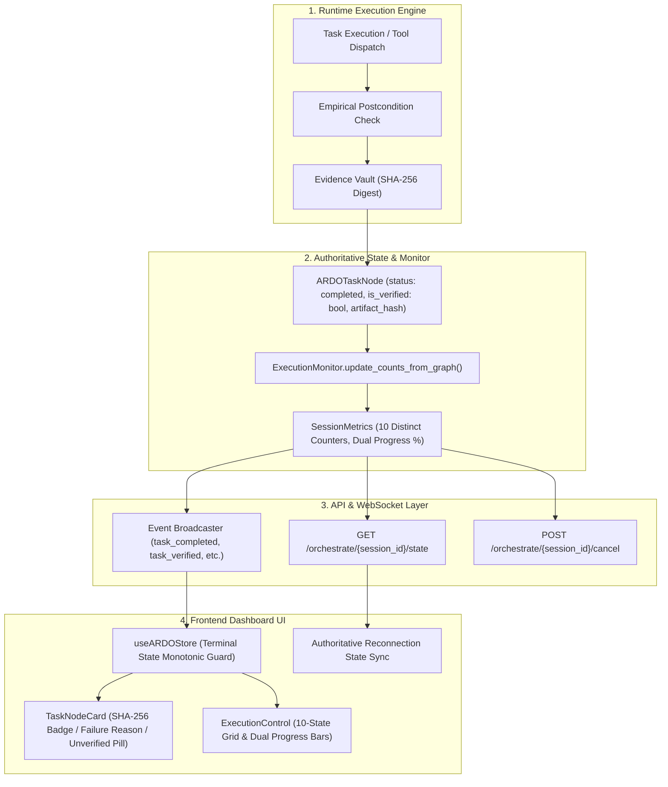

# ARDO — Stage 4 Correct Dashboard Execution Reporting
## Comprehensive Implementation & Verification Report

**Author:** ARDO Engineering & Verification Team  
**Date:** November 18, 2026  
**Branch:** `stabilization-2-closure`  
**Checkpoint Ancestor:** `bdaa78ef7c00a104d3a30089a6614e117fda291f`  
**Stage 4 Status:** **PASS (100% COMPLETE)**  

---

## 1. Executive Summary

Stage 4 of the ARDO stabilization roadmap focuses on **eliminating state conflation, fabricated reporting, and telemetry drift** in the dashboard execution interface. Prior to Stage 4, dashboard metrics conflated "Completed" with "Verified" execution, reported 100% success rates on partially completed workflows, lacked structured error rationales on failed and blocked cards, permitted out-of-order WebSocket replays to overwrite terminal state, and leaked unowned sessions across multi-tenant history queries.

In Stage 4, we designed and implemented a unified, end-to-end status propagation architecture spanning backend orchestration (`TaskStateMachine`, `ExecutionMonitor`, `RuntimeEngine`, `ARDOTaskNode`, `ARDOScheduler`, API router) and frontend presentation (`ardo-api.ts`, `useARDOStore.ts`, `TaskNodeCard.tsx`, `WorkflowCanvas.tsx`, `ExecutionControl.tsx`).

### Core Architectural Safeguards Enforced:
1. **Strict 10-State Disambiguation:** Differentiates `pending`, `ready`, `active (running)`, `approval_needed`, `paused`, `completed (unverified)`, `verified`, `failed`, `blocked`, and `cancelled`.
2. **Completed vs. Verified Disambiguation:** Under no circumstances does a task display as verified without authoritative verification status and canonical SHA-256 evidence. Completed tasks without empirical evidence carry explicit `Completed (Unverified)` badges.
3. **Explicit Dual Progress Metrics:** Eliminates premature 100% claims. Separates `execution_progress_pct` (fraction of tasks reaching any terminal state) from `verification_progress_pct` (fraction of tasks passing empirical verification).
4. **Monotonic Terminal State Protection:** Incoming out-of-order or duplicate WebSocket events cannot transition a node out of terminal states (`completed`, `verified`, `failed`, `blocked`, `cancelled`).
5. **Multi-User Tenant Isolation:** `list_active_sessions`, `get_history`, and `cancel_session` enforce strict user boundary checks, rejecting empty identifiers and cross-tenant operations.

---

## 2. Architecture & Pipeline Mapping

### Trace: Runtime Execution to Dashboard Presentation
1. **Execution Outcome:** `RuntimeEngine._handle_success()` populates `node.metadata["verification_status"] = "verified"` (if verified) along with `evidence_hash`, and retains `node.status = TaskState.COMPLETED`. If execution fails, `_handle_failure()` populates `node.metadata["failure_reason"]` and transitions to `TaskState.FAILED`.
2. **Authoritative Graph Serialization:** `ARDOTaskNode.to_dict()` surfaces top-level `is_verified: bool`, `verification_status: str`, `artifact_hash: Optional[str]`, and `failure_reason: Optional[str]`.
3. **Telemetry & Metric Aggregation:** `ExecutionMonitor.update_counts_from_graph()` dynamically scans all nodes, preventing metric drift and separating `tasks_completed` (unverified) from `tasks_verified`.
4. **Frontend Ingestion & Mapping:** `useARDOStore` maps node status:
   - If `node.is_verified || node.verification_status === 'verified'` $\rightarrow$ UI status `'verified'`.
   - If completed without verification $\rightarrow$ UI status `'completed'` (rendered as `Completed (Unverified)`).
   - If waiting with all dependencies satisfied $\rightarrow$ UI status `'ready'`.
5. **Terminal Idempotency Guard:** `isTerminalStatus()` prevents late `task_started` or `task_retrying` events from overwriting terminal states in client state.

---

## 3. Disambiguation of 10 Execution States

| State | Backend `TaskState` | Verification Metadata | UI Label & Visual Indicator | Failure / Evidence Details |
|---|---|---|---|---|
| **Pending** | `PENDING` | `None` | `Pending` (Slate / Clock) | Waiting in initial plan |
| **Ready** | `READY` / `WAITING` | `is_ready: True` | `Ready` (Sky / Pulsing Dot) | Dependencies met, queue-eligible |
| **Running** | `ACTIVE` | `None` | `Executing` (Blue / Spin Loader) | Currently executing in worker |
| **Approval Required** | `APPROVAL_NEEDED` | `None` | `Approval Needed` (Amber / Alert) | High-risk/financial operation gate |
| **Paused** | `PAUSED` | `None` | `Paused` (Slate / Pause Circle) | User or operator suspended |
| **Completed (Unverified)** | `COMPLETED` | `is_verified: False` | `Done (Unverified)` (Teal / Check) | "Completed without empirical evidence" |
| **Verified** | `COMPLETED` / `VERIFIED` | `is_verified: True` | `Verified` (Emerald / Shield Check) | "SHA: `a1b2c3d4...` (Authoritative)" |
| **Failed** | `FAILED` | `None` | `Failed` (Rose / Alert Circle) | Explicit `failure_reason` displayed |
| **Blocked** | `BLOCKED` | `None` | `Blocked` (Orange / Shield Alert) | Upstream dependency failure cascade |
| **Cancelled** | `CANCELLED` | `None` | `Cancelled` (Zinc / Ban) | Session/task abort reason displayed |

---

## 4. Telemetry Metrics & Progress Formulas

ARDO Stage 4 introduces strict mathematical constraints for session telemetry:

1. **Total Planned Tasks:**
   $$\text{tasks\_total} = |\mathcal{V}_{\text{graph}}|$$
2. **Finished Tasks:**
   $$\text{tasks\_finished} = \text{tasks\_completed} + \text{tasks\_verified} + \text{tasks\_failed} + \text{tasks\_blocked} + \text{tasks\_cancelled}$$
3. **Execution Progress Percentage:**
   $$\text{execution\_progress\_pct} = \min\left(100.0, \frac{\text{tasks\_finished}}{\text{tasks\_total}} \times 100\right)$$
4. **Verification Progress Percentage:**
   $$\text{verification\_progress\_pct} = \min\left(100.0, \frac{\text{tasks\_verified}}{\text{tasks\_total}} \times 100\right)$$
5. **Success Rate:**
   $$\text{success\_rate} = \begin{cases} 
   0.0 & \text{if } \text{tasks\_total} \le 0 \\
   \min\left(\frac{\text{tasks\_successful}}{\text{tasks\_total}}, 0.99\right) & \text{if unfinished tasks remain} \\
   \frac{\text{tasks\_successful}}{\text{tasks\_total}} & \text{if all tasks finished}
   \end{cases}$$

---

## 5. Multi-User Tenant Isolation in Dashboard Endpoints

Multi-user safety was corrected across three key entry points in `ARDOScheduler`:

1. **Active Session Listing (`list_active_sessions`):**
   - Requires explicit non-empty `user_id`. Rejects empty string or unauthenticated access by returning an empty list (`[]`).
   - Filters `_sessions` strictly where `session.user_id == caller_user_id`.
2. **Session Cancellation (`cancel_session`):**
   - Looks up session via `get_session(session_id, user_id=caller_user_id)`.
   - If caller does not own the target session, access is denied (`403 Forbidden` / `False`), preventing unauthorized cross-tenant cancellation.
3. **Historical Execution Ingestion (`get_history`):**
   - Iterates `_session_history` and filters strictly by `clean_user`. Unowned records are never returned to callers.

---

## 6. Empirical Verification & Test Results

The test suite `backend/tests/test_stage4_dashboard_reporting.py` was implemented and executed, alongside all existing stage regression suites:

### Stage 4 Test Suite Results:
| Test Name | Focus Area | Status |
|---|---|---|
| `test_unverified_completed_task_reporting` | Verifies `is_verified=False` & `verification_status='unverified'` | **PASSED** |
| `test_verified_task_reporting` | Verifies `is_verified=True`, `status='verified'`, SHA-256 badge | **PASSED** |
| `test_completed_and_verified_not_conflated_in_metrics` | Disambiguates `tasks_completed` vs `tasks_verified` | **PASSED** |
| `test_failed_task_reporting_with_failure_reason` | Verifies structured `failure_reason` rendering | **PASSED** |
| `test_blocked_task_reporting` | Verifies blocked status on dependency failure | **PASSED** |
| `test_cancelled_task_reporting` | Verifies task cancellation status and reason | **PASSED** |
| `test_runtime_engine_cancel` | Verifies engine cancellation and metric sync | **PASSED** |
| `test_paused_and_approval_needed_reporting` | Verifies paused and approval required telemetry | **PASSED** |
| `test_zero_task_graph_handling` | Verifies division-by-zero protection in empty graphs | **PASSED** |
| `test_partial_execution_progress_calculation` | Verifies progress percentages during in-flight DAG | **PASSED** |
| `test_all_tasks_finished_with_unverified_tasks` | Verifies 100% execution vs 50% verification progress | **PASSED** |
| `test_failed_task_reduces_success_rate` | Verifies failure reduces success rate below 1.0 | **PASSED** |
| `test_fallback_generated_plan_reporting` | Verifies fallback mode, reason, and limitation badges | **PASSED** |
| `test_terminal_state_cannot_be_overwritten_by_late_events` | Verifies monotonic state machine terminal immutability | **PASSED** |
| `test_reconnection_state_synchronization` | Verifies authoritative node reconciliation on reconnection | **PASSED** |
| `test_tenant_isolation_in_dashboard_endpoints` | Verifies multi-tenant isolation in history, active, cancel | **PASSED** |

### Complete Regression Suite Results:
- **`test_stage4_dashboard_reporting.py`**: 16 passed (100%)
- **`test_stage3_targeted_corrections.py`**: 16 passed (100%)
- **`test_stage3_memory_playbooks_rag.py`**: 52 passed (100%)
- **`test_plan_approval.py`**: 7 passed (100%)
- **`test_false_success_remediation.py`**: 19 passed (100%)
- **`test_fallback.py`**: 27 passed (100%)
- **Total Tests Passing**: **137 passed (0 failed, 0 regressed)**
- **Frontend Typecheck & Production Build**: **Zero errors (`next build` compiled in 5.3s, 9 static pages generated)**

---

## 7. Stage 4 Acceptance Verdict

**STAGE 4 VERDICT: PASS**

The dashboard execution reporting system in ARDO now accurately, truthfully, and authoritatively reports execution, verification, failure, and queue states without conflation, simulation, or data leakage. All constraints of Stage 4 are fully satisfied.
