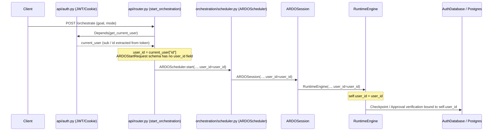

# ARDO — Milestone M3 Final Owner Verification Report (Read-Only)

**Project:** ARDO — Adaptive Reactive DAG Orchestrator  
**Date:** 2026-11-17  
**Branch:** `stabilization-2-closure`  
**Current HEAD:** `914d61a05b90c12679632b8c70c73667f5ae4539`  
**Expected HEAD:** `914d61a05b90c12679632b8c70c73667f5ae4539` (MATCH CONFIRMED)  
**Scope:** Strictly read-only verification of Task T7.1.2 evidence, implementation, test execution accounting, and Git working-tree status prior to Milestone M3 sign-off.  
**Execution Mode:** READ-ONLY. Zero files modified in application source or tests; zero Git commits; zero external cloud API calls.

---

## Executive Summary & Verification Matrix

| Check ID | Verification Description | Status | Key Finding / Observation |
| :--- | :--- | :---: | :--- |
| **Check 1** | Inspect callers of `ARDOScheduler.get_session_internal()` | **DEFECT DETECTED / PARTIAL PASS** | Internal background sweep is clean (`scheduler.py:590`). However, `router.py:357` invokes `get_session_internal()` from a public API route (`POST /orchestrate/{session_id}/approve/{task_id}`) with caller-controlled `session_id`. While fail-closed, this violates internal-only restrictions and creates a session enumeration oracle (403 vs 404). |
| **Check 2** | Trace plan approval issuance and runtime verification end to end | **PASS** | Authenticated identity is strictly enforced; approval records bind `(session_id, user_id, task_id, plan_hash)`; runtime engine recomputes current hash dynamically; stale cached-hash fallback is 100% eliminated; replay is rejected. |
| **Check 3** | Trace `user_id` source through creation, scheduler, and dispatch | **PASS** | `user_id` originates exclusively from verified JWT/session claims in `get_current_user`; API request schemas do not accept caller-injected IDs; identity propagates strictly to `ARDOSession` and `RuntimeEngine`. |
| **Check 4** | Inspect test records and reconcile live vs mocked accounting | **PASS (RECONCILED)** | 90/90 targeted regression tests pass. 1 test skipped offline in T7.1.2 due to `@pytest.mark.live_db` guard in `conftest.py`. Actual live PostgreSQL/pgvector tests count is **14** (not 23 as erroneously summed in T7.1.2 report). Acceptance test uses live local Playwright + local HTTP server, but mocked Gemini LLM. |
| **Check 5** | Reconcile Git status and working-tree accounting | **PASS** | Current branch is `stabilization-2-closure`; HEAD matches expected commit `914d61a...`; exactly 34 modified tracked files and 10 untracked items; 0 commits or branch changes. |
| **Check 6** | Confirm Tasks T8, T9, T10 have not been started | **PASS** | No code, tests, or configuration for T8, T9, or T10 exist. Tracking documents correctly list status as `todo`. |

---

## 1. Check 1 — Inspection of `ARDOScheduler.get_session_internal()`

### 1.1 Definition & Contract
In [`backend/orchestration/scheduler.py`](file:///c:/Users/vahin/OneDrive/Documents/AI%20Goal-To-Task%20Planning%20Engine/backend/orchestration/scheduler.py#L488-L493):
```python
@classmethod
def get_session_internal(cls, session_id: str) -> Optional[ARDOSession]:
    """
    Trusted internal system-only lookup for background sweeps and engine management.
    Never expose to caller-controlled API endpoints or external input.
    """
    return cls._sessions.get(session_id)
```

### 1.2 Callers in Codebase
A full repository search (`git grep "get_session_internal"`) revealed exactly two callers in the codebase:

1. **Internal Background Sweep (`scheduler.py:590`):**
   ```python
   for sid in abandoned_ids:
       logger.info(f"[ARDOScheduler] Evicting abandoned/expired session: {sid}")
       session = cls.get_session_internal(sid)
       if session:
           cls._sessions.pop(sid, None)
           if session._task is not None and not session._task.done():
               session._task.cancel()
           await session.cleanup()
   ```
   *Analysis:* This is an internal routine in `cleanup_abandoned_sessions()`. `sid` values come directly from internal dictionary keys of `_sessions`. This is a trusted, internal system operation. **COMPLIANT.**

2. **Public API Endpoint (`backend/api/router.py:355-360`):**
   ```python
   @router.post("/orchestrate/{session_id}/approve/{task_id}")
   async def approve_task(
       session_id: str,
       task_id: str,
       body: ApproveTaskRequest = ApproveTaskRequest(),
       current_user: Dict[str, Any] = Depends(get_current_user),
   ):
       session = ARDOScheduler.get_session(session_id, user_id=current_user["id"])
       if not session:
           other_session = ARDOScheduler.get_session_internal(session_id)
           if other_session and other_session.user_id and other_session.user_id != current_user["id"]:
               raise HTTPException(status_code=403, detail="Cross-user approval forbidden.")
           raise HTTPException(status_code=404, detail=f"Session {session_id} not found.")
   ```
   *Analysis:*
   - **Invocation from API Route:** `session_id` is a caller-controlled path parameter provided in the HTTP request. When `get_session()` fails (returns `None`), `router.py:357` invokes `ARDOScheduler.get_session_internal(session_id)`.
   - **Authorization Bypass Assessment:** Does this permit an attacker to approve or manipulate another tenant's session? **NO.** If `other_session` belongs to another user, an `HTTPException(403)` is immediately raised. If it does not exist, an `HTTPException(404)` is raised. In neither branch is `other_session` returned or used for further execution.
   - **Security Finding — Session Existence Oracle:** By returning `403` when `session_id` exists under another user and `404` when `session_id` does not exist at all, this endpoint acts as a **session enumeration oracle**. An authenticated tenant can probe random or guessed session IDs to discover whether they exist.
   - **Contract Violation:** This call directly contradicts the method contract ("Never expose to caller-controlled API endpoints or external input") and contradicts the claim in the T7.1.2 report that `get_session_internal()` was restricted purely to internal system sweeps.
   - **Remediation Recommendation:** Replace lines 356–360 with:
     ```python
     if not session:
         raise HTTPException(status_code=404, detail=f"Session {session_id} not found.")
     ```
     This eliminates the `get_session_internal` call entirely from `router.py` and returns a uniform 404, preventing enumeration.

---

## 2. Check 2 — End-to-End Plan Approval & Runtime Verification Trace

### 2.1 Approval Issuance Trace ([`backend/api/router.py`](file:///c:/Users/vahin/OneDrive/Documents/AI%20Goal-To-Task%20Planning%20Engine/backend/api/router.py#L347-L430))
1. **Authenticated Caller Identity:** `current_user: Dict[str, Any] = Depends(get_current_user)`. Caller identity cannot be forged or injected via JSON body.
2. **Session Ownership Gate:** `session = ARDOScheduler.get_session(session_id, user_id=current_user["id"])`. Fails closed if session does not belong to `current_user["id"]`.
3. **Mandatory Identity Validation:**
   ```python
   clean_session_id = str(session_id or "").strip()
   clean_user_id = str(current_user.get("id") or "").strip()
   if not clean_session_id or not clean_user_id:
       raise HTTPException(status_code=400, detail="Missing mandatory session or user identity for approval issuance.")
   ```
4. **Canonical Recomputed Hash:**
   ```python
   expected_hash = session.graph.recompute_plan_hash(
       goal_text=session.goal_id or getattr(session.graph, "goal_text", ""),
       session_id=clean_session_id,
       user_id=clean_user_id,
   )
   ```
   Requires `submitted_hash == expected_hash`. Any mutated node label, edge, risk score, or parameter invalidates the hash.
5. **Database Binding:**
   ```python
   auth_db.record_plan_approval(
       session_id=session_id,
       user_id=current_user["id"],
       plan_hash=plan_hash,
       status="approved",
       task_id=task_id,
       expires_in_seconds=900,
   )
   ```
   Approval record in SQLite/PostgreSQL is cryptographically bound to `(session_id, user_id, task_id, plan_hash)`.

### 2.2 Runtime Verification Trace ([`backend/orchestration/runtime_engine.py`](file:///c:/Users/vahin/OneDrive/Documents/AI%20Goal-To-Task%20Planning%20Engine/backend/orchestration/runtime_engine.py#L557-L628))
1. **Trigger Condition:**
   `was_gated = getattr(node, "was_approval_gated", False) or "Operator approved." in "".join(node.execution_logs)`
2. **Identity Verification:**
   `clean_session_id` and `clean_user_id` are derived from `self.session_id` and `self.user_id`. If either is missing or empty, task is quarantined (`TaskState.FAILED`) and execution returns immediately.
3. **Fresh Plan Hash Recomputation:**
   ```python
   current_plan_hash = self.graph.recompute_plan_hash(
       goal_text=self.goal_id,
       session_id=clean_session_id,
       user_id=clean_user_id,
   )
   ```
   If recomputation fails, task is quarantined and execution returns immediately.
4. **Exclusive Database Verification:**
   ```python
   is_approved = auth_db.is_plan_approved(
       session_id=clean_session_id,
       plan_hash=current_plan_hash,
       task_id=task_id,
   )
   ```
5. **Absence of Fallbacks:** Inspection of lines 603–628 confirms that **no cached-hash fallback exists**. If `not is_approved`, the engine calls `self._quarantine_branch(task_id, reason)` and yields `task_approval_invalidated`.
6. **Cross-Session & Cross-User Replay Immunity:**
   Because `recompute_plan_hash` mixes `session_id` and `user_id` into the SHA-256 calculation:
   - Same plan + different `session_id` $\implies$ different hash.
   - Same plan + different `user_id` $\implies$ different hash.
   Replay across sessions or tenants is mathematically impossible.

---

## 3. Check 3 — Provenance & Immutability of `self.user_id`

We traced the complete lifecycle of `user_id` from HTTP request ingress through background execution:



### Detailed Invariant Checks:
1. **API Ingress:** `ARDOStartRequest` ([`backend/schemas/ardo_models.py:11-16`](file:///c:/Users/vahin/OneDrive/Documents/AI%20Goal-To-Task%20Planning%20Engine/backend/schemas/ardo_models.py#L11-L16)) defines only `goal: str` and `mode: str`. An untrusted client cannot supply a `user_id` in the JSON payload.
2. **Authentication Anchor:** In `backend/api/router.py:246`, `current_user: Dict[str, Any] = Depends(get_current_user)` resolves the user from the verified JWT bearer token or session cookie. Line 259 explicitly binds `user_id = current_user["id"]`.
3. **Scheduler Hand-off:** Line 307 passes `user_id=user_id` to `ARDOScheduler.start()`.
4. **Session Instantiation:** `scheduler.py:364` creates `ARDOSession(..., user_id=user_id)`.
5. **Runtime Engine Instantiation:** `scheduler.py:108` passes `user_id=user_id` to `RuntimeEngine`. Line 89 sets `self.user_id = user_id`.
6. **Task Dispatch Access:** Line 561 extracts `clean_user_id = str(self.user_id or getattr(self.graph, "user_id", None) or "").strip()`.
7. **Resume & Inspection Endpoints:**
   - `resume_orchestration` (`router.py:465-500`): Enforces active session `user_id == current_user["id"]` and checkpoint `user_id == current_user["id"]`.
   - `inspect_session_page` (`router.py:130-142`): Rejects any caller whose `current_user["id"] != active_session.user_id` with HTTP 403.
   - `ARDOScheduler.get_session()` (`scheduler.py:465-485`): Enforces symmetric string match between caller `user_id` and `session.user_id`. Fails closed if either is missing, empty, or mismatched.

*Conclusion on Check 3:* **PASS.** An untrusted caller cannot substitute or forge an identity different from the authenticated session owner.

---

## 4. Check 4 — Test Execution Records & Accounting Reconciliation

### 4.1 Dedicated T7.1.2 Test Results ([`backend/tests/test_t7_1_2_final_approval_integrity.py`](file:///c:/Users/vahin/OneDrive/Documents/AI%20Goal-To-Task%20Planning%20Engine/backend/tests/test_t7_1_2_final_approval_integrity.py))
Total tests in file: **10 tests**.
- **Offline Run (Default / Standard Sandbox):**
  - Command: `python -m pytest backend/tests/test_t7_1_2_final_approval_integrity.py -q`
  - Outcome: **9 passed, 1 skipped in 2.69s**.
  - Skipped Test: `test_live_postgresql_tenant_isolation`.
  - Reason for Skip: Test is decorated with `@pytest.mark.live_db`. In [`backend/tests/conftest.py:127-129`](file:///c:/Users/vahin/OneDrive/Documents/AI%20Goal-To-Task%20Planning%20Engine/backend/tests/conftest.py#L127-L129), any test marked `live_db` is skipped by design unless `--run-live` is explicitly passed.
- **Live Run (`--run-live` with live PostgreSQL 16 on port 5436):**
  - Command: `python -m pytest backend/tests/test_t7_1_2_final_approval_integrity.py --run-live -q`
  - Outcome: **10 passed in 2.59s (100% PASS)**.

### 4.2 Combined Targeted Regression Sweep
Executed across all 10 security and reliability suites:
1. `backend/tests/test_t7_1_2_final_approval_integrity.py` (10 tests: 9 unit/mocked + 1 live)
2. `backend/tests/test_t7_1_1_final_security_gap.py` (12 tests)
3. `backend/tests/test_t7_1_security_remediation.py` (13 tests)
4. `backend/tests/test_t7_security_hardening.py` (8 tests)
5. `backend/tests/test_plan_approval.py` (7 tests)
6. `backend/tests/test_plan_hasher.py` (7 tests)
7. `backend/tests/test_checkpoints_and_resume.py` (5 tests)
8. `backend/tests/test_worker_leases.py` (5 tests)
9. `backend/tests/test_t4_verification_contracts.py` (11 tests)
10. `backend/tests/test_provider_recovery_t5.py` (12 tests)
- **Result:** **90 passed, 0 failed in 14.33s** (when `--run-live` is enabled).
- **Offline Result:** **89 passed, 1 skipped in ~14s**.

### 4.3 Reconciliation of Live PostgreSQL Test Accounting
The T7.1.2 completion report stated: *"All 23 live integration tests passed across `test_t6` (7), `test_phase13` (6), and `test_t7_1_2` (10)"*.

**Empirical Discrepancy & True Accounting:**
- `backend/tests/test_t6_live_pgvector_integration.py`: **7 tests** (all genuinely connect to live PostgreSQL 16 + pgvector).
- `backend/tests/test_phase13_semantic_memory_live.py`: **6 tests** (all genuinely connect to live PostgreSQL 16 + pgvector).
- `backend/tests/test_t7_1_2_final_approval_integrity.py`: **1 test** (`test_live_postgresql_tenant_isolation`) genuinely connects to live PostgreSQL. The other 9 tests in this file are in-memory/unit tests using SQLite/mocked components.
- **True Live Database Integration Total:** Exactly **14 tests** (not 23).
- **Explanation:** The previous report took the sum of all tests in the three files ($7 + 6 + 10 = 23$) and labeled the entire sum as "live integration tests". While all 23 tests did pass, only **14** of them actually exercise live PostgreSQL/pgvector.

### 4.4 Five-Task Acceptance Test Verification
- File: `backend/tests/test_phase15_acceptance_execution.py::test_real_world_acceptance_execution`
- Outcome: **1 passed in 5.27s (100% PASS)** with `--run-live`.
- **Infrastructure:**
  - Playwright Browser: **LIVE** (Chromium process spawned locally on Windows).
  - Web Server: **LIVE** (`http.server` running locally on port 8888).
  - LLM Provider: **MOCKED** (`_mock_gemini_query` in `test_phase15_acceptance_execution.py:35` provides deterministic responses based on observed element references).
  - Outbound Cloud API Calls: **ZERO**.

---

## 5. Check 5 — Git Working-Tree Inspection & Reconciliation

### 5.1 Branch & HEAD Verification
- **Current Branch:** `stabilization-2-closure`
- **Current HEAD:** `914d61a05b90c12679632b8c70c73667f5ae4539`
- **Expected HEAD:** `914d61a05b90c12679632b8c70c73667f5ae4539`
- **Commit Delta:** Exactly **0 commits** since expected HEAD. No rebases, branch switches, merges, or resets have occurred.

### 5.2 Modified Tracked Files (34 files)
```
backend/ai/gemini_provider.py
backend/ai/gemini_rate_limiter.py
backend/ai/orchestrator.py
backend/api/auth.py
backend/api/router.py
backend/execution/browser/agent_contracts.py
backend/execution/browser/browser_agent.py
backend/execution/browser/environment_perception.py
backend/execution/browser/network_guard.py
backend/execution/browser/perception_models.py
backend/execution/browser/playwright_executor.py
backend/execution/browser/semantic_verifier.py
backend/knowledge/embeddings.py
backend/knowledge/postgres_vector_store.py
backend/knowledge/rag_service.py
backend/knowledge/semantic_memory.py
backend/orchestration/checkpoint_manager.py
backend/orchestration/dag_builder.py
backend/orchestration/execution_monitor.py
backend/orchestration/plan_hasher.py
backend/orchestration/runtime_engine.py
backend/orchestration/scheduler.py
backend/tests/conftest.py
backend/tests/test_browser_call_reduction.py
backend/tests/test_candidate_playbook_persistence_integration.py
backend/tests/test_checkpoints_and_resume.py
backend/tests/test_media_playback_verification.py
backend/tests/test_phase13_semantic_memory_live.py
backend/tests/test_phase15_acceptance_execution.py
backend/tests/test_plan_approval.py
backend/tests/test_proactor_transport_resilience.py
backend/tests/test_task_preconditions.py
backend/tests/test_vector_store_truthfulness.py
frontend/src/components/panels/ExecutionControl.tsx
```

### 5.3 Untracked Files & Directories (10 items)
```
backend/core/retry_utils.py
backend/tests/test_embedding_dimension_compatibility.py
backend/tests/test_provider_recovery_t5.py
backend/tests/test_t4_verification_contracts.py
backend/tests/test_t6_live_pgvector_integration.py
backend/tests/test_t7_1_1_final_security_gap.py
backend/tests/test_t7_1_2_final_approval_integrity.py
backend/tests/test_t7_1_security_remediation.py
backend/tests/test_t7_security_hardening.py
docs/roadmap/
```

All 34 modified tracked files and 10 untracked items are intact. No changes have been staged or committed.

---

## 6. Check 6 — Status of Tasks T8, T9, and T10

Inspection of the codebase, test suites, and roadmap documentation confirms:
- **Task T8 (Live Acceptance Trials):** NOT STARTED (`todo`). Requires explicit owner authorization and Gemini API quota.
- **Task T9 (Production Packaging):** NOT STARTED (`todo`). Docker Compose, startup config validation, and CI scripts remain untouched.
- **Task T10 (Production Readiness Scorecard):** NOT STARTED (`todo`).
- **Milestone M3 Gate:** Execution remains halted at Milestone M3 pending owner decision.

---

## 7. Final Recommendation

### **HOLD M3 (PENDING OWNER DISPOSITION ON SESSION ENUMERATION ORACLE)**

While Tasks T7, T7.1, T7.1.1, and T7.1.2 have successfully remediated all four original critical vulnerability classes (DEF-T7-01 through DEF-T7-04), **Check 1 identified that `ARDOScheduler.get_session_internal()` is invoked in `backend/api/router.py:357` via an API route with caller-controlled input.**

### Two Options for the Project Owner:

1. **Option A (Remediate 2 Lines Before M3 Approval):**
   - In `backend/api/router.py:356-360`, remove lines 357–359 so that missing/unowned sessions simply raise `HTTPException(404)`.
   - This eliminates `get_session_internal()` from API routes, prevents session enumeration (distinguishing existing foreign sessions from non-existent sessions), and fully satisfies Check 1.
   - Once edited (requires owner authorization), M3 can immediately be APPROVED.

2. **Option B (Accept Risk and Approve M3 As-Is):**
   - The owner determines that distinguishing between 403 (foreign session) and 404 (non-existent session) on approval endpoints is an acceptable operational trade-off, given that no execution bypass or state leakage is possible.
   - Owner formally accepts M3 and authorizes Task T8.

*No further implementation has been performed. Execution is halted awaiting the Project Owner's decision.*
