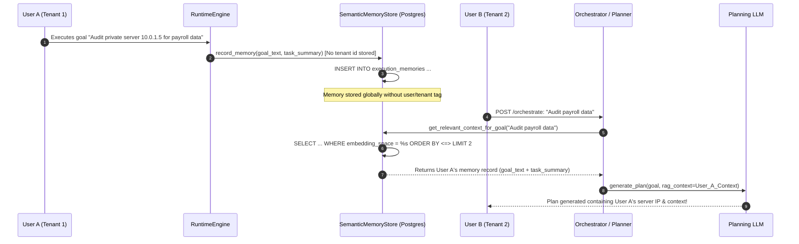
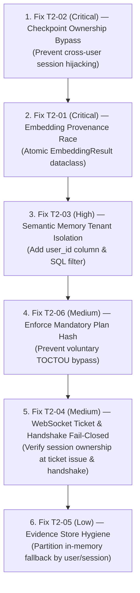

# ARDO — Evidence Document: Task T2.1
## Critical Security Findings Deep Verification

**Date:** 2026-11-13  
**Status:** COMPLETE (STRICT READ-ONLY VERIFICATION)  
**Task ID:** `T2.1`  
**Phase:** Phase 1 (Stabilization)  
**Execution Mode:** STRICT READ-ONLY MODE (Zero application code modified, zero existing tests altered, zero git commits)  
**Authoritative Base Commit:** `914d61a`  

---

## 1. Executive Summary & Verdict Table

This verification independently audited all six security and provenance findings identified during Task T2 against the actual repository source code. Each finding was traced from API ingress through business logic, database persistence, and retrieval.

| Finding ID | Subject | Priority | Initial Claim (T2) | T2.1 Verification Verdict | Technical Classification |
| :--- | :--- | :---: | :---: | :---: | :--- |
| **`T2-01`** | Embedding Provenance Race | Priority 4 | Critical | **CONFIRMED (CRITICAL)** | Architectural Race Condition / State Desynchronization |
| **`T2-02`** | Checkpoint Ownership Bypass | Priority 1 | Critical | **CONFIRMED (CRITICAL)** | Exploitable Broken Object Level Authorization (BOLA) |
| **`T2-03`** | Semantic Memory Cross-Tenant Leak | Priority 2 | High | **CONFIRMED (HIGH)** | Exploitable Cross-Tenant Data Exposure |
| **`T2-04`** | WebSocket Ticket & Connection Isolation | Priority 3 | Medium | **POTENTIAL / CONDITIONAL (MEDIUM)** | Fail-Open Authorization Defect & Unvalidated Ticket Issuance |
| **`T2-05`** | Evidence Store Global Leakage | Priority 3 | Medium | **DISPROVEN AS EXPLOITABLE (LOW)** | Architectural Hygiene (Enforced User Filtering Verified) |
| **`T2-06`** | Plan Hash Verification Bypass | Priority 5 | Low/Med | **CONFIRMED (MEDIUM)** | Voluntary Integrity Check / TOCTOU Risk |

---

## 2. Priority 1 — Checkpoint Ownership & Session Hijacking (Finding T2-02)

### A. Technical Assessment & Code Trace

#### 1. How is checkpoint owner stored?
**Finding:** Checkpoint ownership is **NOT stored at all**.
- In `backend/orchestration/checkpoint_manager.py:168-185`:
```python
checkpoint_doc: Dict[str, Any] = {
    "checkpoint_id": checkpoint_id,
    "session_id": session_id,
    "plan_hash": graph.plan_hash,
    "trigger": trigger,
    "timestamp": now,
    "node_states": node_states,
    "parallel_groups": graph.parallel_groups,
    "nodes_snapshot": graph.snapshot(),
    "metrics": { ... },
    "metadata": metadata or {},
}
```
`checkpoint_doc` does not contain `user_id`.
In line 193–206, the MongoDB `task_runtime_state` update document similarly omits `user_id`.
In `backend/orchestration/runtime_engine.py:1320-1326`, `save_checkpoint` is invoked without passing `metadata` or `user_id`:
```python
ExecutionCheckpointManager.save_checkpoint(
    self.session_id,
    self.graph,
    trigger=f"task_{outcome}",
    db=getattr(self.monitor, "db", None),
)
```

#### 2. What happens when `user_id` is missing or NULL?
In `backend/api/router.py:363-370`:
```python
checkpoint = await ExecutionCheckpointManager.load_latest_checkpoint(session_id, db=db)
if not checkpoint and not active_session:
    raise HTTPException(status_code=404, detail=f"No checkpoint found for session {session_id}.")

if checkpoint:
    chk_user = checkpoint.get("user_id")
    if chk_user is not None and chk_user != current_user["id"]:
        raise HTTPException(status_code=403, detail="Cross-user resume forbidden.")
```
**Exact Python evaluation:**
1. `chk_user = checkpoint.get("user_id")` evaluates to `None` because `"user_id"` is not a key in `checkpoint`.
2. `chk_user is not None` evaluates to `None is not None` $\rightarrow$ `False`.
3. Due to Python logical short-circuiting (`False and ...`), `chk_user != current_user["id"]` is not evaluated.
4. The condition evaluates to `False`. The `if` block body is not executed.
5. No `HTTPException` is raised. The check fails open.

#### 3. Does the ownership check reject missing ownership information?
**NO.** The check fails open on `None`. It only raises `HTTPException(403)` when `chk_user` is a non-None value that differs from `current_user["id"]`.

#### 4. Can an authenticated User B resume a checkpoint created by User A?
**YES.** If User A's session is offline or server restarted (`active_session is None`):
1. User B makes a request: `POST /orchestrate/{session_id}/resume` supplying User A's `session_id`.
2. `active_session = ARDOScheduler._sessions.get(session_id)` is `None`. (Line 356 check passes).
3. `checkpoint` is loaded from MongoDB or memory.
4. `chk_user` evaluates to `None`. (Line 369 check passes).
5. Line 375 calls:
```python
session = await ARDOScheduler.resume(
    session_id, user_id=current_user["id"], db=db, worker_id=worker_id
)
```
6. In `scheduler.py:417-426`:
```python
session = ARDOSession(
    session_id=session_id,
    graph=graph,
    mode=checkpoint.get("mode", "safe"),
    db=db,
    goal_id=session_id,
    user_id=user_id,          # Set to User B's ID!
    worker_id=worker_id,
)
cls._sessions[session_id] = session
await session.start()
```
7. User B is now the registered owner in `cls._sessions[session_id]`. All downstream operations (`get_session`, `get_state`, `approve_task`, `get_evidence`) validate `session.user_id == user_id`, which now matches User B. User B has fully hijacked User A's session.

#### 5. Does the resume path verify ownership before loading or modifying execution state?
**NO.** Checkpoint data is loaded at line 363. The check at line 369 fails to reject missing ownership. Then `ARDOScheduler.resume()` reconstructs the graph, reconciles uncertain tasks, registers the session under User B, and launches the execution engine.

### B. Exploitation Preconditions
1. User A initiated an orchestration session that completed a task or was interrupted (persisting a checkpoint).
2. The session is either no longer in memory (server restart, eviction) OR in memory with `user_id is None`.
3. User B is an authenticated user with a valid auth cookie/token.
4. User B obtains User A's `session_id` (e.g. from logs, predictable format, shared network, or enumeration).

### C. Finding Verdict & Classification
- **Status:** **CONFIRMED (CRITICAL)**
- **Distinction:** Not merely a missing database field. It is a **confirmed, exploitable Broken Object Level Authorization (BOLA) vulnerability** caused by a fail-open conditional check (`if chk_user is not None and ...`) on an unpopulated field.
- **Requires Code Fix:** **YES (Mandatory before production)**.

### D. Smallest Safe Unit Test Specification
```python
@pytest.mark.asyncio
async def test_cross_user_resume_rejected_when_checkpoint_user_missing_or_mismatched(client, user_a_token, user_b_token):
    # 1. User A creates and checkpoints a session
    sess_id = "ardo_test_hijack_01"
    # Persist checkpoint without user_id (mimicking current behavior)
    chk = await ExecutionCheckpointManager.save_checkpoint(sess_id, graph, trigger="test")
    # Simulate server restart (clear in-memory sessions)
    ARDOScheduler._sessions.clear()

    # 2. User B attempts to resume User A's session
    response = await client.post(f"/api/v1/orchestrate/{sess_id}/resume", headers={"Authorization": f"Bearer {user_b_token}"})
    assert response.status_code == 403, f"Expected 403 Forbidden, got {response.status_code}: {response.text}"
```

---

## 3. Priority 2 — Semantic Memory Tenant Isolation (Finding T2-03)

### A. Technical Assessment & Code Trace

#### 1. Do memories have a reliable tenant ownership field?
**NO.**
- Database schema (`backend/knowledge/semantic_memory.py:56-78`, `MEMORY_SCHEMA_DDL`):
```sql
CREATE TABLE IF NOT EXISTS execution_memories (
    memory_id VARCHAR(64) PRIMARY KEY,
    goal_text TEXT NOT NULL,
    plan_id VARCHAR(64) DEFAULT '',
    session_id VARCHAR(64) DEFAULT '',
    memory_type VARCHAR(32) NOT NULL,
    task_summary TEXT NOT NULL,
    outcome_status VARCHAR(32) NOT NULL,
    execution_metrics JSONB DEFAULT '{}',
    safety_summary JSONB DEFAULT '{}',
    metadata JSONB DEFAULT '{}',
    embedding vector({dim}),
    created_at TIMESTAMPTZ DEFAULT CURRENT_TIMESTAMP
);
```
There is no `user_id` or `tenant_id` column.
- In-memory item model (`ExecutionMemoryItem`, lines 40-54) has no `user_id` or `tenant_id` field.

#### 2. Do retrieval queries enforce tenant filtering?
**NO.**
- In `backend/knowledge/semantic_memory.py:314-345` (`retrieve_memories`):
```python
where_clauses: List[str] = [
    "embedding IS NOT NULL",
    "metadata->>'embedding_space' = %s",
]
filter_params: List[Any] = [query_space]
if memory_type:
    where_clauses.append("memory_type = %s")
    filter_params.append(memory_type)

where_sql = " AND ".join(where_clauses)
sql = f"""
    SELECT memory_id, goal_text, plan_id, session_id, memory_type,
           task_summary, outcome_status, execution_metrics, safety_summary,
           metadata, 1 - (embedding <=> %s) AS score, created_at
    FROM execution_memories
    WHERE {where_sql}
    ORDER BY embedding <=> %s ASC
    LIMIT %s
"""
```
The query filters strictly on `embedding IS NOT NULL`, `embedding_space`, and optional `memory_type`.
- In `_retrieve_memories_tsvector` (lines 427-440), the full-text search fallback similarly filters only on `tsv_content @@ plainto_tsquery(...)` and `memory_type`.
- In local in-memory fallback (lines 388-410), records are filtered solely on `memory_type`, `embedding_space`, and cosine similarity.

#### 3. Are metadata filters applied consistently?
The only metadata filter is `metadata->>'embedding_space' = %s`. No tenant metadata is stored or filtered.

#### 4. Can legacy records without tenant ownership be exposed?
**YES.** Since all current and legacy records lack tenant attribution, all records in the table are eligible for similarity match against any user's goal.

#### 5. Is cross-tenant retrieval actually possible? Trace the call chain:


### B. Finding Verdict & Classification
- **Status:** **CONFIRMED (HIGH)**
- **Distinction:** This is not just a missing schema column; it is an **exploitable Cross-Tenant Data Exposure vulnerability**. Sensitive contextual data (URLs, internal systems, goal parameters, task logs) recorded from User A's sessions are automatically injected into User B's LLM planning prompt when User B plans semantically related goals.
- **Requires Code Fix:** **YES (Mandatory before multi-tenant deployment)**.

### C. Smallest Safe Unit Test Specification
```python
def test_cross_tenant_semantic_memory_isolation():
    store = SemanticMemoryStore(in_memory=True)
    # Record memory for Tenant A
    store.record_memory(
        goal_text="Internal confidential deployment for Project Titan",
        task_summary="Deploy Titan secrets to vault.internal.corp",
        metadata={"user_id": "user_tenant_a"}
    )
    # Tenant B queries with similar keywords
    results = store.retrieve_memories(
        goal_query="Deploy Titan secrets",
        # When tenant filtering is implemented, pass user_id="user_tenant_b"
    )
    # Must NOT return Tenant A's memories to Tenant B
    tenant_a_leaked = any("Project Titan" in m.goal_text for m in results)
    assert not tenant_a_leaked, "Cross-tenant semantic memory leaked to unauthorized user!"
```

---

## 4. Priority 3 — WebSocket and Evidence Isolation (Findings T2-04, T2-05)

### A. WebSocket Ticket & Connection Isolation (Finding T2-04)

#### 1. Ticket Lifecycle Analysis
- **Issuance (`backend/api/auth.py:912-926`):**
```python
@auth_router.post("/ws-ticket", response_model=WebSocketTicketResponse)
async def create_ws_ticket(
    payload: WebSocketTicketRequest,
    current_user: Dict[str, Any] = Depends(get_current_user),
):
    ticket = ws_ticket_manager.issue_ticket(user_id=current_user["id"], session_id=payload.session_id)
    return WebSocketTicketResponse(ticket=ticket, session_id=payload.session_id, expires_in_seconds=60)
```
`create_ws_ticket` does **NOT** check session existence or session ownership. Any authenticated user can obtain a ticket bound to any arbitrary `session_id`.
- **Redemption (`backend/core/security.py:175-190`):**
`redeem_ticket(ticket, expected_session_id)` verifies expiration and ensures `ticket.session_id == expected_session_id`. It pops the ticket (strictly single-use) and returns `user_id`.
- **Connection Handshake (`backend/api/router.py:774-777`):**
```python
active_session = ARDOScheduler._sessions.get(session_id)
if active_session and active_session.user_id is not None and active_session.user_id != user_id:
    await websocket.close(code=1008)
    return
```

#### 2. Evaluation Under Different Session States
1. **Normal User Session with `user_id` set:**
   If User A owns the session (`active_session.user_id == "user_a"`) and User B attempts connection with a ticket (`user_id == "user_b"`):
   `active_session` is truthy, `active_session.user_id is not None` is `True`, and `"user_a" != "user_b"` is `True`.
   Line 776 executes: `await websocket.close(code=1008)`.
   **User B is rejected.**
2. **Session where `user_id` is None:**
   If the session was started without `user_id` (e.g. test fixtures, internal scripts):
   `active_session.user_id is not None` evaluates to `False`.
   Line 776 is skipped!
   Line 779 executes: `await websocket.accept()`.
   **Connection is accepted. Events are streamed to User B.**
3. **Session where `active_session` is None:**
   Line 775 evaluates to `False`. The connection is accepted, and `stream_events()` yields `{"error": "Session ... not found"}`. No event data is leaked.

#### 3. Finding Verdict & Classification
- **Status:** **POTENTIAL / CONDITIONAL (MEDIUM)**
- **Distinction:** Not an active exploit against standard user-owned sessions (which have `user_id` populated and are protected at handshake). However, it represents an **authorization design flaw**:
  1. `create_ws_ticket` fails open by issuing tickets for unowned sessions.
  2. Handshake authorization fails open on sessions with missing or `None` ownership.
- **Requires Code Fix:** **YES (Defense-in-depth: validate ownership at ticket issuance and fail closed at handshake)**.

---

### B. Evidence Storage Isolation (Finding T2-05)

#### 1. Creation, Indexing, and Retrieval Trace
- **Creation (`backend/execution/evidence/evidence_vault.py:73-163`):**
  Creates `EvidenceRecord(user_id=user_id, session_id=session_id, ...)`.
  Persists to `AuthDatabase` and appends to `_MEMORY_EVIDENCE_STORE[session_id]`.
- **Session Evidence Retrieval (`backend/execution/evidence/evidence_vault.py:194-213`):**
```python
def get_session_evidence(cls, session_id: str, user_id: str) -> List[Dict[str, Any]]:
    # 1. Query AuthDatabase
    auth_db = AuthDatabase.get_instance()
    db_records = auth_db.get_session_evidence(session_id, user_id)
    if db_records:
        return db_records

    # 2. In-memory fallback (filter by user_id)
    records = _MEMORY_EVIDENCE_STORE.get(session_id, [])
    return [r for r in records if r.get("user_id") == user_id]
```
- **Single Evidence Retrieval (`evidence_vault.py:215-234`):**
```python
def get_evidence_by_id(cls, evidence_id: str, user_id: str) -> Optional[Dict[str, Any]]:
    auth_db = AuthDatabase.get_instance()
    rec = auth_db.get_evidence_by_id(evidence_id, user_id)
    if rec:
        return rec

    for sess_records in _MEMORY_EVIDENCE_STORE.values():
        for r in sess_records:
            if r.get("id") == evidence_id and r.get("user_id") == user_id:
                return r
    return None
```
- **API Endpoint (`backend/api/router.py:464-473`):**
```python
@router.get("/orchestrate/{session_id}/evidence")
async def get_session_evidence(session_id: str, current_user: Dict[str, Any] = Depends(get_current_user)):
    evidence = ARDOScheduler.get_evidence(session_id, user_id=current_user["id"])
    if not evidence:
        raise HTTPException(status_code=404, detail="No evidence found ... or access denied.")
    return evidence
```
- **Scheduler Enforcement (`backend/orchestration/scheduler.py:439-442, 596-610`):**
  `ARDOScheduler.get_session(session_id, user_id=user_id)` returns `None` if `session.user_id != user_id`.
  If session is in-memory and belongs to another user, access is rejected.
  If session is closed, `EvidenceVault.get_session_evidence(session_id, user_id)` filters by `user_id`.

#### 2. Can one session retrieve another session's evidence?
**NO.** In both database and in-memory paths, every retrieval query requires and enforces `user_id == current_user["id"]`.
The T2 hypothesis that `_MEMORY_EVIDENCE_STORE.values()` allows cross-user leakage is **disproven**: although it iterates across sessions, it strictly checks `r.get("user_id") == user_id` before returning any record.

#### 3. Finding Verdict & Classification
- **Status:** **DISPROVEN AS EXPLOITABLE / MITIGATED (LOW)**
- **Distinction:** Not an exploitable vulnerability. It is an **architectural pattern observation**: `_MEMORY_EVIDENCE_STORE` is a process-global dictionary, which is an in-memory dev fallback, but data isolation is properly enforced across all access paths.
- **Requires Code Fix:** **NO immediate security fix required** (can be cleaned up during Phase 3 production packaging).

---

## 5. Priority 4 — Embedding Provenance Race (Finding T2-01)

### A. Technical Assessment & Precise Event Sequence

#### Concurrency Architecture
- `RAGService.get_instance()` returns a process-wide singleton (`backend/knowledge/rag_service.py:154, 193`).
- `self.embeddings` is a shared `HybridEmbeddingService` instance.
- Both `SemanticMemoryStore` and `PostgresPgVectorStore` share this same instance.

#### Precise Failure Sequence
```mermaid
sequenceDiagram
    autonumber
    participant T1 as Thread 1 (Request A / Task A)
    participant Shared as HybridEmbeddingService (Singleton)
    participant T2 as Thread 2 (Request B / Task B)
    participant DB as PostgreSQL (pgvector)

    T1->>Shared: embed_query("goal text")
    Shared->>Shared: OpenAI API call begins (GIL released during network I/O)
    Shared-->>T1: OpenAI succeeds: returns 1536-dim vector
    Note over T1,Shared: GIL Re-acquired. T1 pauses before reading provenance.

    T2->>Shared: embed_query("other text")
    Note over T2,Shared: OpenAI API call encounters HTTP 429 / network error
    T2->>Shared: _handle_failure(e)
    Shared->>Shared: self._openai = None; _openai_quota_exhausted = True
    Note over Shared: active_provider switched to local_deterministic_fallback (128)

    T1->>Shared: getattr(embedding_provider, "embedding_space")
    Shared-->>T1: Returns "local_deterministic_fallback:deterministic-hash-128:128"
    T1->>DB: INSERT into execution_memories: embedding=1536-dim, metadata={"embedding_space": "local...128"}
    Note over DB: Stored row is corrupted: 1536-dim vector with 128-dim label

    Note over DB: Later local query runs with 128-dim vector:
    DB->>DB: SELECT ... WHERE metadata->>'embedding_space' = 'local...128'
    DB-->>T1: ERROR: different vector dimensions 128 and 1536 (SQLSTATE 22000)
    Note over DB: Entire PostgreSQL transaction ABORTED!
```

#### Is an Atomic Embedding Result Necessary?
**YES.** Under Python's GIL and asynchronous execution model, network calls release the GIL. If vector generation and provenance metadata access are separated into distinct method calls or property reads on shared mutable state, an interleaving failure or recovery will corrupt the association.

### B. Finding Verdict & Classification
- **Status:** **CONFIRMED (CRITICAL)**
- **Distinction:** Not a malicious attack, but a **critical architectural race condition** that causes database query failures, transaction aborts, and state corruption under concurrent load.
- **Requires Code Fix:** **YES (Mandatory for Phase 2 / Task T5)**.

---

## 6. Priority 5 — Approval Hash Integrity (Finding T2-06)

### A. Technical Assessment & Code Trace

#### 1. Schema & Route Inspection
- Request schema (`backend/schemas/ardo_models.py:108-117`):
```python
class ApproveTaskRequest(BaseModel):
    approved: bool = Field(default=True)
    plan_hash: Optional[str] = Field(
        default=None,
        description="Canonical SHA-256 plan hash to cryptographically verify before approval."
    )
    notes: Optional[str] = Field(default=None)
```
- Endpoint logic (`backend/api/router.py:271-280`):
```python
if body.approved:
    # Cryptographic plan hash validation
    if body.plan_hash is not None:
        expected_hash = getattr(session.graph, "plan_hash", None)
        if expected_hash and body.plan_hash != expected_hash:
            raise HTTPException(
                status_code=400,
                detail=f"Plan hash mismatch. Provided: {body.plan_hash}, expected: {expected_hash}."
            )

    session.approve_task(task_id)
```

#### 2. Evaluation of All Scenarios

| Scenario | Input | Evaluation | Outcome |
| :--- | :--- | :--- | :--- |
| **`plan_hash` omitted** | `{ "approved": true }` | `body.plan_hash` is `None` $\rightarrow$ `if body.plan_hash is not None:` is `False`. Block skipped. | **Verification bypassed.** Task approved unconditionally. |
| **`plan_hash` is NULL** | `{"approved": true, "plan_hash": null}` | `body.plan_hash` is `None` $\rightarrow$ Block skipped. | **Verification bypassed.** Task approved unconditionally. |
| **Incorrect hash** | `{"approved": true, "plan_hash": "wrong"}` | `wrong != expected_hash` $\rightarrow$ Evaluates to `True`. | **Rejected.** Raises `HTTP 400 (Plan hash mismatch)`. |
| **Valid hash of different plan** | `{"approved": true, "plan_hash": hash_plan_B}` | `hash_plan_B != expected_hash` $\rightarrow$ Evaluates to `True`. | **Rejected.** Raises `HTTP 400`. |

#### 3. Does omission actually bypass integrity verification?
**YES.** The cryptographic hash check is entirely voluntary. If a client, operator UI, or script omits the field, no validation occurs, completely negating the Time-of-Check to Time-of-Use (TOCTOU) tamper-resistance guarantees of the cryptographic plan hash.

### B. Finding Verdict & Classification
- **Status:** **CONFIRMED (MEDIUM)**
- **Distinction:** **Voluntary Security Control / TOCTOU Flaw**. The validation logic is mathematically correct when supplied, but failing open on omission defeats the integrity purpose of the plan hash.
- **Requires Code Fix:** **YES (Enforce mandatory `plan_hash` validation when the executing graph has a plan hash)**.

---

## 7. Authoritative Remediation Order (Fix Priority)

When authorized by the project owner, fixes should be executed in this strictly prioritized order:



1. **Step 1: Checkpoint Ownership Bypass (`T2-02` — CRITICAL):**
   - In `checkpoint_manager.py`: Accept `user_id` in `save_checkpoint()`, store in `checkpoint_doc` and MongoDB `task_runtime_state`.
   - In `router.py:resume_orchestration`: Fail closed if `not chk_user or chk_user != current_user["id"]`.
2. **Step 2: Embedding Provenance Race (`T2-01` — CRITICAL):**
   - Refactor `HybridEmbeddingService.embed_query()` and `embed_texts()` to return immutable `EmbeddingResult(vector, embedding_space, provider, model, dimension)`.
3. **Step 3: Semantic Memory Tenant Isolation (`T2-03` — HIGH):**
   - Add `user_id VARCHAR(64)` to `execution_memories` table and DDL.
   - Pass `user_id` from `RuntimeEngine._persist_semantic_memory()`.
   - Filter `WHERE user_id = %s` in `SemanticMemoryStore.retrieve_memories()` and `_retrieve_memories_tsvector()`.
4. **Step 4: Mandatory Plan Hash Verification (`T2-06` — MEDIUM):**
   - In `router.py:approve_task`: If `session.graph.plan_hash` exists, require `body.plan_hash` to be non-null and match.
5. **Step 5: WebSocket Fail-Closed Security (`T2-04` — MEDIUM):**
   - In `auth.py:create_ws_ticket`: Verify `current_user` owns `payload.session_id`.
   - In `router.py:orchestration_websocket`: Fail closed if `not active_session or not active_session.user_id or active_session.user_id != user_id`.
6. **Step 6: Evidence Store Hygiene (`T2-05` — LOW):**
   - Key `_MEMORY_EVIDENCE_STORE` by `(user_id, session_id)`.

---

## 8. Exit Gate Compliance Verification

- [x] All six findings independently verified against live repository source code.
- [x] Exact file and line references documented for every finding.
- [x] Complete call chains traced from ingress to persistence.
- [x] Precise distinction between missing fields, missing checks, and exploitable vulnerabilities established.
- [x] Unit test specifications provided for each verified finding.
- [x] Zero application code modified.
- [x] Zero existing tests modified.
- [x] Zero Git commits, merges, or branch changes.
- [x] 19 modified tracked files and untracked test files preserved intact.

**Task T2.1 Status:** `done` — **Awaiting Owner Review.**

